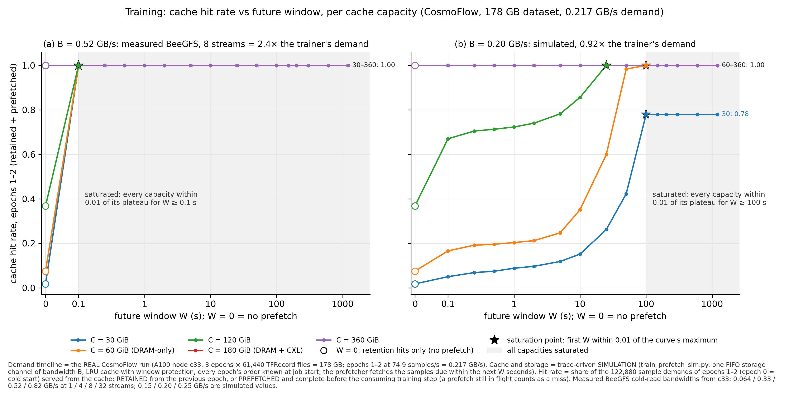
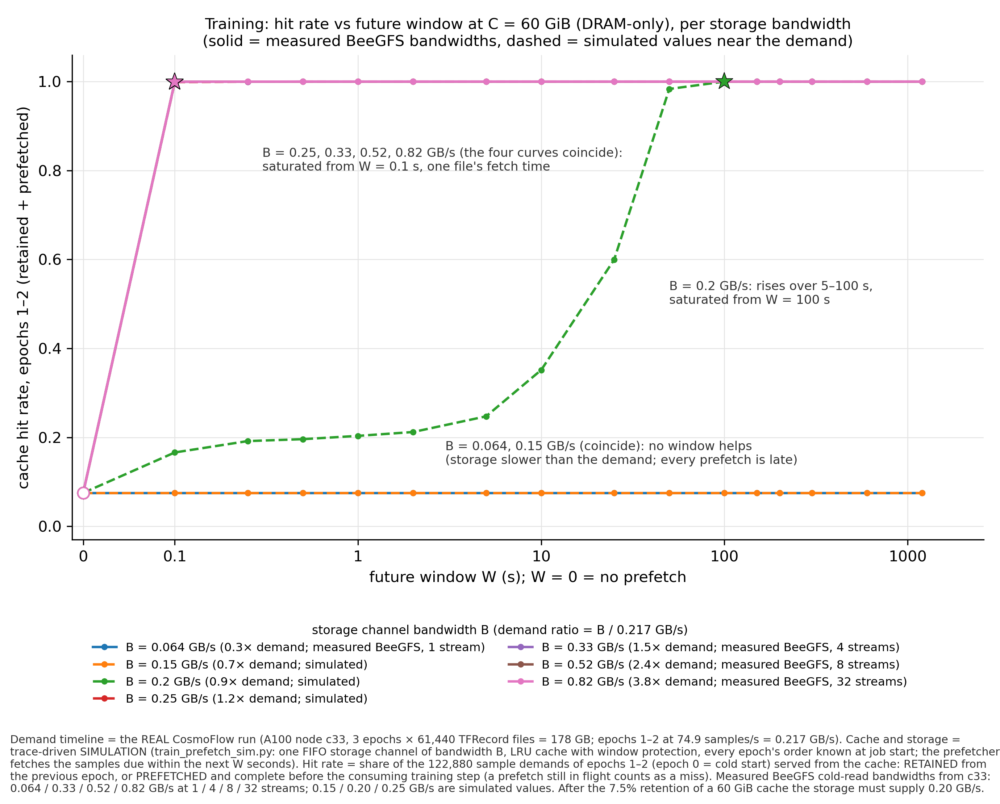
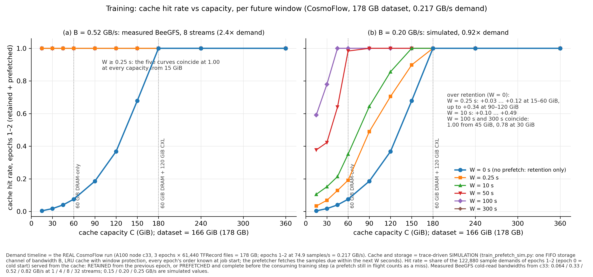
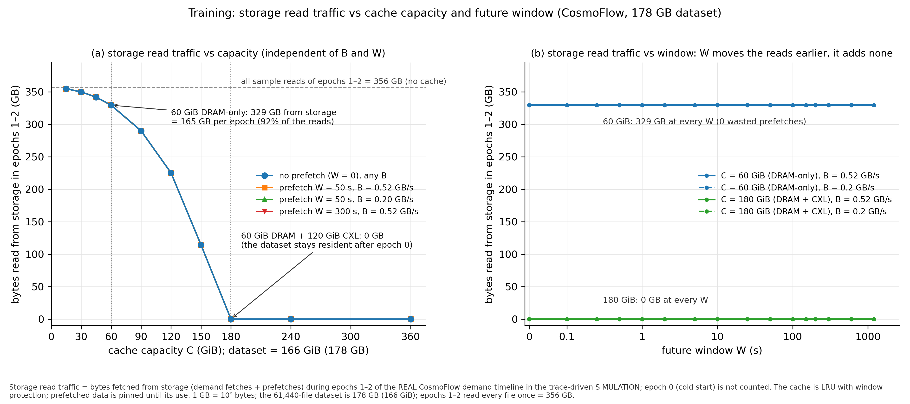
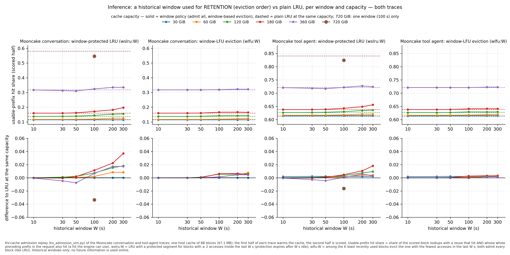
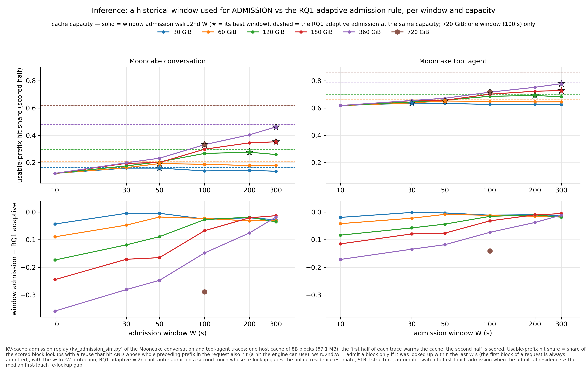

# 2026-10-27 — Exploratory study: reuse windows, future-aware prefetching and cache capacity in training and inference

**STATUS: CLOSED 2026-10-27 (branch `explore/reuse-window-prefetch`; not merged). Figure revision 2026-10-27 (see Change history):
the report is now organized around six data figures and one table, all drawn from the simulators' raw outputs.**

**Findings in one paragraph.** *Training:* the batch schedule is known a whole epoch ahead in standard loaders (and for all epochs
from the seed), but a future-aware prefetcher needs almost none of it. With storage faster than the trainer (BeeGFS at ≥ 4 streams,
0.33–0.82 GB/s, against a 0.217 GB/s A100 trainer) a future window of 0.1 s — one file's fetch time — already gives ≥ 99.9% hits at
every capacity from 15 GiB up, and longer windows add nothing (fig 1a, 2, 3a). Windows of tens of seconds matter only when the storage
bandwidth is within ~10% of the rate the trainer needs (B = 0.20 GB/s: saturation at 25 s for 120 GiB, 100 s for 60 GiB, a 0.78 plateau
at 30 GiB; fig 1b, 3b), and no window helps when storage is slower than the demand (0.064 and 0.15 GB/s: 0.075 at every window; fig 2).
Capacity's value for training is retention, not prefetch depth: without prefetch an LRU cache keeps 0.4% / 1.8% / 7.5% / 37% / 68% of
the dataset's reads at 15 / 30 / 60 / 120 / 150 GiB and 100% from 180 GiB (fig 3), so the 60 GiB DRAM-only cache re-reads 329 GB
from storage per two epochs (92% of all reads) while 60 GiB DRAM + 120 GiB CXL re-reads nothing — at any window and any bandwidth
(fig 4). *Inference:* a historical window used for RETENTION (window-protected LRU, window-LFU eviction) stays within −0.03 … +0.04
of plain LRU at every window and capacity on both Mooncake traces (fig 5); a historical window used for ADMISSION gains +0.05 … +0.19
over LRU at 6–30× fewer writes but stays 0.001–0.018 below the RQ1 adaptive admission at every capacity, its best window grows with
the capacity (50 s at 30–60 GiB → 300 s at 180–360 GiB) and at 720 GiB every fixed window loses to admit-all (fig 6, table). Tripling
the capacity with CXL (60 → 180 GiB) is worth +0.04 to LRU and +0.155 / +0.073 to reuse-aware admission (conversation / tool agent).
The two workloads do not share a window–hit law: training's window hides a fetch latency, inference's matches a residence time.
Nothing here changes the main line's negative joint-benefit result.

**Scope.** An independent exploratory branch of the project, from the meeting with Dr. Mueller: (training) how much FUTURE knowledge of
the batch schedule is useful for prefetching training samples into a DRAM/CXL cache, as a function of the future window W and the
capacity C; (inference) whether a HISTORICAL window of reuse information improves LRU for the KV cache, and how the useful window
relates to capacity; (both) what a small DRAM-only cache (60 GiB) loses against a larger DRAM + CXL cache (180 GiB). It does not
change the research direction, the three RQs, the charter, the decision report or the gate status, and it does not touch the Phase 3
negative joint-benefit result. Raw: `experimental_results/2026-10-27-reuse-window-prefetch/` (`train/`: the trace run; `train/sim/`:
the sweeps, `run_sweep.sh` = exact commands and the three passes; `infer/`: the KV campaign, `run_all.sh`; `figs/`: the figures below
with their data tables). Code: `scripts/train_prefetch_sim.py` (new), `scripts/kv_admission_sim.py` (window policies added, existing
policies unchanged), `scripts/window_report_figs.py` (the figures of this revision), `scripts/window_figs.py` (the first version's
figures, kept), `kv_window_stats.py`, `kv_window_tables.py`, `kv_horizon_eval.py`, `train_window_tables.py`, `train_window_fit.py`,
`experimental_results/.../train/train_trace.py` (new).

## Three kinds of evidence — kept apart in every figure
1. **REAL training demand trace.** A real CosmoFlow run (the group's TF benchmark, the 61,440-file / 178 GB mini set on BeeGFS) on the
   A100 node c33, 3 epochs, with an explicit seeded per-epoch permutation and a per-file / per-step timestamp trace. Epochs 1–2 ran at
   74.9 samples/s = 0.217 GB/s of sample files (step 53 ms p50); this timeline is the demand that every training figure replays.
2. **Trace-driven prefetch SIMULATION** (`train_prefetch_sim.py`): a cache of C bytes fed by one FIFO storage channel of B bytes/s;
   the prefetcher may fetch any sample due within the next W seconds (epoch order known at job start; `avail epoch` gives the same
   numbers); prefetched data is pinned until its use, resident data due inside the window is protected from eviction, a prefetch still
   in flight at its demand is a MISS (late), misses are fetched on demand, used data stays (LRU). Epoch 0 is the cold start, epochs 1–2
   are scored. The simulation does not slow the trainer: in the starved regime the real trainer would run at storage speed, which a
   fixed demand timeline cannot show (its stall column is not meaningful there).
3. **Measured BeeGFS bandwidth** (cold reads from c33): 0.064 GB/s at one stream, 0.33 at 4, 0.52 at 8, 0.66 at 16, 0.82 at 32
   streams (0.06 / 0.32 / 0.49 from c28). The real run read 8 files concurrently, so **0.52 GB/s is the measured operating point** of
   its reader; 0.15 / 0.20 / 0.25 GB/s are simulated values placed around the trainer's demand (0.7× / 0.92× / 1.15×).

**Metrics.** *Training hit rate* = share of the 122,880 sample demands of epochs 1–2 served from the cache, split into RETENTION hits
(the sample stayed resident since the previous epoch; this is the whole hit rate at W = 0) and PREFETCH hits (fetched by the window
and complete before the consuming step); the data tables carry both columns. *Inference usable-prefix hit share* = share of the
scored block lookups (second half of each trace; the first half warms the cache) whose block hit AND whose whole preceding prefix in the
request also hit — a hit the engine can use; Mooncake conversation and tool-agent traces, 8B blocks of 67.1 MB. No future information is
used by any online decision; oracles are labelled as such.

## Figures and data (`experimental_results/2026-10-27-reuse-window-prefetch/figs/`, PNG 300 dpi + PDF + one CSV per figure)
| figure | question | workload / configuration | x | curves |
|---|---|---|---|---|
| fig1-train-window-by-capacity | hit rate vs future window per capacity | REAL CosmoFlow trace, SIM cache; (a) B = 0.52 GB/s measured 8-stream BeeGFS, (b) B = 0.20 GB/s simulated | W = 0, 0.1 … 1200 s | C = 30, 60, 120, 180, 360 GiB |
| fig2-train-window-by-bandwidth | hit rate vs future window per storage bandwidth | same; C = 60 GiB (DRAM-only) | W = 0 … 1200 s | B = 0.064, 0.15, 0.20, 0.25, 0.33, 0.52, 0.82 GB/s (solid = measured BeeGFS points) |
| fig3-train-capacity-by-window | hit rate vs capacity per window | same; (a) B = 0.52, (b) B = 0.20 GB/s | C = 15 … 360 GiB | W = 0, 0.25, 10, 50, 100, 300 s |
| fig4-train-storage-traffic | storage read traffic vs capacity and vs window | same; 60 GiB DRAM-only vs 60 + 120 GiB CXL marked | C; W | no prefetch; W = 50 / 300 s at B = 0.52 / 0.20 |
| fig5-infer-window-retention-vs-lru | window-based eviction vs plain LRU | Mooncake conversation + tool agent, SIM replay; admit-all | historical W = 10 … 300 s | C = 30 … 720 GiB; dashed = LRU; lower row = difference |
| fig6-infer-window-admission-vs-rq1 | window-based admission vs the RQ1 adaptive admission | same | admission W = 10 … 300 s | C = 30 … 720 GiB; dashed = RQ1 adaptive; lower row = difference |
| table-infer-admission | LRU / second touch / 2nd_int / RQ1 adaptive / best window admission / oracle, writes | same | capacity | — |
The first version's figures (`fig-train-window`, `fig-train-capacity`, `fig-train-fit`, `fig-infer-window`, `fig-infer-capacity`,
`fig-infer-writes` in the results directory root) are kept unchanged.

# Part 1 — Training

## 1.1 How far ahead a training system knows its batches (REAL measurements)
- **PyTorch:** `RandomSampler` draws the WHOLE epoch order with `torch.randperm` when its iterator is created, i.e. at epoch start —
  0.5 ms / 4.4 ms / 277 ms and 0.5 / 4 / 108 MiB for 61,440 / 524,288 / 14.2 M samples (measured on c28); `DistributedSampler` is
  deterministic in (seed, epoch), so ANY future epoch's order can be computed ahead (1.2 / 12 / 545 ms per rank); per-batch
  importance updates (SHADE-style) shorten the lookahead to what the sampler commits to; the DataLoader itself fetches
  `prefetch_factor × num_workers` = 4 batches ahead.
- **TensorFlow (the CosmoFlow benchmark as the group runs it):** `Dataset.shuffle(len(files), reshuffle_each_iteration=True)` draws the
  permutation inside the shuffle op at the epoch's start, not exposed to the application; replacing it with an explicit seeded
  permutation (`train_trace.py`) makes every epoch's order available at job start — 10–11 ms and 0.49 MB per epoch of 61,440 files,
  all three epochs 8.1 s after job start, before the first batch (≈ 9 s). CosmoFlow has no augmentation, no dynamic sampling and one
  sample per file, so the batch schedule IS the file-read order.
- **The real run:** pilot on `train_1024` with the benchmark's single-stream reader on cold BeeGFS: 5.4 samples/s (I/O-bound at
  15.7 MB/s), 9.9 samples/s once the files were in the node's page cache; full run (`run-61440`, 8 files read concurrently, 4 parallel
  parses): 63.5 / 74.9 / 74.9 samples/s in epochs 0 / 1 / 2 (184 / 217 / 217 MB/s), 205 MB/s mean and 233 MB/s max demand per second,
  2,618 s in total; the tf.data pipeline pulls each file only 0.4–0.85 s before the step that consumes it. Against the measured BeeGFS
  bandwidth this trainer needs ≥ 4 parallel streams (0.33 GB/s, 1.5× the demand) to be fed from cold storage; one stream (0.064 GB/s)
  is 3.4× too slow.

## 1.2 Fig 1 — hit rate vs future window, per capacity

- **(a) B = 0.52 GB/s (the measured 8-stream operating point, 2.4× the demand):** every capacity jumps from its retention-only value
  at W = 0 (0.018 / 0.075 / 0.368 at 30 / 60 / 120 GiB; 1.000 at 180 and 360 GiB, where the dataset fits) to ≥ 0.9996 at W = 0.1 s and
  1.000 from W = 0.5 s, and stays there to W = 1,200 s. The saturated interval is W ≥ 0.1 s for all five capacities — the fetch time of
  one 2.9 MB file; no late and no wasted prefetch at any W ≥ 0.1 s (the 19–51 misses left at W = 0.1 s are cold misses; stall ≤ 1 s).
- **(b) B = 0.20 GB/s (0.92× the demand, simulated):** the curves rise over two decades and saturate at different windows: 120 GiB at
  W = 25 s (0.368 → 0.670 at 0.1 s → 0.856 at 10 s → 1.000), 60 GiB at W = 100 s (0.075 → 0.166 → 0.600 at 25 s → 0.983 at 50 s →
  1.000), 30 GiB at W = 100 s with a plateau of 0.779 (the cache cannot hold more than 149 s of future data, so 27,116 prefetches are
  still late at every W ≥ 100 s); 180 and 360 GiB are 1.000 at every W. All capacities are within 0.01 of their plateau for W ≥ 100 s.
- **Shape, as far as the data shows it:** a fast rise followed by a flat plateau; the window at which the curve saturates is 0.1 s in
  (a) and 25–100 s in (b), i.e. it is set by the storage bandwidth, while the capacity sets the starting level (the retention at W = 0)
  and, when the queue the window builds does not fit, the plateau (30 GiB in b).

## 1.3 Fig 2 — hit rate vs future window, per storage bandwidth (C = 60 GiB, DRAM-only)

Three regimes, read directly off the curves (demand ratio = B / 0.217 GB/s; after the 7.5% retention of a 60 GiB cache the storage
must supply 0.20 GB/s):
| storage bandwidth B | regime | hit rate at W = 0 / 0.1 / 5 / 25 / 50 / 100 / 1200 s | saturated from |
|---|---|---|---|
| 0.064 GB/s (1 BeeGFS stream, 0.3×) and 0.15 GB/s (0.7×) | starved | 0.075 at every W (all 113,641 prefetches arrive late) | never |
| 0.20 GB/s (0.92×) | marginal | 0.075 / 0.166 / 0.247 / 0.600 / 0.983 / 1.000 / 1.000 | W = 100 s |
| 0.25 (1.15×), 0.33 (4 streams), 0.52 (8 streams), 0.82 GB/s (32 streams) | comfortable | 0.075 / ≥ 0.9988 / 1.000 / 1.000 / 1.000 / 1.000 / 1.000 (the four curves coincide) | W = 0.1 s |
The measured BeeGFS points fall on both sides: one stream cannot feed this trainer at any window, 4 streams and more need only one
file's lead. A window of tens of seconds is useful in a band of about ±10% around the needed rate — in this band the window lets the
prefetcher run ahead during the slower steps (the demand is 205 MB/s mean, 233 max) — and nowhere else.

## 1.4 Fig 3 — hit rate vs capacity, per future window

- **W = 0 (no prefetch) is the retention curve of LRU under per-epoch reshuffling:** 0.004 / 0.018 / 0.040 / 0.075 / 0.186 / 0.368 /
  0.679 at 15 / 30 / 45 / 60 / 90 / 120 / 150 GiB and 1.000 from 180 GiB (dataset 166 GiB). It is convex: half the dataset's capacity
  retains 19%, not 50%; the literature's rule of thumb "hit ≈ cached fraction" over-estimates it 2–5× (0.36 vs 0.075 at 60 GiB). The
  curve equals c + (1 − c) ln(1 − c) with c = C / dataset to ±0.002 at every point (our derivation, `train_window_fit.py`,
  `fig-train-fit`; not needed for the reading of the figure).
- **(a) B = 0.52 GB/s:** every window ≥ 0.25 s lifts every capacity from 15 GiB to 1.000 — the five prefetch curves coincide. With
  adequate storage bandwidth, capacity does not change the hit rate at all once a prefetcher exists.
- **(b) B = 0.20 GB/s:** the prefetch curves fan out between the retention curve and 1.000: W = 0.25 s adds +0.03 … +0.12 at
  15–60 GiB and up to +0.34 at 90–120 GiB (where retention lowers the rate the storage must supply), W = 10 s adds +0.10 … +0.49, W = 50 s reaches
  0.983 at 60 GiB and 1.000 from 90 GiB, W = 100 s and 300 s coincide (1.000 from 45 GiB, 0.779 at 30 GiB, 0.592 at 15 GiB). Capacity
  helps here through retention (less to fetch) and through the room for the queue.

## 1.5 Fig 4 — storage read traffic: 60 GiB DRAM-only vs 60 GiB DRAM + 120 GiB CXL

| capacity | retention hit rate (W = 0) | bytes read from storage in epochs 1–2 (GB; 356 GB of reads in total) | hit rate with prefetch, B = 0.52 GB/s, W ≥ 0.25 s | with prefetch, B = 0.20, W = 50 s | B = 0.064 (1 stream), any W |
|---|---|---|---|---|---|
| 30 GiB | 0.018 | 350 | 1.000 | 0.423 | 0.018 |
| 60 GiB (DRAM-only) | 0.075 | 329 (165 per epoch, 92% of the reads) | 1.000 | 0.983 | 0.075 |
| 120 GiB | 0.368 | 225 | 1.000 | 1.000 | 0.368 |
| 180 GiB (60 DRAM + 120 CXL) | 1.000 | 0 | 1.000 | 1.000 | 1.000 |
- **(a)** The traffic falls with capacity exactly as the retention rises — 355 / 350 / 342 / 329 / 290 / 225 / 114 GB at 15 … 150 GiB,
  0 from 180 GiB — and it is the same with and without prefetch, at B = 0.52 and at 0.20 GB/s, at W = 50 and 300 s (the four series
  overlap; 0 wasted prefetches in every run of the figure).
- **(b)** At 60 GiB the storage reads are 329 GB at every window from 0 to 1,200 s and both bandwidths; at 180 GiB they are 0 at every
  window. The window changes WHEN the bytes are fetched, not HOW MANY: a future window cannot replace capacity for traffic.
- **What the CXL capacity buys for training**, therefore, is not hits (the 60 GiB cache already reaches 1.000 by prefetching when
  the storage is fast enough) but the removal of the storage traffic and the independence from storage speed: at one BeeGFS stream the
  60 GiB cache gives 0.075 and the 180 GiB cache 1.000 (fig 2 vs table).

## 1.6 Other training observations (data in `train/sim/`, `tables.md`)
- **Schedule availability:** `avail epoch` (order known from the epoch's start) equals `avail all` (all epochs from the seed) at every
  window and capacity at B = 0.33 and 0.82 GB/s — the first files of an epoch are fetched on demand in 9 ms each.
- **A naive prefetcher** that does not protect resident data due inside its window loses 0.2 → 5.7 points at 60 GiB as W grows from 5
  to 200 s (0.998 → 0.943, B = 0.82 GB/s): it evicts retained samples it will need inside its own window and refetches them late. That is
  the "cache pollution by early prefetch" the brief asked about; it is an implementation property, not a window property — the
  window-aware prefetcher of figs 1–4 never loses hits to a longer window.
- **Faster trainers on the same link** (demand ×4 and ×16 at B = 0.82 GB/s, `all-bw0.82-x4/x16.csv`): ×4 (0.94× of the needed rate)
  behaves like the marginal regime (60 GiB: 0.729 at 5 s, 1.000 at 25 s), ×16 (0.24×) like the starved one (no window helps).
- **Lookahead needed in time:** 0.1 s in the comfortable regime, 25–100 s in the marginal one. The standard tf.data pipeline already
  pulls 0.4–0.85 s ahead, so with adequate storage no explicit schedule is needed; the whole-epoch knowledge of 1.1 is needed only when
  the storage is marginal — and then 1–2 minutes of it.
- **The window–hit relation, as the sweeps support it** (Task B4, `train_window_fit.py`, `fig-train-fit`): within one regime the curves
  are a saturating exponential H = H0(C) + (H1 − H0)(1 − e^(−W/τ)) anchored at the measured retention H0(C), with τ = 0.2 s (the smallest
  grid value) at B ≥ 0.25 GB/s and τ = 49.5 / 23.8 / 5.5 s at 30 / 60 / 120 GiB at B = 0.20 GB/s (RMSE 0.000 and 0.025); it transfers
  across bandwidths inside a regime and across capacities, and fails across regimes (RMSE 0.23) because τ collapses from tens of seconds
  to 0.2 s as the margin opens. The window is a bandwidth quantity; capacity enters through H0 and the queue bound.

# Part 2 — Inference

## 2.1 Policies
Added to `kv_admission_sim.py` (suffix `:W`, existing policies unchanged): `wslru:W` = LRU with a protected segment for blocks with
≥ 2 accesses inside the last W s, protection expiring after W s without an access (eviction from probation first); `wlfu:W` = among the
K = min(64, cap/16) least recently used blocks evict the one with the fewest accesses in the last W s; `wslru2nd:W` = `wslru:W` plus
admission only of blocks looked up within the last W s (the first block of a request always admitted) — the window as an admission
rule. Baselines on identical traces, capacities and scoring: LRU, SLRU, second touch (`2nd`, unbounded ghost), `2nd_int` (second
touch with re-lookup gap ≤ the online residence), the RQ1 adaptive policy (`2nd_int_auto`: gap rule + regime switch to first-touch
admission when the admit-all residence ≥ the median first-touch re-lookup gap, SLRU structure, dead-eviction residence estimator),
ORACLE (Belady with bypass). Capacities 30 / 60 / 120 / 180 / 360 / 720 GiB; at 720 GiB only LRU, SLRU, RQ1 adaptive, oracle and the
100-s windows were run.

## 2.2 Fig 5 — a historical window used for retention does not beat LRU

- Across 6 windows × 6 capacities × 2 traces, `wslru:W` is within −0.034 … +0.037 of LRU (conversation) and −0.016 … +0.018 (tool
  agent); `wlfu:W` within −0.000 … +0.008 and −0.000 … +0.004. The best window per capacity gains +0.000 / +0.009 / +0.018 / +0.037 /
  +0.018 (conversation, 30 → 360 GiB) and +0.002 / +0.004 / +0.010 / +0.018 / +0.006 (tool agent); at 720 GiB the 100-s protection
  loses 0.034 / 0.016. The lower row of the figure is the whole result: flat lines around zero.
- **Why (`infer/stats/`, offline statistics on the traces):** the window count does predict reuse — P(next access within 300 s) is
  41 / 54 / 83% for blocks with 1 / 2 / ≥ 3 accesses in the past 300 s (conversation) — but recency alone predicts almost as well
  (44–53% for a last access 10–300 s ago, 7% beyond 900 s, 99.6% within 10 s), so a block with two accesses inside W is already recent
  and protecting it changes few eviction decisions. And 42% (conversation) / 16% (tool agent) of the future reuses sit on blocks with
  NO access in the past 300 s (70% / 47% of all accesses), which no historical window can see — the RQ1 finding that first-touch reuse
  is not predictable from history, reproduced with a different policy family.

| trace, W = 300 s | class | share of accesses | P(next access ≤ 300 s) | share of the reuses within 300 s |
|---|---|---|---|---|
| conversation | unseen in the past 300 s | 70.3% | 16.8% | 42.3% |
| conversation | 1 access | 15.6% | 40.6% | 22.7% |
| conversation | 2 accesses | 6.6% | 54.1% | 12.9% |
| conversation | ≥ 3 accesses | 7.5% | 83.1% | 22.2% |
| tool agent | unseen in the past 300 s | 47.2% | 17.5% | 16.0% |
| tool agent | 1 access | 10.9% | 40.9% | 8.7% |
| tool agent | 2 accesses | 4.6% | 54.2% | 4.8% |
| tool agent | ≥ 3 accesses | 37.3% | 97.6% | 70.5% |

## 2.3 Fig 6 and the admission table — a historical window used for admission helps, but not beyond the RQ1 rule

| trace | capacity (GiB) | LRU (admit all) | second touch (2nd) | 2nd_int (gap ≤ residence) | RQ1 adaptive (2nd_int_auto) | best window admission wslru2nd:W (W) | oracle | writes TB: LRU / RQ1 adaptive / best window |
|---|---|---|---|---|---|---|---|---|
| Mooncake conversation | 30 | 0.114 | 0.122 | 0.157 | 0.164 | 0.160 (50 s) | 0.336 | 18.54 / 0.91 / 0.59 |
| Mooncake conversation | 60 | 0.117 | 0.138 | 0.196 | 0.210 | 0.193 (50 s) | 0.476 | 18.51 / 1.42 / 0.55 |
| Mooncake conversation | 120 | 0.137 | 0.213 | 0.289 | 0.294 | 0.276 (200 s) | 0.645 | 18.33 / 1.89 / 2.81 |
| Mooncake conversation | 180 | 0.160 | 0.299 | 0.354 | 0.365 | 0.353 (300 s) | 0.754 | 18.15 / 2.11 / 3.09 |
| Mooncake conversation | 360 | 0.318 | 0.465 | 0.484 | 0.479 | 0.461 (300 s) | 0.931 | 16.87 / 2.84 / 2.48 |
| Mooncake conversation | 720 | 0.580 | – | – | 0.620 | 0.331 (100 s) | 1.000 | 15.09 / 14.49 / 1.49 |
| Mooncake tool agent | 30 | 0.613 | 0.619 | 0.635 | 0.637 | 0.636 (30 s) | 0.719 | 18.23 / 0.92 / 0.25 |
| Mooncake tool agent | 60 | 0.617 | 0.628 | 0.653 | 0.660 | 0.652 (50 s) | 0.786 | 18.14 / 1.43 / 0.60 |
| Mooncake tool agent | 120 | 0.627 | 0.672 | 0.695 | 0.702 | 0.692 (200 s) | 0.868 | 17.98 / 1.91 / 2.83 |
| Mooncake tool agent | 180 | 0.638 | 0.715 | 0.728 | 0.733 | 0.728 (300 s) | 0.920 | 17.79 / 2.13 / 3.10 |
| Mooncake tool agent | 360 | 0.721 | 0.793 | 0.789 | 0.790 | 0.779 (300 s) | 0.996 | 16.53 / 2.87 / 2.49 |
| Mooncake tool agent | 720 | 0.840 | – | – | 0.858 | 0.717 (100 s) | 1.000 | 14.63 / 14.17 / 1.49 |
(`figs/table-infer-admission.csv` carries the unrounded values, SLRU and every window.)

- **It helps:** at its best window the admission rule gains +0.046 / +0.076 / +0.139 / +0.193 / +0.144 over LRU at 30 / 60 / 120 / 180 /
  360 GiB (conversation) and +0.024 / +0.035 / +0.065 / +0.090 / +0.058 (tool agent) while writing 6–30× less (0.25–3.1 TB vs 18 TB in
  the scored half). It is also at or above plain second touch everywhere except 360 GiB.
- **It does not beat the RQ1 adaptive rule:** −0.004 / −0.018 / −0.018 / −0.013 / −0.018 (conversation) and −0.001 / −0.008 / −0.010 /
  −0.006 / −0.011 (tool agent) at the best window of each capacity — the dashed lines of fig 6 sit above every solid curve, and the
  lower row never crosses zero.
- **Why:** the right admission window is the residence time of the FILTERED cache, which grows with capacity — the best W moves
  from 50 s at 30–60 GiB to 200 s at 120 GiB and 300 s at 180–360 GiB (4–8× LRU's residence of 6–72 s). A window shorter than that
  rejects blocks that would have been reused (W = 10 s: −0.016 … −0.197 below LRU from 120 GiB up on the conversation trace), a window
  longer than that admits blocks that are evicted before their reuse and only adds writes (60 GiB: W = 300 s writes 4.25 TB for 0.180,
  W = 50 s writes 0.55 TB for 0.193). The RQ1 gap rule measures that residence online instead of guessing it, and its regime switch
  handles the case a fixed window cannot: at 720 GiB the capacity covers the reuse horizon, every fixed window loses to admit-all
  (0.331 vs 0.580–0.620 on the conversation trace, 0.717 vs 0.840–0.858 on the tool agent), while the adaptive rule switches to
  first-touch admission and matches SLRU (0.620 / 0.858).
- **Future-horizon check (`infer/horizon/`):** the ranking is the same over the first 60 / 300 / 900 / 1,800 s after the scoring
  boundary as over the whole half (180 GiB conversation: RQ1 adaptive 0.131 / 0.138 / 0.143 / 0.143 vs LRU 0.048 / 0.061 / 0.066 /
  0.062); the long window's early lead (`wslru2nd:300` 0.090 in the first 60 s at 60 GiB vs 0.070 overall) is the warm-up's residue.

## 2.4 Capacity: DRAM-only 60 GiB vs DRAM + CXL 180 GiB (from the table)
From 60 to 180 GiB, LRU gains +0.043 / +0.022 (conversation / tool agent), the RQ1 adaptive policy +0.155 / +0.073, the best window
admission +0.160 / +0.076 and the oracle +0.278 / +0.133: the extra capacity is worth 3.5× more with reuse-aware admission than with
LRU, because LRU fills the extra 120 GiB with the same 70% of never-reused blocks (its residence grows 12 → 36 s and the hits barely
move) while admission lets the residence grow from 93 s to 186 s and keep the re-seen blocks that return within that time. An
equal-total-capacity control (180 GiB of DRAM vs 60 + 120) gives identical hits in this single-tier replay by construction (reads are
tier-independent, measured 2026-10-07); the tiers differ only in where the writes land, which the Phase 3 and hardware-validation
files cover.

# Part 3 — Training vs inference
| property | training (CosmoFlow, REAL trace + SIM cache) | inference (Mooncake KV, SIM replay) |
|---|---|---|
| future information | the whole epoch's order at epoch start (all epochs from the seed); 10 ms and 0.5 MB to materialize | none online; the future is used only to score |
| reuse structure | every sample once per epoch; reuse distance = one epoch (820 s, 166 GiB); no popularity | 70% / 47% of accesses never seen in the past 300 s; bursts (0–10 s, 4.5% / 35%) and a 10–300 s band at 44–53% reuse |
| what a window buys | hides the fetch latency: 0.1 s with adequate storage (fig 1a, 2), 25–100 s when marginal (fig 1b), nothing when starved | admission: +0.05 … +0.19 over LRU at 6–30× fewer writes (fig 6); retention: nothing (fig 5) |
| how the best window scales with capacity | it does not (comfortable) or shrinks (marginal: retention lowers the needed bandwidth) | it grows with the residence: 50 s at 30–60 GiB → 300 s at 180–360 GiB; no window at 720 GiB |
| capacity's value | retention 0.075 → 1.000 and storage traffic 329 → 0 GB from 60 to 180 GiB (fig 3, 4); independence from storage speed | 60 → 180 GiB: LRU +0.04 / +0.02, reuse-aware admission +0.155 / +0.073, oracle +0.28 / +0.13 |
| a common law? | fast rise then plateau; the saturation window is set by the bandwidth margin | hits rise with the admission window up to the residence, then fall; the residence is the window |
One shared principle — the useful window is the time the cache needs to fetch or hold the data before its use — but its value comes
from different places (a link bandwidth vs an eviction age), so no single window function covers both.

## D7 — answers
1. **Future reuse information available in training:** the full epoch order at epoch start in both PyTorch (randperm at `__iter__`)
   and tf.data (inside the shuffle op, exportable with a seeded permutation), all epochs from the seed with `DistributedSampler`;
   10 ms and 0.5 MB per epoch at 61k samples, 0.3 s and 108 MB at ImageNet-22k scale; dynamic sampling shortens it to what the
   sampler commits to.
2. **Prefetch value vs future window:** saturates at W = 0.1 s (one file) when the storage out-paces the trainer by ≥ 15%, at 25–100 s
   when the margin is within ~10%, never when the storage is slower (figs 1, 2); knowledge beyond that is free but useless.
3. **Does a historical window improve LRU for inference?** As a retention rule, no (−0.03 … +0.04, fig 5); as an admission rule, yes
   (+0.05 … +0.19), but it is a fixed-parameter version of the RQ1 gap rule and 0.001–0.018 below it at every capacity (fig 6, table).
4. **Window vs capacity:** training — independent (the window is a bandwidth quantity; capacity sets the retention floor, fig 3);
   inference — the useful admission window equals the filtered cache's residence, ≈ 3 s per GiB here, so it grows with capacity and
   vanishes once the capacity covers the reuse horizon.
5. **Real benefit of the CXL capacity:** training — 100% retention of a 166 GiB dataset instead of 7.5%, i.e. 0 instead of 329 GB of
   storage reads per two epochs and no dependence on storage speed (fig 4; hits themselves are reachable by prefetch from 60 GiB
   when the storage is fast); inference — +0.04 (LRU) to +0.155 / +0.073 (reuse-aware admission) usable hit share, the gain being 3.5×
   larger with admission.
6. **Consistent with RQ1?** Yes: historical retention ranking ≈ LRU, admission is where the value is, first-touch reuse is
   unpredictable, and the admission window must track the residence — all reproduced with a different policy family.
7. **Potentially useful for the unified DRAM/CXL line:** the retention curve (fig 3, W = 0) and the "capacity = independence from
   storage" argument for training-data caches on CXL; the fact that a 0.1-s lookahead suffices (a training-data tier needs bandwidth
   and capacity, not clairvoyance); the inference result that the admission window is the residence (already in RQ1).
8. **Not worth more investment:** window-based retention for KV blocks (two families, six windows, six capacities: nothing); fixed
   admission windows (dominated by the adaptive rule); longer future windows for training; a unified window function.

## Related work (LIT, not our findings)
NoPFS (Dryden et al., SC'21, "clairvoyant prefetching") rests on exactly the premise of the training question: the SGD access order is
a function of the sampler's seed, so where and when every sample will be read is known in advance; it reports up to 5.4× training-I/O
speedups on ImageNet-1k/22k and CosmoFlow. Quiver (Kumar & Sivathanu, FAST'20) avoids thrashing when the cache is much smaller than
the working set with *substitutable* hits (any cached sample instead of a specific one) and shares the cache across jobs. SHADE (Khan
et al., FAST'23) caches by sample importance and reports up to 4.5× the hit ratio of LRU at the same size. HVAC (ORNL, CLUSTER'22) is a
transparent node-local read cache for Summit (67–85% of training time in PFS I/O at scale); FitCache (IPDPS'26, this group) adds
multi-tier fastest-responder reads (−40% training time on Frontier). SOLAR (SC'22) precomputes the shuffle lists of all epochs and
orders them to maximize reuse between consecutive epochs; Lee & Bahn show that full per-epoch reshuffling defeats the OS buffer cache.
The known rule of thumb for an LRU cache under per-epoch reshuffling is "hit rate ≈ the cached fraction of the dataset" (cloud-storage
studies); none of these papers gives a window-vs-hit function, which is what this study measures. Material in the group's tree used
here: the CosmoFlow TensorFlow/Keras benchmark (NERSC implementation, MLPerf HPC v1.0 data) with the HVAC client and FitCache++, the
CosmoFlow dataset on BeeGFS (524,288 TFRecords = 1.7 TB; the `_mini` subset `train_61440`); DeepCAM / dinov2 / Megatron-LM checkouts have
no data on this cluster. Inference material: the Mooncake conversation and tool-agent traces and the RQ1 admission simulator.

## Evidence boundaries
- The training cache is simulated on the real demand timeline of a GPU-bound run (epochs 1–2 partly served by c33's page cache, which
  is what makes the timeline compute-bound); the storage channel is a single FIFO link at the measured BeeGFS bandwidths; the replay
  does not slow the trainer, so in the starved regime the hit rate is right but the run time is not modelled (the stall columns of the
  starved sweeps are not meaningful).
- One training workload (CosmoFlow; DeepCAM / dinov2 have no data on this cluster); the group's benchmark as it ships reads one stream
  and is I/O-bound at 5.4 samples/s — the trace used the parallel pipeline.
- The simulator was corrected twice during the sweeps (window protection as a count of pending demands; prefetch traffic counted for
  the scored epochs only); both passes are recorded in `run_sweep.sh`, the third pass is the data of every figure; the figure revision
  added grid points (B = 0.52 GB/s; fine windows at every capacity; 15–360 GiB) with the unchanged simulator, and the 106 points shared
  with the third pass reproduce it exactly (checked by `window_report_figs.py`).
- Inference is trace replay in a single-tier cache; at 720 GiB only the 100-s windows were run.

## Change history
- 2026-10-27: opened and closed on the exploratory branch; the first two passes of the training sweeps were discarded after two
  simulator corrections recorded in `train/sim/run_sweep.sh` (window protection as a count; scored-epoch traffic accounting).
- 2026-10-27 (figure revision, same branch): report reorganized around six figures and one table generated by
  `scripts/window_report_figs.py` into `figs/` (PNG + PDF + the data CSV of each figure); extra grid points run for them with the
  unchanged simulator (`run_sweep.sh`, block of 16:40: `grid-bw0.52`, `grid-bw0.2`, `fine-bw0.064`, `fine-bw0.15`), overlapping points
  identical to the third pass. Correction: the first version's Task F quoted 3.09 TB of writes for `wslru2nd:300` at 60 GiB — that is
  the 180 GiB value; at 60 GiB it is 4.25 TB (the conclusion is unchanged). Saturation is now stated from the data as the first
  window within 0.01 of a curve's maximum (0.1 s in the comfortable regime, where the first version said 0.1–0.25 s). The first
  version's text is in commit 7ad141b. Main line untouched.
- 2026-10-27 (same revision, follow-up): the first version's Task A literature paragraph, dropped by mistake in the rewrite, restored as
  "Related work (LIT, not our findings)".
