# 2026-11-10 — GPU KV memory admission of external KV hits (RQ2 validation; exploratory)

**STATUS: COMPLETE 2026-11-11 (started 2026-11-10; branch `explore/gpu-kv-admission`, from `explore/cxl-serving-scheduling-gap` cb7c4ba =
the verified serving-study commit b7b6823 plus its summary file; not merged anywhere).** This study does not change the
research charter, the charter-RQ1 conclusions, the Phase 3 negative result or the 2026-11-04 serving study; where its
measurements correct a statement of that study, the correction is recorded here (§A1.4) and the old file is left as it is.
Raw data: `experimental_results/2026-11-10-gpu-kv-admission/` (during the study a symlink to
`/mnt/local/ghu4/results/2026-11-10-gpu-kv-admission/` on c28's local NVMe). Tools: `benchmarks/serving/` (the 2026-11-04
harness) plus `kvadm/sitecustomize.py` (admission instrumentation and flag-gated prototypes), `analyze_adm.py`, `run_adm.py`.

<!-- SUMMARY -->
## Summary (2026-11-11)
All results are MEASURED on vLLM 0.31.0 + LMCache 0.5.5 with a pinned-DRAM host tier (CXL is still inaccessible: these are
host-memory results, not CXL results); numbers are changes against the stock run of the same replay on the same node.

1. **Cause (A).** A request whose KV is cached waits for the scheduler, not for a reservation. (a) The waiting queue is
   scanned only with the token budget that running requests leave, and one prefill leaves none: 54–68 % of the waiting time of
   every class, on every pool size. (b) When more than about three quarters of the GPU KV pool are in use, a request that does
   not fit stops the scan for everyone behind it: 10–35 %. The whole-prefix reservation that the 2026-11-04 study blamed
   refused 17 of 4,924 admission attempts; hits and misses of equal length are refused and admitted at the same free-block
   counts. A side finding: under overload the stock store path loses 31–33 % of the KV it has computed (a counter is advanced
   at every retry); a one-line fix stores all of it.
2. **Mechanisms (B).** Three work: a token reserve with short steps (a hit behind a 28k-token prefill: first token after
   0.9–1.1 s instead of 4–8 s); a bounded head-of-line bypass at the block gate with a bounded reservation for passed hits;
   the store fix. Three do not: relaxing the reservation of loads, compute fallback, chunked loading.
3. **Sustainable load (C2.1, C2.4).** Token mechanisms: mean TTFT −17 to −26 % on four server configurations, cached requests
   53–81 % sooner, misses' TTFT +6 to +11 % and request time +0 to +3 %; p99 and throughput unchanged. With the bypass
   bounded at 30 s added (P4): −33 to −34 %, p95 −30 to −32 %, misses +3 to +4 %. The bypass alone: −16 % with no class slower.
4. **Overload (C2.2).** The token mechanisms alone are worse than stock (+9 %; +29 % on a large pool). The bypass alone with
   a 30 s bound: mean TTFT −28 %, mean request time −15 %, p95 −28 %, no class slower on average, longest wait +4 s
   (confirmed on two nodes). The bound decides the outcome: 3 s gives −10 %, 10 s −23 % at no measurable cost, 100 s −39 %
   with a longest wait of 75 s. With the token mechanisms added the misses pay (+16 % at 30 s) for no further gain in the
   mean.
5. **The strong baseline (C2.6).** vLLM's own priority scheduling with the prompt length as priority — one request field, no
   knowledge of the cache — does as well as the prototype at the sustainable load and better on the means above it: mean
   TTFT −28 % at the sustainable load (p95 −40 %, misses 8 % faster, nobody waiting longer), −43 % at an intermediate load,
   −49 % under overload (mean request time −21 %), where it lets the largest prompts wait up to four minutes (stock: 53 s).
   With oracle knowledge of the hits, priority gives −20 %, −32 % and −33 %. The token reserve adds to that ordering where
   the queue drains: both together reach −41 % at the sustainable load (p95 −47 %, misses still 4 % faster than in stock);
   under overload it adds nothing.
6. **What the prototype adds to that baseline:** the token reserve, at the sustainable load — 13 points of mean TTFT on top
   of the ordering and the lowest median for cached requests. Under overload it adds nothing: the bypass bounded at 30 s
   (−28 %, longest wait +4 s) is matched by shortest-prompt-first with an aging term in the priority (−30 %, longest wait as
   in stock). **What nothing has:** more throughput — every gain in this report is a gain of order.
7. **Beyond the 8 GB GPU (C3).** The token-budget half of the problem and its remedy carry over to a 2.67× pool and to a 7B
   model; the memory half is a property of pool against workload and disappears with the larger pool. One GPU compute class
   only.
8. **Assessment (F).** The delay of cached requests is real, repeatable and explained, and it is an ordering problem of the
   scheduler rather than a GPU KV admission problem of external hits. Its largest part has a one-flag remedy that already
   exists. Of the brief's six criteria, 1–3 are met (the bottleneck under a different name), 4 and 6 partly, 5 depends on the
   mechanism. The open points the data leaves are listed in F.7.

**Where things are.** Report sections A (cause), B (mechanisms), C (C1 mixed workloads, C2 trace replays, C3 larger pool and
model, C4 CXL), D (cross-experiment analysis), E (negative results), F (implications and criteria), G (correctness and validity),
H (limitations). Configuration matrix of all 181 runs: `experimental_results/2026-11-10-gpu-kv-admission/experiment-matrix.md`.
Prototype: `benchmarks/serving/kvadm/kvadm_policy.py` (flags in `KVADM_POLICY`; nothing is active without it). Figures:
`experimental_results/2026-11-10-gpu-kv-admission/figs/`. Branch `explore/gpu-kv-admission`, not merged.
<!-- /SUMMARY -->

## Question
External (host-tier) KV hits waited seconds for admission under GPU KV memory pressure in the 2026-11-04 study although
their transfer takes tens of milliseconds (tool-agent replay at a sustainable load, 320 GB host tier: host-dominant hits
3.3 s TTFT p50 against 0.3 s for GPU-prefix hits; 42 of 148 waited more than 2 s between lookup result and load). That
study explained it from the source as a whole-prefix block reservation. This study asks: **what exactly delays an external
hit (A), which minimal change removes the unnecessary part of the delay (B), and does that improve end-to-end serving
(C, D) beyond one small GPU (E)?** Success criteria are the qualitative gates of the brief (§11 there): a repeatable
bottleneck, a causal explanation, a practical mechanism, an end-to-end gain, no unacceptable loss for misses, and benefit
beyond one pathological configuration.

## Evidence labels
**MEASURED** = real vLLM 0.31.0 + LMCache 0.5.5 serving with logging-only instrumentation (prototype runs additionally name
their flags); **SOURCE** = read from the installed source (file:line of the installed packages); **PREVIOUSLY MEASURED** =
a closed experiment file, cited with its date; **SIMULATED** is not used in this study. Host-tier capacity is pinned DRAM:
every result is a host-memory admission result, not a CXL measurement (§0).

## 0. Environment (2026-11-10)
- **Node** c28, Slurm job 330576 (2026-11-10 13:12 → 2026-11-13 13:12; follow-up job 334219 pending to 2026-11-16): 128 cores /
  256 threads, one NUMA node, 755 GiB DRAM; RTX 4060 Ti 8 GiB (PCIe 4.0 ×8). Software unchanged from the 2026-11-04 study:
  Python 3.12, vLLM 0.31.0, LMCache 0.5.5 (multi-process server), env `/mnt/local/ghu4/envs/lmcache`; model
  Qwen2.5-3B-Instruct-AWQ (36 KiB of fp16 KV per token, 16-token GPU KV blocks = 576 KiB per block).
- **GPU KV pool.** With `--gpu-memory-utilization 0.85` vLLM sizes the pool from the memory free at start-up, and that
  varied between runs of the previous study: 121,792 tokens (7,612 blocks) in `dl-tool-dram320` / `dl-tool-dram80`, 119,296
  tokens (7,456 blocks) in `d-tool-dram80` / `dl-conv-dram320` (server logs, "GPU KV cache size"). Policy comparisons of this
  study therefore pin the pool with `--num-gpu-blocks-override` (`gpu_blocks=`) wherever runs are compared.
- **CXL: still blocked (checked 2026-11-10 15:55).** `/dev/dax0.0`, `/dev/dax1.0`, `/dev/dax2.0` are `crw------- root root`
  (mtime 2026-10-20 15:32); `open()` as `ghu4` fails with EACCES. `/dev/dax2.0` is in addition mounted as a root-owned famfs
  (FUSE) at `/mnt/famfs/dax2.0` and is reserved for another project by the user's rule of 2026-09-17; it was not touched.
  No permission, mount or system setting was changed. Consequence: the host tier of every run is pinned DRAM; §F states what
  that does and does not show about CXL.
- **Larger GPUs (checked 2026-11-10 16:30).** c33 (A100 80 GB) and c29 (H100 94 GB) are allocated to another user until
  2026-11-13 14:04 and 22:01; c30 / c31 (A6000) are in use until at least 2026-11-11. The `rtx4060ti16g` partition has idle
  nodes with the same GPU model and twice the memory — used for Experiment E and, with the pool pinned to c28's 7,456 blocks,
  as additional machines for the controlled scenarios.
- **The 16 GB nodes (results under `E16/`).** c60, c61, c66: RTX 4060 Ti 16 GiB, EPYC 8124P (16 cores), 188 GiB RAM; NVIDIA
  driver 580.82.07 on c60 and c61, 595.58.03 on c66. Added on 2026-11-11 for two self-contained families (C2.5, C1 Result 4):
  c73 and c74, the same GPU with an EPYC 7302P (16 cores), 125 GiB RAM, driver 580.82.07. The software is a copy of c28's environment and model cache on the shared
  scratch file system (`/mnt/beegfs/ghu4/kvadm/`), visible under its c28 path through one symlink; vLLM runs on cores 0–9,
  LMCache on 10–13, the samplers on 14–15 (`remote16.sh`). With the pool pinned the node reproduces c28's controlled trials to
  the hundredth of a second (A3.1). Every comparison of configurations in this report is between runs on the same node
  (the tables name it); where a figure puts pools measured on two nodes side by side, its caption says so. The nodes cannot hold a 320 GB host tier, so the replays with that tier ran on
  c28 only.

## A1. Source inspection: how a waiting request gets GPU KV blocks (SOURCE; vLLM 0.31.0 and LMCache 0.5.5 as installed)
Paths are relative to `/mnt/local/ghu4/envs/lmcache/lib/python3.12/site-packages/`. `S` = `vllm/v1/core/sched/scheduler.py`,
`K` = `vllm/v1/core/kv_cache_manager.py`, `C` = `lmcache/integration/vllm/lmcache_mp_connector.py`,
`M` = `lmcache/integration/vllm/lmcache_mp_metadata.py`, `W` = `vllm/v1/worker/kv_connector_model_runner_mixin.py`.

### A1.1 One engine step
`Scheduler.schedule()` (S:562) has a token budget per step (`max_num_scheduled_tokens`, default = `max_num_batched_tokens` =
2,048; `vllm/config/scheduler.py:42`) and two loops.
1. **Running loop (S:628–870).** Every RUNNING request, in admission order, gets `min(tokens it still needs, budget left)`
   (S:630; `long_prefill_token_threshold`, default 0, would cap a prefill chunk). A prefill in progress therefore takes the
   whole remaining budget of every step until its last chunk. Blocks for the chunk come from
   `KVCacheManager.allocate_slots` (S:745) with no admission gate; if the pool cannot provide them the scheduler preempts
   the most recently admitted running request (S:803; its blocks are freed, its computed tokens are lost, it returns to the
   **front** of the waiting queue, S:1580) unless that request's blocks cannot be freed yet (deferred free, S:2694).
2. **Waiting loop (S:872–1345)** — entered only if nothing was preempted in this step (S:873) and **only while token budget
   is left** (`while token_budget > 0`, S:885), also for requests that need no tokens (a lookup, an external load). It ends
   when `max_num_seqs` requests are running (S:893). Requests that already hold blocks (`kv_holding_waiting`: loads in
   transfer, loads that have arrived) are visited before the plain FCFS queue `waiting` (S:887).

### A1.2 The path of one waiting request (S:885–1340)
1. **Blocked states (S:899 → S:3099).** A request in `WAITING_FOR_REMOTE_KVS` whose load has not been reported finished is
   skipped: it is set aside for this step and the scan continues with the next request (`skip_request`, S:877; the skipped
   requests are put back in their order at the end of the step, S:1345).
2. **Local and external hit (S:931–1010).** For a request without computed tokens the scheduler takes the GPU prefix-cache
   hit, then asks the connector: `get_num_new_matched_tokens` (C:977) submits the LMCache lookup on the first call and
   returns `(None, True)` while it is pending → the request is skipped and the scan continues (S:956). So one pass of the
   scan submits the lookups of all waiting requests it reaches. With the result the call returns `(tokens to load,
   async=True)` for an external hit or `(0, False)`. The connector answers `(0, False)` for a PREEMPTED request (C:1011: a
   preempted hit is recomputed).
3. **What the step computes for it (S:1063–1170).** An external load schedules no tokens in this step (`num_new_tokens = 0`,
   S:1065). Any other request gets `min(tokens to compute, budget left)`: a miss starts with a chunk of at most 2,048 tokens.
4. **Block allocation = the admission gate (S:1195–1220 → K:371–614).** One call of `allocate_slots` with
   `full_sequence_must_fit = scheduler_reserve_full_isl` (**default True**, `vllm/config/scheduler.py:191`) and, for an
   external load only, `reserved_blocks = _inflight_prefill_reserved_blocks() + _spec_decode_step_blocks()` (S:1201). Inside:
   - **Full-sequence gate (K:519–536), every request:** the blocks the whole sequence (prompt plus tokens generated so far)
     still needs — beyond its local prefix-cache blocks, counting cached blocks that sit in the free queue — must not exceed
     the free blocks of the pool, else `None`. This holds for a miss as well: it is *allocated* chunk by chunk but *admitted*
     only if its whole prompt fits in the free blocks at that instant. No reservation is recorded: the check uses the raw
     free count, so two requests can be admitted against the same free blocks.
   - **Allocation gate (K:570–576):** the blocks this call takes — for an external load **all blocks of the external
     prefix at once**, for a miss the blocks of its first chunk — must fit in `free − reserved_blocks`.
     `reserved_blocks` is non-zero only for external loads: the blocks that in-flight prefills (S:3032; running requests
     still prefilling and loads in transfer) need to finish their sequences. The comment at S:1196: "An async load holds
     its blocks for the whole transfer with no forward progress and isn't preemptible here. Admit it only if it fits in
     (free − other in-flight reservations)".
   - Free blocks = `block_pool.get_num_free_blocks()` = every block not referenced by a live request, including blocks that
     still hold evictable prefix-cache content.
5. **Refusal (S:1223–1229).** If `allocate_slots` returns `None` the scheduler **`break`s the scan**: the request stays at
   the head of the queue, nothing behind it is visited in this step, and nothing falls back to another way of serving it.
   It is retried at every later step that reaches the waiting loop. (The `watermark` option, default 0.0, would keep an
   additional share of the pool free for waiting requests.)
6. **External load admitted (S:1258–1282).** Status `WAITING_FOR_REMOTE_KVS`; the request joins `_inflight_prefills`
   (S:1276) and is set aside; the connector marks it (`update_state_after_alloc`, C:1111) and emits **one** retrieve
   operation for the whole range `[local hit, external hit)` with the block ids (C:1388, M:283). The worker starts the load
   after launching the step's forward pass (W:83) and reports finished loads in the result of a later step (W:94); the
   scheduler records them in `update_from_output` (S:3133). At the next step **with token budget left** the request is
   visited in `kv_holding_waiting`, promoted (`_update_waiting_for_remote_kv`, S:3052), and goes through the allocation
   gate again for its uncached tail (not an async load any more, so no reservation) before it becomes RUNNING.
7. **Miss admitted (S:1289–1330).** RUNNING at once with its first chunk; it joins `_inflight_prefills` while it has
   prompt tokens left (S:1324) and leaves when its prefill ends (S:1609).

### A1.3 Answers to the inspection questions of the brief
| question | answer (SOURCE) |
|---|---|
| Where are external hits detected? | `C.get_num_new_matched_tokens` (C:977), called from the waiting loop (S:949) the first time the scan reaches a request without computed tokens; asynchronous (pending → the request is skipped, S:956). With `lmcache.mp.eager_prefetch` the lookup is submitted at arrival (C:1092) but its result is still taken only at a scan visit. |
| Where are GPU KV blocks allocated? | `K.allocate_slots` (K:371), called from the running loop (S:745) and the waiting loop (S:1207). |
| Must all external prefix blocks be reserved before loading? | Yes: the call allocates slots for every external token (`num_external_computed_tokens`) in one piece, and the connector issues one retrieve for the whole range (M:283–330). |
| What happens when the allocation fails? | The scan of the waiting queue stops for this step (S:1223–1229, `break`); no fallback; the request keeps its place. |
| Is the request retried? | At every later step that enters the waiting loop, i.e. every step in which the running requests leave token budget and nothing is preempted. Each retry calls `get_num_new_matched_tokens` again, which adds the hit to the connector's `num_stored_tokens` once more (C:1065) — see A1.4. |
| Are misses admitted with smaller chunks? | Allocated in chunks (≤ 2,048 tokens per step), **but admitted only if the whole sequence fits in the free blocks** (`scheduler_reserve_full_isl`, default True; K:519–536). |
| How is block availability tracked? | A free-block queue in the block pool (`get_num_free_blocks`, `vllm/v1/core/block_pool.py:871`); blocks of finished or preempted requests return to it, with a one-step delay under asynchronous scheduling for a KV-consumer connector (`defer_block_free`, S:176–181, S:2694–2736). |
| Preemption and reclamation? | Only from the running loop, when a RUNNING request cannot get the blocks of its next chunk: the last admitted running request is preempted (S:763–811, S:1538), loses its computed tokens and returns to the front of the waiting queue; an external hit that is preempted is recomputed (C:1011). Requests in `WAITING_FOR_REMOTE_KVS` are not preempted. |
| Does the scan stop after a failed allocation? | Yes (`break`), for hits and misses alike. A pending lookup or a load in transfer does not stop it (skip). |
| When does a finished load become schedulable? | When the worker's result that carries `finished_recving` has been processed (S:3133) **and** a later step enters the waiting loop with token budget left; the promoted request then needs budget for its tail tokens. |

### A1.4 What the source says about the 2026-11-04 explanation (to be tested in A2 / A3)
The earlier report (§7.2c) stated that "a miss is admitted with slots for one 2,048-token chunk and then grows as a running
request" while an external load must reserve its whole prefix. The source supports three more precise statements, and the
experiments below test them:
1. **At the block gate a miss and an external hit of the same length need the same number of free blocks** (the
   full-sequence gate applies to both); the hit additionally has to fit under the in-flight reservation. Whole-prefix
   allocation alone does not distinguish them.
2. **The in-flight reservation should usually be small when a load is evaluated**: the waiting loop runs only when the
   running requests left token budget, i.e. when every running prefill received all the tokens it still needed in this
   step; what remains reserved are the tails of loads in transfer.
3. **An external hit must pass the waiting loop twice** (admission of the load, promotion after the load) and each pass
   needs a step with token budget left, which a running prefill denies for the whole of its prefill; a miss passes once.
   Its lookup result, the finished load and its tail computation are each picked up only at such a step.
A side effect found in the source: every retry of a refused hit increases the connector's `num_stored_tokens` by the hit
length (C:1065), and the store path writes only tokens beyond that counter (M:248), so a hit that was refused at least
once may not store the KV of its new tokens (checked against the logs in §A2).

## A2. Admission instrumentation (MEASURED; `benchmarks/serving/kvadm/sitecustomize.py`, `analyze_adm.py`)
**Why.** The 2026-11-04 hooks recorded when a request was queued, when its load started and when it ran, not why it waited
in between. The brief asks for the scheduler's own numbers at every admission attempt.

**How.** `kvadm/sitecustomize.py` is loaded into the vLLM processes instead of the 2026-11-04 hook directory
(`serving_env.py`: `adm=true`); it first loads those hooks unchanged and then wraps, in the EngineCore process, four
functions — each wrapper calls the original with the original arguments and returns its result:
- `connector.get_num_new_matched_tokens` → one `poll` event per visit of a waiting request by the scan: lookup pending, or
  the external tokens to load;
- `KVCacheManager.allocate_slots` → one `adm` event per admission attempt of a request that is not RUNNING: tokens to
  compute, local and external hit tokens, the reservation the scheduler passed, the free blocks before the call, the
  blocks the full sequence needs and the blocks this call takes (computed with the allocator's own
  `get_num_blocks_to_allocate`), the result and the gate that failed (`full` = full-sequence gate, `free` = does not fit
  in the free blocks, `resv` = fits in the free blocks but not under the reservation); failures of RUNNING requests
  (`runfail`) and the tokens the running loop consumed per step;
- `Scheduler._preempt_request` → `preempt`;
- `Scheduler.schedule` → one `kv` line per step: free blocks before / after, pool size, queue lengths, loads in transfer
  and the blocks they hold, in-flight prefills and their reservation, tokens given to RUNNING requests (the budget left
  for the waiting loop is 2,048 minus that), deferred frees, heads of the two queues.
`analyze_adm.py` joins the stream with the per-request records and charges every engine step a request spent waiting to
one reason: its own refusal (`own:<gate>`), a refusal of another request that stopped the scan (`hol:<gate>`), the running
requests using the whole token budget so that the queue was not scanned (`budget`), the scan running out of budget on
requests admitted ahead (`budget_adm`), a pending lookup (`pending`), `slots`, `preempt`, `other`. Phases per request:
`pre` (queued → first visit), `lookup` (first visit → result known), `admit` (result → first successful allocation),
`load` (allocation → the engine notices the finished load), `promote` (noticed → RUNNING), `compute` (RUNNING → first token).
The client additionally records a hash of the generated text (`out_sha`) for the output-equality checks of §G.

### A2.1 Instrumented baseline: tool-agent replay at 0.04×, 320 GB host tier (MEASURED 2026-11-10 16:09–17:33, `replay/tool04-320-base`)
**Why.** The delay to explain was measured on this configuration (`dl-tool-dram320`, 2026-11-05). The replay is repeated with
the admission stream and nothing else changed: trace seconds 0–200 of the Mooncake tool-agent trace at 0.04× (1,159 requests,
4,982 wall s), 320 GB pinned-DRAM tier, 3B-AWQ, `max_num_seqs` 16, chunked prefill 2,048, asynchronous scheduling, stock
vLLM and LMCache. The pool came up at 7,456 blocks (7,612 in the 2026-11-05 run); later runs pin 7,456.

**Result 1 — the run reproduces the earlier one, with the extra instrumentation on.** All 1,159 requests completed; cached
share 0.431 (host 0.120, GPU 0.311); TTFT p50 / p95 / p99 1.563 / 20.76 / 33.86 s (2026-11-05: 1.56 / 20.7 / 33.8 s);
computed 1,117 prompt tokens/s (1,117); host-dominant hits 3.3 s p50, GPU-prefix hits 0.3 s, misses 5.1 s (the same three
numbers; `replay/tables-hitcat-tool04-320-base.md`). The admission stream costs nothing measurable, and a 2 % smaller pool
does not move the aggregates.

**Result 2 — where the waiting time goes (`replay/tables-adm-tool04-320-base.md`, Table 2).** Mean seconds per request
between queueing and RUNNING, charged step by step to the scheduler's reason:

| category | n | wait, mean (s) | token budget used up by running requests (queue not scanned) | scan ran out of budget on earlier admissions | another request refused, scan stopped (`hol:full`) | own refusal (`own:full`) | reservation gate (own + hol) | lookup pending | other |
|---|---|---|---|---|---|---|---|---|---|
| host-dominant hit | 148 | 7.59 | 4.27 (56 %) | 0.27 (4 %) | 1.81 (24 %) | 0.28 (4 %) | 0.02 (0 %) | 0.75 (10 %) | 0.19 (3 %) |
| GPU-prefix hit | 576 | 2.16 | 1.47 (68 %) | 0.10 (4 %) | 0.22 (10 %) | 0.01 (0 %) | 0.00 | 0.36 (16 %) | 0.00 |
| partial hit (10–50 %) | 121 | 3.34 | 2.09 (63 %) | 0.10 (3 %) | 0.71 (21 %) | 0.02 (1 %) | 0.01 | 0.40 (12 %) | 0.02 |
| miss | 301 | 3.87 | 2.36 (61 %) | 0.17 (4 %) | 0.57 (15 %) | 0.34 (9 %) | 0.00 | 0.44 (11 %) | 0.00 |

- **The largest cause for every class is the token budget (56–68 % of the waiting time):** in those steps the running
  requests — one prefill in progress is enough — took all 2,048 tokens, so the waiting loop was not entered and nobody in
  the queue was looked up, admitted or promoted. Such steps cover 18.6 % of the run's wall time.
- **Second: the full-sequence gate (10–28 %),** mostly as head-of-line blocking: the request at the head does not fit and
  the scan stops in front of everyone else. Only 59 of the 1,159 requests were themselves refused at least once.
- **The reservation gate is not a factor:** 4,924 refused attempts in the run — 3,615 of compute requests, 1,303 of external
  loads, 6 of promotions — and all but 17 were refused by the full-sequence gate (a refused load needed 456 blocks for its
  sequence where 287 were free, p50; a refused compute request 1,700 where 821 were free). The reservation the scheduler
  passed was 0 blocks at the median of the admitted loads (max 1,030). One preemption in the run.
- GPU KV memory is under pressure for a small part of the time (free blocks below 25 % of the pool: 9.2 % of the wall
  time; below 10 %: 3.7 %; mean used share 0.26).

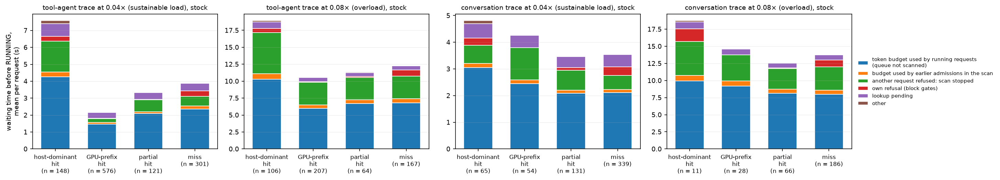

*Figure A1 — where the waiting time goes, stock server, four replays (this one, A2.2 and the conversation trace at both loads, C2.3).
x: request category (number of requests); y: mean seconds per request between queueing and RUNNING, split by the scheduler's
reason at each engine step. Blue: the running requests used the whole token budget and the queue was not scanned.*

**Result 3 — phases (Table 1 there; median / mean seconds).** Host-dominant hits: `pre` 0.00 / 2.20, `lookup` 0.78 / 4.29,
`admit` 0.00 / 0.32, `load` 0.21 / 0.58, `promote` 0.00 / 0.20, `compute` 0.21 / 0.42. GPU-prefix hits: 0.00 / 1.09,
0.03 / 1.05, 0.00 / 0.01, (small loads) 0.09 / 0.38, 0.00 / 0.14, 0.17 / 0.29. Misses: 0.00 / 1.55, 0.03 / 1.98, 0.00 / 0.34,
–, –, 2.98 / 3.89. The hit's time is not in the allocation (`admit`) but in front of it: waiting for the scan to come
(`pre`), and to come again for the lookup result (`lookup`; the lookup itself takes milliseconds, its result is taken only
at a scan visit).

**Result 4 — the class comparison of the earlier study is confounded by the state of the engine at arrival (Table 6 there).**

| category | n | arrives while a prefill is in flight | TTFT p50, no prefill in flight at arrival (s) [n] | TTFT p50, prefill in flight (s) [n] | TTFT p50, free blocks ≥ 25 % of the pool [n] | TTFT p50, free blocks < 25 % [n] |
|---|---|---|---|---|---|---|
| host-dominant hit | 148 | 51 % | 0.32 [73] | 10.42 [75] | 2.43 [134] | 18.73 [14] |
| GPU-prefix hit | 576 | 28 % | 0.17 [415] | 5.41 [161] | 0.26 [559] | 11.62 [17] |
| partial hit | 121 | 34 % | 0.45 [80] | 8.25 [41] | 0.72 [117] | 11.32 [4] |
| miss | 301 | 36 % | 2.74 [193] | 11.84 [108] | 4.70 [289] | 25.47 [12] |

A host-dominant hit that arrives when no prefill is in flight answers in 0.32 s (twice a GPU-prefix hit, a ninth of a
miss); one that arrives during a prefill needs 10.4 s. The headline "3.3 s against 0.3 s" is the median of a class that is
split half and half between the two states, against a class that is in the fast state 72 % of the time. Host-dominant hits
meet a prefill in flight twice as often as GPU-prefix hits because the category itself depends on the load: a prefix is
served from the host tier exactly when the GPU prefix cache has lost it, i.e. after other requests have churned the pool.
Conditional on the state, an external hit is 1.9× slower than a GPU-prefix hit and faster than a miss in both states.

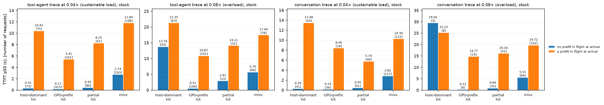

*Figure A2 — TTFT p50 per category, split by the state of the engine when the request arrived (blue: no prefill in flight;
orange: a prefill in flight); the number of requests in brackets. Same four replays.*

**Result 5 — a side effect of retries (SOURCE A1.4, confirmed).** Of the external loads whose lookup result was polled once,
137 of 137 with new chunks stored them all; of those polled twice or more (refused and retried; median 32 polls, max 320),
17 of 17 stored nothing: after a refusal the request's new tokens do not reach the host tier. A5 measures the same effect over
all requests of the run — it also hits compute requests whose prefix LMCache holds — and finds 48 requests and 6 % of the bytes.

**Explanation.** Three mechanisms, all in `Scheduler.schedule()`, in the order of their weight in this run:
1. *The waiting queue is served from what the running requests leave of the token budget* (A1.1). A prefill of 13.7k tokens
   takes seven steps of 2,048 tokens (about 3 s on this GPU), a 31k one fifteen; for that long nothing waiting is visited.
   This hits every class; it costs a hit most relative to what it needs (a transfer of 0.05 s and a tail of 0.6k tokens).
2. *The detour of a load.* A compute request that is visited starts at once and from then on is served by the running loop
   ahead of later arrivals. A load that is visited leaves for `WAITING_FOR_REMOTE_KVS`, its completion reaches the scheduler
   with the output of a later step, and it must be visited by the waiting loop again — behind every request that started
   computing in the meantime, a miss admitted in the same scan pass included. This is why, in the same state, a hit is slower
   than a GPU-prefix hit.
3. *The full-sequence gate under memory pressure,* with head-of-line blocking; it treats hits and misses alike.
The whole-prefix reservation of the earlier explanation is real (A1.2, step 4) but is not what makes the hits wait here.

### A2.2 Instrumented baseline under overload: tool-agent replay at 0.08×, 320 GB (MEASURED 2026-11-10 17:47–18:10, `replay/tool08-320-base`)
Trace seconds 0–100 at 0.08× (544 requests, 1,250 wall s), pool pinned at 7,456 blocks. All requests completed; cached share
0.355 (host 0.114, GPU 0.241); TTFT p50 / p95 / p99 12.4 / 40.8 / 47.4 s; GPU busy 0.87; backlog up to 42 (the 2026-11-05 run with
80 GB, `d-tool-dram80`: 12.7 / 40.9 / 48.1 s). Waiting time by reason (`replay/tables-adm-tool08-320-base.md`):

| category | n | wait, mean (s) | token budget | budget used by earlier admissions | `hol:full` | `own:full` | reservation gate | lookup pending |
|---|---|---|---|---|---|---|---|---|
| host-dominant hit | 106 | 18.95 | 10.28 (54 %) | 0.84 (4 %) | 6.04 (32 %) | 0.62 (3 %) | 0.01 | 0.96 (5 %) |
| GPU-prefix hit | 207 | 10.60 | 6.01 (57 %) | 0.48 (5 %) | 3.33 (31 %) | 0.09 (1 %) | 0.00 | 0.62 (6 %) |
| partial hit | 64 | 11.37 | 6.68 (59 %) | 0.56 (5 %) | 3.28 (29 %) | 0.15 (1 %) | 0.00 | 0.59 (5 %) |
| miss | 167 | 12.31 | 6.81 (55 %) | 0.59 (5 %) | 3.35 (27 %) | 0.89 (7 %) | 0.00 | 0.62 (5 %) |

The same order of causes as at the sustainable load: token budget first (54–59 %), the full-sequence gate with head-of-line
blocking second (28–35 %), the reservation gate absent (9 of 6,527 refused attempts; 1,991 of the 2,000 refused load attempts
failed the full-sequence gate, needing 425 blocks where 212 were free at the median). The confound is stronger here: a
host-dominant hit arrives with 16 % of the pool free at the median (GPU-prefix hit 52 %, miss 49 %) and 59 % of them during a
prefill; 65 % arrive with less than a quarter of the pool free (39 % of the GPU-prefix hits).

**Conversation trace at 0.08× (MEASURED 2026-11-10 18:10–18:33, `replay/conv08-320-base`).** Trace seconds 0–100 (291 requests,
1,292 wall s), same server. Cached share 0.075 (host 0.031, GPU 0.044): 11 host-dominant hits, 28 GPU-prefix hits, 186 misses.
TTFT p50 / p95 / p99 14.4 / 41.8 / 49.4 s. Waiting time by reason (`replay/tables-adm-conv08-320-base.md`): token budget 53–65 %
for every class (host-dominant hits 9.95 of 18.77 s, misses 7.98 of 13.75 s), `hol:full` 24–26 %, own refusal 0–10 %, lookup
pending 5–6 %. 6,363 refused attempts, every one at the full-sequence gate (a refused load needed 871 blocks where 542 were free,
p50), none at the reservation; 5 preemptions; free blocks below 25 % of the pool for 0.51 of the wall time. The decomposition
does not depend on the trace.

## A3. Controlled reproduction (MEASURED 2026-11-10 17:33–17:47, c28, `A3/a3-*`, tables `A3/tables-a3-a3.md`)
**Why.** The replay shows what happens to classes of requests that arrive under different conditions. To separate the
mechanisms the pressure has to be set, not inferred, and a hit has to be compared with a miss of the same length in the
same state.

**How.** `run_adm.py`, stock scheduler, 3B-AWQ, pool pinned at 7,456 blocks, 120 GB DRAM tier, 16 output tokens per probe.
Each trial starts K *holders* — long prompts that decode for the whole trial (2,000 output tokens) and hold their blocks —
sized so that a chosen number of blocks is free; then it sends *probes*: `host` = L tokens stored in LMCache and absent from
the GPU prefix cache plus 256 fresh tokens, `cold` = L + 256 fresh tokens. Where the probe cannot fit, the driver cancels one
holder 3 s after the probe (a release of ≈ 1,100–1,800 blocks at a known instant). The pressure a probe meets is read from the
admission stream (free blocks, blocks needed, gate at its first attempt), not from K. 114 trials: part 1, one probe,
L = 1k / 2k / 4k / 8k × free = 3.0 / 1.5 / 0.6 × the probe's need × host / cold × 3 repetitions, K = 6; part 2, the same at
4k with K = 4 and 12; part 3, two probes 5 ms apart with 700 free blocks, four orders; part 4, bursts of 4 and 8 probes of
2k alternating host / cold with room for half; part 5, two probes with more than 5,000 blocks free. No probe timed out, no
hook error.

**Result (Tables A3-1 … A3-6).**

| probe | free ≥ need: first attempt | TTFT (s), free = 3.0× / 1.5× | free = 0.6× need: first attempt (free / needed blocks) | admitted after the release (s) | TTFT (s) |
|---|---|---|---|---|---|
| host 1k | admitted, 3 of 3 | 0.34 / 0.32 | refused, full-sequence gate, 3 of 3 (68 / 80) | 0.06 | 3.32 |
| cold 1k | admitted | 0.36 / 0.35 | refused, full-sequence gate (64 / 80) | 0.06 | 3.34 |
| host 2k | admitted | 0.34 / 0.35 | refused, full-sequence gate (104 / 144) | 0.07 | 3.33 |
| cold 2k | admitted | 0.61 / 0.62 | refused, full-sequence gate (100 / 144) | 0.05 | 3.57 |
| host 4k | admitted | 0.34 / 0.34 | refused, full-sequence gate (180 / 272) | 0.06 | 3.34 |
| cold 4k | admitted | 1.03 / 1.04 | refused, full-sequence gate (178 / 272) | 0.07 | 4.01 |
| host 8k | admitted | 0.34 / 0.37 | refused, full-sequence gate (336 / 528) | 0.07 | 3.37 |
| cold 8k | admitted | 1.87 / 1.93 | refused, full-sequence gate (334 / 528) | 0.07 | 4.90 |

- **The block gate is symmetric.** With enough free blocks a hit is admitted at its first attempt whatever its length
  (TTFT 0.32–0.37 s under six decoding requests; lookup 0.05 s, load 0.13 s, tail 0.14 s) and a miss as well. With too few,
  the hit and the miss of the same length are refused by the same gate — the full-sequence gate, never the reservation
  (0 blocks reserved in all 72 trials) — and both are admitted within one engine step (0.05–0.07 s) of the release. The
  threshold is the request's own need: 80 / 144 / 272 / 528 blocks for 1k / 2k / 4k / 8k (+256); admitted at 139 / 234 /
  425 / 807 free, refused at 64–68 / 100–104 / 178–180 / 334–336.
- **The number of running requests does not matter at equal free blocks** (Table A3-2): 4k probes behind 4 and 12 holders
  behave as behind 6 (admitted at 420–446 free, refused at 171–203; TTFT 0.33–0.37 s for the hit).
- **Order decides who waits, not hit or miss** (Table A3-3, 700 free blocks): whichever probe comes first is admitted; the
  second is refused by the full-sequence gate (a hit of 4k with 189 free, a miss of 4k with 189 free, a miss of 8k with
  445–461 free) and enters when the first one finishes. In second position the hit's TTFT is 2.64 s, the 4k miss's 3.33 s.
- **Without memory pressure a hit next to a prefill is no faster than the prefill** (Table A3-5, > 5,000 blocks free): hit
  first, then an 8k miss 5 ms later → hit 1.70 s, miss 1.62 s (the hit's load is noticed 1.5 s after it was issued, i.e.
  when the miss's four chunks are through); miss first → miss 1.63 s, hit 1.77 s (its lookup result is taken 1.1 s after
  the first visit). Alone the same hit takes 0.34 s.
- **In bursts hits are not ahead of misses** (Table A3-4): TTFT p50 1.83–2.01 s (hits) vs 1.69–1.83 s (misses) for four
  probes, 2.41–2.86 vs 2.21–2.27 s for eight; half of each burst is refused at first by the full-sequence gate.

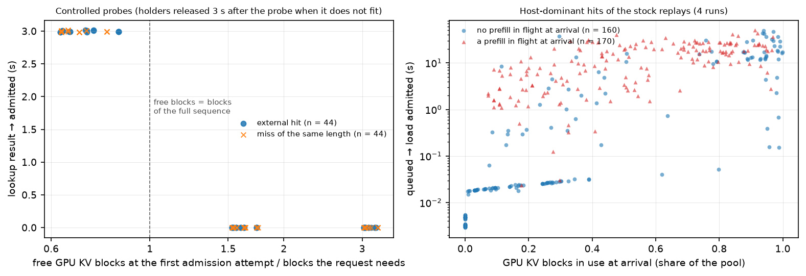

*Figure 1 — GPU KV occupancy against the admission wait of external hits. Left, controlled probes: x = free blocks at the
probe's first admission attempt divided by the blocks its whole sequence needs (log scale); y = seconds from the lookup result to
admission. Hits (dots) and misses of the same length (crosses) fall on the same two levels: admitted at once when the sequence
fits, admitted when the holder is released (3 s) when it does not. Right, the host-dominant hits of the four stock replays:
x = share of the pool in use when the request arrived; y = seconds from queueing to the admission of its load (log scale);
triangles arrived while a prefill was in flight. At low occupancy the wait is mostly 3–30 ms without a prefill in flight and
1–30 s with one; occupancy alone does not predict the wait until the pool is nearly full.*

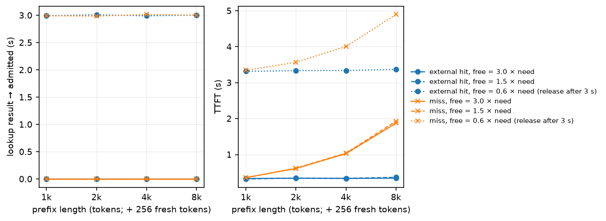

*Figure 2 — prefix length against the admission wait (left) and TTFT (right), controlled probes of part 1. x: length of the
cached prefix (the probe has 256 fresh tokens more); lines: external hit and miss at three levels of free blocks relative to the
probe's need. The wait is 0 s or the 3 s until the release for every length and for hits and misses alike; the TTFT of a hit
does not grow with its prefix, that of a miss does.*

**Explanation.** These trials answer the brief's questions for the block gate: admission of an external hit starts to fail
when the free blocks fall below the blocks of its whole sequence — the same point at which a miss of that length fails;
the number of concurrent requests is irrelevant beyond the blocks they hold; and a miss does not "make progress while the
hit waits" at the gate: what progresses are requests already RUNNING, which take their next chunk without a gate. What the
hit loses relative to a miss is not at the gate but around it (parts 3–5): its lookup result, its finished load and its
promotion are each picked up only at a step with token budget left, and a miss that starts in between takes the budget
first.

### A3.1 The same trials with the full-sequence gate switched off (MEASURED 2026-11-10 18:18–18:49, 16 GB node c60, pool pinned at 7,456 blocks; `E16/a3gate/a3g-base`, `a3g-noisl`)
**Why.** A1 says the admission asymmetry of the earlier explanation is removed by `scheduler_reserve_full_isl`, which is on by
default. If that is right, switching it off (`--no-scheduler-reserve-full-isl`, a stock flag) must bring the asymmetry back.

**How.** The 114 trials of A3, twice on one node: stock flags, and with the gate off. Nothing else differs.

**Result.**
| probe, free = 0.6 × need | gate on: first attempt | gate on: TTFT (s) | gate off: first attempt | gate off: TTFT (s) |
|---|---|---|---|---|
| host 4k (needs 256 blocks at once; 180 free) | refused (`full`) | 3.35 | refused (`free`) | 3.34 |
| cold 4k (first chunk 128 blocks; 178 free) | refused (`full`) | 4.00 | **admitted** | 3.62 |
| host 8k (512 at once; 335 free) | refused (`full`) | 3.37 | refused (`free`) | 3.36 |
| cold 8k (first chunk 128; 334 free) | refused (`full`) | 4.89 | **admitted** | 4.10 |
| host 1k (64 at once; 68 free) | refused (`full`) | 3.32 | admitted (the load fits; the tail does not yet) | 0.31 |
| cold 1k (80 in one chunk; 68 free) | refused (`full`) | 3.36 | refused (`free`) | 3.34 |

With the gate on, the node reproduces c28's A3 to the hundredth of a second (hit and miss refused together, admitted 0.06–0.08 s
after the release). With the gate off, **a miss is admitted with its first chunk where a hit of the same length is refused
for its whole prefix** — the mechanism of the 2026-11-04 explanation, observed directly — and the run has 23 preemptions and
46 failed chunk allocations of running requests against 2 and 4 with the gate on. In the two-probe trials the gate-off server
admits the 8k miss next to the 4k hit that came first (700 free blocks), and the hit's TTFT rises from 0.35 to 1.52 s.

**Explanation.** The earlier explanation describes vLLM without the full-sequence reservation. vLLM 0.31's default closes that
gap from the other side: it makes a miss wait for its whole sequence as well. Switching the gate off does not help hits (they
are refused at the same free-block counts as before) and costs preemptions.

## A4. Answers to the analysis questions of Experiment A
First admission attempts against the occupancy at that instant (`replay/tables-first-<tag>.md`, `adm_first_attempts.py`; MEASURED,
stock runs; refused attempts / attempts):

| run | kind of request | attempts | pool in use < 50 % | 50–75 % | 75–90 % | 90–95 % | 95–98 % | ≥ 98 % |
|---|---|---|---|---|---|---|---|---|
| `tool04-320-base` | external load | 191 | 0 / 118 | 0 / 16 | 3 / 25 | 7 / 16 | 11 / 13 | 3 / 3 |
| `tool04-320-base` | compute (miss, GPU-prefix hit) | 968 | 0 / 738 | 0 / 117 | 8 / 61 | 13 / 31 | 6 / 15 | 6 / 6 |
| `tool08-320-base` | external load | 126 | 0 / 10 | 0 / 15 | 2 / 34 | 4 / 20 | 21 / 30 | 17 / 17 |
| `tool08-320-base` | compute | 418 | 0 / 166 | 0 / 53 | 11 / 63 | 16 / 46 | 23 / 49 | 26 / 41 |
| `conv08-320-base` | external load | 14 | 0 / 3 | 0 / 3 | 0 / 1 | 2 / 2 | 2 / 3 | 2 / 2 |
| `conv08-320-base` | compute | 277 | 0 / 92 | 0 / 38 | 15 / 61 | 18 / 32 | 23 / 36 | 17 / 18 |

1. **At what GPU KV occupancy does external-hit admission begin to fail?** When the free blocks fall below the blocks of the
   request's whole sequence. In the controlled trials that is exact (A3: a 4k hit needs 272 blocks, is admitted with 425 free and
   refused with 180). In the replays none of the 1,369 first attempts made while less than 75 % of the pool was in use was
   refused; of the loads' first attempts in the two tool-agent replays (sustainable load, overload) 12 % and 6 % were refused
   at 75–90 %, 44 % and 20 % at 90–95 %, 85 % and 70 % at 95–98 %, and all above 98 %. Compute requests follow the same curve.
2. **How many blocks does the hit need?** The refused loads needed 450 blocks for their full sequence at the sustainable load
   (p50; 312–1,505 p10–p90; about 7.2k tokens) and 409 under overload; the loads admitted at once needed 387 (p50).
3. **How many are available?** 353 free blocks at the refused first attempts at the sustainable load (p50; 139–906), 217 under
   overload (34–382): the request needs 1.6× and 2.0× what is free (median). Admitted first attempts saw 5,542 and 1,222 free.
4. **Why can a miss make progress while a hit waits?** At the block gate it cannot: with vLLM 0.31's default
   (`scheduler_reserve_full_isl`) a hit and a miss of the same length are refused at the same free-block count and admitted in
   the same step after a release (A3). What makes progress while a hit waits are (a) requests that are already RUNNING, which
   take the blocks of every further chunk without a gate, (b) a miss that was visited by the same scan pass: it starts
   computing at once and from then on is served by the running loop, while the hit leaves for the load and needs two more
   visits by the waiting loop. With the gate switched off the miss-first asymmetry of the 2026-11-04 explanation appears
   (A3.1), at the price of preemptions.
5. **Does the waiting-queue scan or the token budget also contribute?** It is the main contributor: the waiting loop runs only
   on budget the running requests leave, and one prefill in progress leaves none.
6. **What fraction of the waiting time comes from each mechanism?** For host-dominant hits: token budget (queue not scanned)
   56 % at the sustainable load and 54 % under overload, plus 4 % of budget used by earlier admissions of the same scan;
   full-sequence gate 28 % and 35 % (of which head-of-line blocking 24 % and 32 %, own refusal 4 % and 3 %); in-flight
   reservation gate 0.3 % and 0.1 %; pending lookup 10 % and 5 %. The other classes have the same order (A2.1, A2.2).
7. **Does the proposed cause explain the long delays in the real tool-agent trace?** No. Whole-prefix reservation under the
   in-flight reservation refused 17 of 4,924 attempts at the sustainable load, 9 of 6,527 under overload and none in the
   conversation replay. The long delays are explained by the token budget of the step (hits wait for running prefills like
   everybody else, and need more step boundaries than a miss), by the full-sequence gate with head-of-line blocking when the
   pool is more than about 75 % in use, and — for the size of the class gap — by the fact that prefixes are served from the
   host tier mostly when the engine is busy and the pool has been churned (A2.1, Result 4).

**A side observation: a waiting request does not pin its GPU-cached prefix.** Between a request's first visit and its
admission its GPU prefix hit can be evicted by the requests that run meanwhile: 20 requests lost 101k tokens of prefix that
way at the sustainable load (3.3 % of the GPU-prefix tokens seen at the first visits), 36 requests lost 117k tokens (11.7 %)
under overload; every one of them was then served by a load from the host tier. Part of what the replays count as host-tier
hits are GPU-prefix hits that waited too long — the host tier catches what the queueing delay costs the GPU cache.

## A5. A side effect of admission retries: KV that never reaches the host tier (SOURCE + MEASURED; `store_loss.py`, `replay/tables-store-loss.md`)
**Why.** A1.4 noted that every poll of a waiting request adds the LMCache hit length to the connector's stored-token counter. A2.1
(Result 5) confirmed it for refused loads. The same code path serves every request that has *any* LMCache hit — also a GPU-prefix
hit whose prefix LMCache holds as well, and a near-miss that shares one 256-token chunk with an earlier prompt — so the size of the
effect was measured over all requests.

**How (SOURCE).** `get_num_new_matched_tokens` runs `tracker.increase_num_stored_tokens(ret)` whenever the lookup result `ret` is
non-zero (C:1065) — on every call, and the stock scheduler calls it again at every step in which it visits a request it could not
admit (A1.3). The store path writes the chunks from `start_token_idx = tracker.num_stored_tokens` (M:252). After k polls the
counter stands at k × ret: the tokens between ret and k × ret are never stored, and nothing at all once k × ret exceeds the prompt
(a refused request is polled 32 times at the median, A2.1). LMCache finds a prefix chunk by chunk, so chunks stored behind such a
hole cannot be found by a later request either.

**Result (MEASURED; the first three rows are the 2026-11-05 runs, which had no admission instrumentation).** A request "with a new
chunk" has at least one full 256-token chunk beyond what a cache served; expected bytes = new full chunks × 256 tokens × 36 KiB.

| run | requests with ≥ 1 new chunk | of those stored nothing | GB stored | GB expected | missing | polled with a result once: n / stored nothing | polled ≥ 2 times: n / stored nothing / GB stored of expected |
|---|---|---|---|---|---|---|---|
| `dl-tool-dram320` (2026-11-05, tool-agent 0.04×) | 981 | 48 | 187.9 | 200.5 | 6 % | – | – |
| `d-tool-dram80` (2026-11-05, tool-agent 0.08×) | 478 | 77 | 74.6 | 107.5 | 31 % | – | – |
| `dl-conv-dram320` (2026-11-05, conversation 0.04×) | 584 | 26 | 198.4 | 209.3 | 5 % | – | – |
| `tool04-320-base` | 981 | 48 | 187.9 | 200.5 | 6 % | 927 / 1 | 54 / 47 / 2.2 of 21.8 |
| `tool08-320-base` | 477 | 82 | 73.8 | 107.2 | 31 % | 368 / 0 | 109 / 82 / 9.4 of 45.0 |
| `conv08-320-base` | 290 | 54 | 76.7 | 112.6 | 32 % | 209 / 0 | 81 / 54 / 10.3 of 48.3 |
| `tool08-320-sync` (stock flag) | 477 | 87 | 71.8 | 107.2 | 33 % | 363 / 0 | 114 / 87 / 9.7 of 47.2 |
| `tool08-320-tokfast11` (prototype v1.1, counter repaired at every poll) | 475 | 1 | 108.7 | 105.1 | 0 % | 146 / 0 | 329 / 1 / 88.9 of 86.4 |

- **The stock system loses 5–6 % of the KV it should store at a sustainable load and 31–33 % under overload,** on both traces, with
  and without the instrumentation of this study (the 2026-11-05 rows). Requests polled once store everything (1 exception in 1,504);
  requests polled twice or more store 10–21 % of their bytes, and what they store lies behind a hole.
- The loss grows with congestion because only requests that had to wait are polled again — the busier the engine, the less of
  what it computes reaches the host tier, which is when the host tier would be most useful.
- With the counter repaired (`storefix`, B7) the same replay stores 108.7 GB instead of 73.8 GB.

**Explanation.** A counter that is meant to say "this much of the prompt is already in the store" is incremented by a polling loop
instead of being set once. It is harmless while every request is admitted at its first visit, which is why it does not show in
light-load tests. The 2026-11-04 study's host-tier occupancy and hit shares under overload were measured with this loss in place.

## B. Mechanism evaluation

### B0. The prototype mechanisms (`benchmarks/serving/kvadm/kvadm_policy.py`; flags in the vLLM process environment, `KVADM_POLICY=…`)
**Why these, from A.** The delay has three parts with different remedies. (1) The waiting queue gets only what the running
requests leave of the token budget → keep a bounded share of the budget for short work and keep the scan alive. (2) The load
detour: lookup result, finished load and promotion are each picked up at a step boundary, and a prefill step is long → make
the steps short while such work is under way. (3) The full-sequence gate with head-of-line blocking under memory pressure →
let requests that fit pass a request that does not, with a bound on how long it can be passed and a bounded block
reservation for the hits that are passed. The brief's B2–B5 map onto (3) and onto the two gates of A1.2; A predicts that
relaxing the reservation gate (B2 in its literal form) and chunked loading (B3) cannot help, because the gate that refuses
loads is the full-sequence gate, which every admission shares. Both are tested rather than assumed.

**How they are built.** No vLLM or LMCache source is patched. The hook wraps three existing interfaces of the scheduler
process, and with `KVADM_POLICY` unset every wrapper returns its input (the instrumented baseline):
1. the connector's answer `get_num_new_matched_tokens`: `(None, True)` is what the connector returns for a pending lookup,
   and the stock scheduler then sets the request aside for this step and scans on; `(0, False)` makes it compute the prompt;
2. the `reserved_blocks` argument of `allocate_slots`;
3. `scheduler_config.long_prefill_token_threshold` (vLLM's own per-step cap of a prefill chunk) and
   `max_num_scheduled_tokens` (the step's token budget), both read at the start of every `schedule()`.

| flag | mechanism | addresses |
|---|---|---|
| `tokres=<n>` | **Token reserve.** Before each step: tokens needed by loads that have arrived (their uncached tail), by waiting compute requests whose need is known and ≤ n (GPU-prefix hits, short prompts) and whose blocks are free, plus 1 token if anything else waits (so that the scan runs). Running long prefills (more than n tokens left) are capped so that this amount, at most n, is left of the budget. | (1) |
| `minchunk=<m>` | A compute request is not started in a step with fewer than min(its need, m) budget tokens left (it is set aside for this step). Default n + 256 with `tokres`, so that the reserve can never start a long prefill: long work stays first-come-first-served. | keeps (1) from turning into round-robin among prefills |
| `fastchunk=<f>` | **Short steps while short work is under way** next to a long prefill (a request not yet visited or its lookup pending, a load in transfer or arrived, a short tail running): the whole step's budget is f instead of 2,048 — more if the short work itself needs more — and each long prefill keeps at least `mincap` = 256 tokens of it. A request counts as short work under way for a bounded number of engine steps per phase (lookup 3, load in transfer 10, promotion 4, short compute request 4; `faststeps` scales them): one that stays longer is waiting for memory or for its turn, which short steps do not help. | (2) |
| `skip=<s>` | **No head-of-line blocking by a request that does not fit.** The two block gates are evaluated before the scheduler tries the allocation; a request that would be refused is set aside for this step instead (requests behind it are visited) until it has waited s seconds since its lookup result; after that the stock behaviour returns: its refusal stops the scan, so freed blocks go to it first. | (3), starvation bound |
| `hitres=<b>` | **Bounded block reservation for skipped hits** (the brief's B2): while external hits are set aside for lack of blocks, other compute requests are admitted only if they leave min(b, blocks those hits need) free. Nothing is reserved when no hit is waiting. | (3), for hits |
| `alpha=<a>` | Scale the stock in-flight reservation charged to a load (1 = stock, 0 = a load is admitted under the same block rule as a miss). | the reservation gate (B2, literal form) |
| `resvall` | A compute request that is started while a prefill is in flight must fit under the in-flight reservation, as the stock scheduler demands of a load; otherwise it is set aside for this step. Needed only because the token reserve lets requests in during a prefill, which the stock scheduler never does. | preemptions caused by (1) |
| `blkfirst` | A compute request that would fail the block gates is never set aside by the token rules (`minchunk`, `resvall`): it gets the stock treatment — its allocation is refused and the scan stops there — unless `skip` is set and it is inside its skip time. Keeps the token reserve from passing a request that waits for *blocks*. | starvation caused by (1) under memory pressure |
| `agecap=<s>` | **Starvation bound.** While a waiting request that is not short work (a compute request that needs more than `tokres` tokens, or an external hit that waits for blocks) has been queued for more than s seconds, every mechanism is suspended and the scheduler runs with its stock rules until that request is admitted. The store-counter fix stays on. | bounds what (1)–(3) can cost long requests |
| `fallback=<s>` | **Compute fallback** (B5): a hit that still fails the gates s seconds after its lookup result is computed instead of loaded if the compute path passes the gates. | (3) |
| `storefix` | Undo the repeated addition to the connector's `num_stored_tokens` when a waiting hit is polled again (A1.4); applied automatically with every mechanism that makes the scheduler poll a request again. | side effect of A |

**Versions of the module, and why there are four.** Each version was replaced because a measurement showed a flaw; the runs made
with the earlier versions are kept and labelled.

| version | commit | flags added / changed | what the measurements with the previous version showed |
|---|---|---|---|
| v1 | 537d2ff | `tokres`, `minchunk`, `fastchunk`, `skip`, `hitres`, `alpha`, `fallback`, `storefix` | – |
| v1.1 | 1b5fa31 | store-counter fix at every poll with a result; the reserve counts a request for a bounded number of steps and a short compute request only if its blocks are free; a long prefill keeps 256 tokens of a short step | `replay/tool08-320-tokfast` (v1): stores fell from 73.8 to 31.3 GB — the fix covered only loads, and `minchunk` makes the scheduler poll GPU-prefix hits again (A5); 24 % of the run in short steps with the prefill at its 128-token floor while the short work was waiting for memory, not tokens; TTFT p95 58.8 s against 40.8 s |
| v1.2 | 9f3b1c8 | `resvall` | `replay/tool08-320-tokfast11` (v1.1): 32 preemptions against 5 — short compute requests admitted during a prefill took blocks the prefill still needed |
| v1.3 | 68acb27 | `agecap` | the same run: requests that are not short work waited behind a continuous stream of short work (longest TTFT 77.7 s against 53.2 s) |
| v1.4 | 49c3585 | `blkfirst` | the same run, traced request by request: in every step in which little budget was left the token rule set a memory-blocked request aside and admitted short work behind it, i.e. an unbounded head-of-line bypass that nobody had asked for; one request that needed 50 blocks waited 48 s after its first refusal while 22 others were admitted |

The configurations evaluated end to end are cumulative: **P1** = `tokres=768,fastchunk=512,resvall,blkfirst` (token reserve and
short steps in their safe form), **P2** = P1 + `skip=3,hitres=600` (bounded head-of-line bypass), **P3** = P2 + `agecap=20`
(starvation bound), **P4** = P2 with the bypass bound raised from 3 s to 30 s (`skip=30`; added on 2026-11-11 after the bound
was varied on the overloaded replay, C2.2 — the same module, v1.4, no code change). `kvadm/test_policy.py` drives the module
with stand-ins for the scheduler and checks each rule (9 cases).

### B1. Baseline and the scheduler options vLLM already has (MEASURED 2026-11-10 19:27–19:58, 16 GB node c66, pool pinned at 7,456 blocks; `E16/c1c/`, table `E16/c1c/tables-c1c.md`)
**Why.** A prototype has to beat what the engine can already be configured to do. The options that touch the causes found in A:
synchronous scheduling (`--no-async-scheduling`: one batch in flight instead of two, so an event reaches the scheduler one step
sooner), a per-step cap on a prefill chunk (`--long-prefill-token-threshold 1024`: half of every step's budget is left to other
requests), a smaller step for everybody (`--max-num-batched-tokens 512`), priority scheduling with hits first (needs the client to
label its requests; controlled workloads only, C1) and the full-sequence gate off (A3.1).

**How.** Scenario c1, "compute contention without memory pressure" (`run_adm.py plan=c1`): six small holders decode, 5,500 of the
7,456 blocks are free; a miss of 8k, 16k or 28k tokens (the *blocker*) starts prefilling; external hits of 4k tokens (+256 fresh
tokens) are sent 0.5, 2.5 and 4.5 s after it and a 4k miss 1.5 s after it; 16 output tokens per probe; 3 repetitions; medians. Every
configuration runs the same 9 trials on the same node. The cells are TTFT / request time in seconds.

| blocker | probe | stock | synchronous | prefill cap 1,024 | step budget 512 |
|---|---|---|---|---|---|
| 28k | blocker miss | 7.33 / 8.71 | 7.35 / 8.78 | 8.64 / 9.00 | 8.52 / 9.91 |
| 28k | hit +0.5 s | 7.83 / 8.33 | 7.83 / 8.37 | 2.27 / 7.86 | 9.30 / 9.71 |
| 28k | 4k miss +1.5 s | 6.68 / 7.28 | 6.72 / 7.36 | 2.97 / 7.21 | 8.23 / 8.69 |
| 28k | hit +2.5 s | 5.97 / 6.36 | 5.94 / 6.39 | 4.31 / 6.40 | 7.48 / 7.78 |
| 28k | hit +4.5 s | 4.08 / 4.37 | 4.05 / 4.40 | 3.09 / 4.44 | 5.56 / 5.79 |
| 16k | hit +0.5 s | 4.05 / 4.47 | 4.04 / 4.51 | 2.26 / 4.42 | 4.83 / 5.21 |
| 8k | hit +0.5 s | 2.00 / 2.29 | 1.98 / 2.32 | 1.45 / 2.35 | 2.41 / 2.70 |

**Result.**
- **Stock:** every request sent during the blocker's prefill gets its first token after the blocker's (7.33 s for 28k): the hits at
  7.83 / 5.97 / 4.08 s, the 4k miss at 6.68 s. An external hit on this engine takes 0.2–0.3 s when no prefill is running (the
  hits sent after the 8k blocker has finished: 0.21–0.23 s).
- **Synchronous scheduling** changes nothing here (within 0.03 s): the queue is still not scanned during the prefill.
- **Prefill cap 1,024** lets the first hit in (2.27 s) because half of every step's budget is left over — and the 4k miss as well
  (2.97 instead of 6.68 s), after which two prefills share the steps: the blocker's first token comes 18 % later (8.64 s), and the
  later hits wait while the two prefills use the whole budget (4.31 / 3.09 s). On the overloaded replay the same option is worse
  than stock on every metric (TTFT p50 17.7 against 12.4 s, 74 preemptions against 5; C2): with the cap long prefills advance
  round-robin, more requests hold their blocks at the same time, and the pool fills.
- **A 512-token step for everybody** is worse everywhere (hits 9.30 / 7.48 / 5.56 s, blocker +16 %): the prefill still takes every
  step whole, and small steps cost throughput.

**Explanation.** None of the existing options separates the two things the waiting queue needs — a visit, which costs no GPU work,
and tokens — from the question of who gets the GPU. The cap comes closest and pays for it by starting long work early.

### B2. Token reserve and short steps (`tokres`, `minchunk`, `fastchunk`; MEASURED 2026-11-10 19:27–19:58, same node and scenario; `E16/c1c/`)
**What changed.** Before every step the hook caps the running long prefills (through vLLM's own per-request cap) so that the
tokens short work needs are left in the budget: the uncached tails of loads that have arrived, compute requests that need at most
`tokres` = 768 tokens and whose blocks are free, or a single token if anything else waits, which is enough for the scan to run,
lookups to be submitted and loads to be issued. `minchunk` (1,024) keeps the reserve from starting a long prefill: a compute request
is not started in a step with fewer budget tokens left than min(its need, 1,024), so long work stays first-come-first-served. With
`fastchunk` = 512 the whole step is limited to 512 tokens while short work is in the pipeline (B0), so that the step boundaries a
hit needs come 0.08 s apart instead of 0.3 s.

**What problem it addresses.** Causes 1 and 2 of A: the waiting loop is not entered during a prefill, and a hit needs four step
boundaries (lookup result, load issued, load noticed, tail computed), each a full prefill step away and two batches deep under
asynchronous scheduling.

| blocker | probe: TTFT / request time (s) | stock | reserve only (`tokres=768`) | reserve + 512-token steps | reserve + 256-token steps | reserve + 512-token steps, synchronous |
|---|---|---|---|---|---|---|
| 28k | blocker miss | 7.33 / 8.71 | 7.40 / 8.71 | 8.36 / 9.28 | 8.27 / 9.43 | 8.09 / 9.27 |
| 28k | hit +0.5 s | 7.83 / 8.33 | 4.17 / 8.10 | 1.62 / 5.71 | 1.25 / 4.93 | **0.94** / 4.94 |
| 28k | 4k miss +1.5 s | 6.68 / 7.28 | 6.80 / 7.25 | 7.44 / 7.81 | 7.62 / 7.97 | 7.45 / 7.81 |
| 28k | hit +2.5 s | 5.97 / 6.36 | 5.64 / 6.24 | 1.89 / 6.47 | 1.73 / 6.51 | **1.04** / 6.48 |
| 28k | hit +4.5 s | 4.08 / 4.37 | 3.93 / 4.28 | 2.67 / 4.74 | 1.90 / 4.86 | **1.10** / 4.68 |
| 28k | sum of the five request times | 35.05 | 34.57 | 34.01 | 33.70 | 33.17 |
| 16k | blocker miss | 3.62 / 4.79 | 3.88 / 4.85 | 4.14 / 5.14 | 4.28 / 5.27 | 4.06 / 5.23 |
| 16k | hit +0.5 s | 4.05 / 4.47 | 3.74 / 4.37 | 1.61 / 4.42 | 1.25 / 4.46 | 0.93 / 4.43 |
| 16k | hit +2.5 s | 2.17 / 2.50 | 2.15 / 2.49 | 2.01 / 2.69 | 1.99 / 2.82 | 1.03 / 2.71 |
| 16k | sum of the five request times | 15.77 | 15.67 | 16.76 | 17.32 | 16.99 |
| 8k | hit +0.5 s | 2.00 / 2.29 | 1.98 / 2.28 | 1.55 / 2.31 | 1.31 / 2.34 | 0.93 / 2.31 |
| 8k | sum of the five request times | 7.04 | 7.05 | 7.28 | 7.53 | 7.45 |

**Did it work?** For the first token, yes. The reserve alone admits the hit during the prefill (4.17 instead of 7.83 s) but each of
its step boundaries is still a 2,048-token step (its load phase lasts 2.3 s for a transfer of 0.05 s). With short steps the three
hits answer in 1.6–2.7 s, with 256-token steps in 1.3–1.9 s, and with synchronous scheduling on top — one batch in flight — in
**0.94–1.10 s, 4–8× sooner than stock** and 0.7–0.9 s above a hit on an engine without a prefill. Figure 4 shows the request
timelines of one repetition.

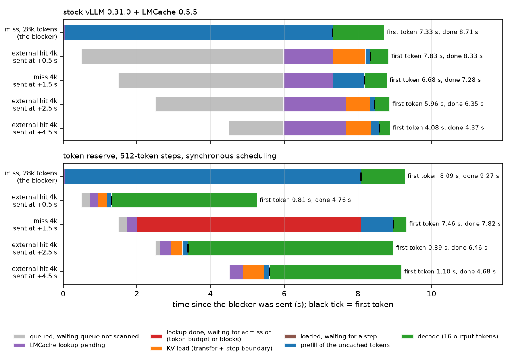

*Figure 4 — what each request of scenario c1 does over time behind a 28k-token prefill, stock (top) and with the token reserve,
512-token steps and synchronous scheduling (bottom); one repetition. x: seconds since the blocker was sent; one bar per
request, coloured by what the request is doing; black tick = first token. The times printed beside a bar count from that
request's own send time.*

**Side effects (the same table).**
- **The request time of the hits does not improve unless the prefill is long.** After its first token a request decodes one token
  per engine step, and while the blocker is prefilling a step is a 2,048-token chunk (0.3 s): the 16 output tokens of the first hit
  take as long as the rest of the blocker's prefill. Behind the 8k and 16k blockers the hits finish when they finished before
  (2.29 → 2.31 s, 4.47 → 4.43 s); behind the 28k blocker the first hit finishes 41 % sooner (8.33 → 4.94 s) and the two later ones
  2–11 % later. The mechanism moves the first token, not the last.
- **The blocker pays:** first token +10–18 % (7.33 → 8.09–8.36 s at 28k, 3.62 → 4.06–4.28 s at 16k), request time +6–10 %. The 4k
  miss pays +11–18 % (it now shares its steps with decoding hits).
- **Total work is not reduced:** the sum of the five request times is 3–5 % lower at 28k and 3–10 % higher at 8k and 16k.
- Nothing is refused or preempted in this scenario (no memory pressure): 0 preemptions in every configuration.

**Why it works, and why not further.** The hit's four step boundaries now come every 0.08–0.15 s instead of 0.3 s, and its load and
tail ride in steps that also carry a slice of the prefill. What remains is the pipeline itself: five or six short steps from arrival
to first token, plus up to one full prefill step that was already issued when the hit arrived (two under asynchronous scheduling).

### B3. Letting requests that fit pass a request that does not (`skip`, `hitres`; MEASURED 2026-11-10 19:58–20:07, node c66; `E16/c2b/c3b-*`, table `E16/c2b/tables-c3b.md`)
**What changed.** The hook evaluates the two block gates of `allocate_slots` before the scheduler tries the allocation. A request
that would be refused is set aside for this step — the connector's "lookup pending" answer, which the stock scheduler handles by
scanning on — instead of ending the scan. `skip=<s>` bounds this: `s` seconds after its lookup result the request gets the stock
treatment again (its refusal stops the scan, so every block that is freed goes to it first). `hitres=<b>` adds a bounded block
reservation for external hits that are being passed: compute requests are admitted only if they leave min(b, the blocks those hits
need) free; nothing is reserved when no hit is waiting.

**What problem it addresses.** Cause 3 of A (24–35 % of the hits' waiting time in the replays): the request at the head of the
queue does not fit, and the scan stops in front of requests that would.

**How.** Scenario c3 (`run_adm.py plan=c3`): six holders leave 600 free blocks; a 16k miss (needs 1,041) arrives, followed 50, 100
and 150 ms later by two external hits and a miss of 2k (145 blocks each) and 1 s later by another 2k hit; one holder is released
after 4 s (about 1,140 blocks). 3 repetitions; medians of TTFT (s) with the gate of the first attempt.

| probe | stock | `skip=2` | `skip=3,hitres=600` + token reserve and short steps |
|---|---|---|---|
| #1 miss 16k (does not fit) | 7.98 (refused: full-sequence gate) | 7.97 | 7.97 |
| #2 hit 2k | 8.70 | **0.75** | 0.75 |
| #3 hit 2k | 8.65 | **0.82** | 0.82 |
| #4 miss 2k | 8.35 | **0.65** | 0.65 |
| #5 hit 2k, 1 s later | 7.88 | **0.35** | 0.35 |
| refused admission attempts of the probes | 492 | 243 | 120 |
| preemptions | 0 | 0 | 0 |

**Did it work?** Yes, and at no cost in this scenario: the four requests that fit are served in 0.35–0.82 s instead of 7.9–8.7 s,
and the request that does not fit is admitted at the same instant as before (the release) and answers in the same 7.97 s. In the
stock run the four small requests wait twice: first behind the refused request, then — once it is admitted — for its whole prefill.

**Why.** The stock scan confuses "this request cannot be admitted" with "nothing can be admitted". The blocks the small requests
take (435 of the 600 free) are not blocks the large request could have used: it needs 1,041.

**Side effects, and what the reservation is for.** A request that is passed can be starved by the requests that pass it if they
keep taking the blocks that are freed; the `skip` bound limits that to `s` seconds, and `hitres` keeps blocks aside for a passed
hit. Scenario c5 measures both (B3.1).

### B3.1 How long may a request be passed, and how much should be kept for it? (the brief's B2; MEASURED 2026-11-10 22:07–22:38, node c66; `E16/c5/`, table `E16/c5/tables-c5.md`)
**Why.** B3 shows the bypass where the passed request loses nothing. The brief asks what a reservation for a waiting external hit
buys and costs: how much, when, whether it prevents starvation, whether it takes memory from active requests, what it does to
misses, whether it causes preemptions.

**How.** Scenario c5 (`run_adm.py plan=c5`) puts the passed request at risk. Ten holders leave about 330 free blocks. A 16k external
hit arrives (1,040 blocks for its sequence; it does not fit), followed by a stream of thirty 2k misses, one every 0.15 s for
4.5 s (145 blocks each: they fit, and they are more than the GPU can compute, so they take every block that becomes free). One
holder is cancelled 1.0, 2.5 and 4.0 s after the hit (about 710 blocks each): the hit fits after the second release if nobody
else has taken the blocks. 3 repetitions, medians; 16 output tokens per probe.

| configuration | hit: load admitted at (s) | hit: TTFT (s) | misses admitted before the hit (of 30) | first miss admitted at (s) | misses: TTFT p50 / p95 / max (s) | mean request time of the 31 probes (s) | blocks kept free for the hit while it waits (mean) | preemptions |
|---|---|---|---|---|---|---|---|---|
| stock | 2.57 | 4.50 | 0 | 2.59 | 8.39 / 12.84 / 12.91 | 10.94 | – | 0 |
| `skip=3`, no reservation | 3.95 | 5.93 | 7 | 0.11 | 6.21 / 10.60 / 10.67 | 8.19 | – | 0 |
| `skip=8`, no reservation | 4.59 | 5.53 | 9 | 0.11 | 6.14 / 10.90 / 11.27 | 9.16 | – | 0 |
| `skip=3,hitres=300` | 2.97 | 3.33 | 4 | 1.07 | 7.20 / 11.23 / 11.46 | 9.34 | 289 | 0 |
| `skip=3,hitres=600` | 2.91 | 4.86 | 4 | 1.07 | 7.48 / 11.72 / 12.08 | 9.77 | 577 | 0 |
| `skip=3,hitres=1200` | 2.57 | 4.55 | 0 | 2.57 | 8.29 / 12.57 / 12.68 | 10.66 | 980 | 0 |
| P2 (token reserve and short steps + `skip=3,hitres=600`) | 2.91 | 4.86 | 4 | 1.07 | 7.64 / 11.74 / 12.11 | 9.87 | 577 | 0 |

**Result.**
- **Stock:** the hit that does not fit holds back all thirty misses for 2.6 s (it is refused 89 times, once per engine step), and
  when the second release lets it in, the thirty misses start with it: its own first token then takes another 1.9 s.
- **Bypass without a reservation:** the misses flow from the first step (first one admitted after 0.11 s; TTFT p50 6.2 instead of
  8.4 s; mean request time −25 %) — and they take the first two releases. The hit is admitted 1.4 s later than in stock, when its
  3 s are over and the scan stops at it again; its TTFT is 5.9 s instead of 4.5 s. With `skip=8` it is passed for longer and
  admitted 2.0 s later than in stock. The bound is what prevents starvation here; without it nothing would.
- **Bypass with a bounded reservation:** with 300 or 600 blocks kept free, no miss is admitted until the first release; from then
  on four misses pass, and the second release completes the hit's blocks: it is admitted 0.3–0.4 s later than in stock. Misses:
  TTFT p50 7.2–7.5 s (stock 8.4, no reservation 6.2), mean request time −11 to −15 %. (The hit's time from admission to first
  token differs between the rows — 0.35 s with 300 blocks, 1.5–1.9 s elsewhere — with the number of misses that are prefilling
  when its load is issued; that part is the step-boundary effect of A, not the reservation.)
- **A reservation as large as the hit's need** (1,200 ≥ 1,024 blocks) reproduces stock exactly: nothing can pass.
- No preemption in any configuration: a passed request holds no blocks, and the requests that pass are admitted under the stock
  gates.

**Answers to the brief's questions.** *How much?* Enough that one further release completes the hit's need: here 300 blocks of a
1,040-block need were sufficient, and anything up to the need only removes passing. *When?* Only while a hit is actually being
passed — the reservation exists for 16 % of the overloaded replay's wall time and averages 75 blocks of 7,456 (C2). *Can it prevent a
long hit from waiting indefinitely?* The reservation alone cannot (requests that leave it untouched still pass); the time bound
does. *Does it reduce the memory of active requests?* It withholds free blocks from new compute requests, never from running
ones. *Does it increase the misses' waiting time?* Relative to the bypass without reservation, yes (p50 6.2 → 7.2–7.5 s);
relative to stock, no (8.4 s). *Preemptions or throughput?* No preemptions; the mean request time of the probes is 10–25 % lower
than in stock wherever requests pass, and 3 % lower with the full reservation.

**What the replays added on 2026-11-11 (C2.2).** This scenario has one blocked request and a stream that arrives for 4.5 s; it
shows the mechanism, not the right numbers. In the overloaded replay the bound matters far more than it does here — 3 s gives −2
to −4 % in mean TTFT, 30 s −28 % — and the reservation is a small net cost: the bypass with a 30 s bound reaches −28 % with it
and −33 % without it.

### B4. The in-flight reservation charged to a load (`alpha`; MEASURED 2026-11-10 20:07–20:34, node c66; `E16/c2b/c2b-*`, table `E16/c2b/tables-c2b.md`)
**What changed.** `alpha=0` removes the stock reservation from the admission of an external load: the load is admitted if its
blocks are free, as a miss's first chunk would be. This is the literal form of "do not make a hit reserve more than a miss".

**What problem it addresses.** The reservation gate. In the stock replays it refuses almost nothing (A4, question 7), because a
load is only ever evaluated in a step in which no prefill needed more tokens. With the token reserve of B2 that changes: the
scan now runs *during* prefills, when the reservation is large. Scenario c2 (`run_adm.py plan=c2`) sets this up: a 16k miss
starts prefilling in a pool where it fits with 100 or with 400 blocks to spare; external hits of 4k (272 blocks) are sent 0.5 and
2.5 s later; 3 repetitions, medians of TTFT (s) with the gate of the first admission attempt.

| trial | probe | stock | token reserve + short steps | + `alpha=0` | + `alpha=0`, 512 output tokens | reserve + short steps, 512 output tokens | reserve + `skip=1,fallback=1` |
|---|---|---|---|---|---|---|---|
| 100 blocks to spare | 16k miss | 4.04 | 4.34 | 4.73 | 4.74 | 4.34 | 4.34 |
| 100 blocks to spare | hit +0.5 s | 4.22 (full) | 4.52 (**resv**) | **2.16** (ok) | 2.17 (ok) | 7.83 (resv) | 4.52 (full) |
| 100 blocks to spare | hit +2.5 s | 2.35 | 2.68 | 3.50 (full) | 6.55 (full) | 5.98 | 2.68 |
| 400 blocks to spare | 16k miss | 4.01 | 4.64 | 4.92 | 4.91 | 4.49 | 4.65 |
| 400 blocks to spare | hit +0.5 s | 3.80 | **2.11** (ok) | 2.13 | 2.11 | 1.98 | 2.12 |
| 400 blocks to spare | hit +2.5 s | 2.30 (full) | 2.69 (resv) | 1.99 (ok) | 1.97 | 2.16 | 2.70 (full) |
| preemptions / running requests refused their next chunk (6 trials) | | 0 / 0 | 0 / 0 | **6 / 12** | 6 / 12 | 0 / 0 | 0 / 0 |

**Did it work?** It admits the hit — 2.16 instead of 4.52 s when only 100 blocks are spare — and breaks something else every
time: one preemption and two refused chunks of running requests in each of the six trials, the 16k miss's first token 6–9 %
later than with the reserve alone (4.34 → 4.73 s, 4.64 → 4.92 s), and the next hit later (3.50 against 2.68 s; with 512 output
tokens 6.55 against 5.98 s). Where the hit
fits beside what the prefill still needs (400 spare blocks), the token reserve alone admits it under the stock reservation
(3.80 → 2.11 s) and `alpha` adds nothing.

**Why.** The reservation is not an arbitrary penalty on loads. A load takes all its blocks at once and holds them without
computing; if those are blocks a running prefill needs for its remaining chunks, the prefill's next chunk fails and the scheduler
preempts a running request, whose computed tokens are lost. The stock rule is the correct one for a request that enters during a
prefill, and the prototype extends it instead of relaxing it: with `resvall`, a *compute* request that the token reserve lets in
during a prefill must also fit under the in-flight reservation (C2 shows the preemption counts with and without it).

**Verdict.** Negative for `alpha` < 1 (kept as a flag, off in every other run). The reservation gate is a consequence of scanning
during a prefill, not a cause of the delays A measured.

### B5. Compute fallback (`fallback`; same runs, last column)
**What changed.** A hit that still fails the block gates `fallback` seconds after its lookup result is computed instead of
loaded — the connector's answer is turned into `(0, False)` — if the compute path passes the gates at that moment.

**Did it work?** It never fired: 0 fallback decisions in 18 probes (6 of them refused at their first attempt), and the results
are those of the run without it.

**Why.** Wherever the load is refused, computing is refused too. The gate that refuses loads is the full-sequence gate
(1,286 of 1,303 refused load attempts at the sustainable load, A2.1), and it asks for the blocks of the whole sequence whichever
way the prefix is obtained. The remaining case — a load refused only by the in-flight reservation — is the case of B4: starting
the request by computing would take the same blocks from the running prefill, a chunk at a time, and would add 4k tokens of
prefill (about 0.7 s of GPU) to save a transfer of 0.05 s. Recomputing is never the cheaper way to wait for memory on this path.

**Verdict.** Negative; no configuration was found in which the fallback is both possible and better than waiting.

### B6. Chunked external loading (the brief's B3): not possible in this protocol, and it would not help (SOURCE)
(i) The scheduler asks the connector only for requests
without computed tokens (S:931); after a load the request re-enters through the branch for requests that have them (S:1041),
which adopts no further external tokens, so a second load for the same request has no entry point. (ii) The connector's
tracker issues one retrieve per request (`PREFETCHING → WAITING_FOR_LOAD → READY`, C:1388–1402; M:100–110) for the whole range
recorded at lookup, with block ids sliced from the blocks allocated at that moment (M:283–330). (iii) More fundamentally, a
partial first load would not be admitted earlier: the full-sequence gate (K:519–536) requires the blocks of the whole
sequence to be free whatever the first allocation takes, and that gate, not the size of the first allocation, is what
refused 1,286 of 1,303 load attempts at the sustainable load and 1,991 of 2,000 under overload. A request whose first chunk of
KV is on the GPU also cannot run: attention needs the KV of every preceding position, so a partially loaded hit would hold
blocks without making progress — the situation `scheduler_reserve_full_isl` exists to prevent. Loading incrementally would
therefore move the wait from "before the load" to "between the pieces" and hold blocks longer. What can be tested without
changing model semantics is the effect of the gate itself (`--no-scheduler-reserve-full-isl`, a stock flag; A3.1) and of the
reservation (`alpha`; B4).

**Answers to the brief's questions on chunked loading.**
- *Does it enable earlier execution?* No. A request cannot run on the first part of its prefix; execution starts when the last
  piece is on the GPU, which needs the same total of free blocks as the single load.
- *Does it only move the waiting time?* Yes: from before the load to between the pieces — with blocks held in the meantime.
- *Does it increase GPU KV memory pressure?* Yes. A partially loaded request holds blocks without making progress and cannot be
  preempted while a transfer is in flight (S:1196). A3.1 shows the analogous case for misses: with the full-sequence gate off,
  requests are admitted on a first chunk they cannot follow up, and the run has 23 preemptions against 2.
- *Does it require changes to block mapping or connector semantics?* Yes, in three places: the scheduler's connector query (only
  for requests without computed tokens), the connector's per-request state machine (one retrieve), and the slicing of block ids
  at allocation time.
- *Repeated copies or other overhead?* Not measured, because the mechanism was not built: it cannot be expressed through the
  existing interfaces, and (iii) above says the admission would not come earlier if it were.

**Verdict.** Not implemented; incompatible with the connector protocol of vLLM 0.31 / LMCache 0.5.5, and the measured cause of
the refusals (the full-sequence gate) would be unchanged by it.

### B7. The store-counter fix (`storefix`; MEASURED 2026-11-10 22:44–23:05, c28, `replay/tool08-320-storefix`)
**What changed.** At every poll of a waiting request that returns a lookup result, the hook sets the connector's stored-token
counter back to the LMCache hit length if no token of the request has been scheduled yet — i.e. it undoes the repeated addition
described in A5. Nothing else: stock scheduling, stock gates.

**What problem it addresses.** A5: requests that are polled again after a refusal skip the store of their new KV.

**How.** The overloaded tool-agent replay (0.08×, 544 requests, 320 GB tier, pool 7,456 blocks) with this flag alone, against the
stock run of the same replay.

| quantity | stock | store-counter fix alone |
|---|---|---|
| requests with a new chunk that stored nothing | 82 of 477 | 0 of 475 |
| KV stored in the host tier (GB; expected from the new chunks: 105–107) | 73.8 | 108.9 |
| requests polled ≥ 2 times: GB stored of expected | 9.4 of 45.0 | 46.2 of 45.0 |
| share of prompt tokens served from a cache: total / host tier | 0.355 / 0.114 | 0.368 / 0.126 |
| TTFT p50 / p95 / p99 / mean, all requests (s) | 12.45 / 40.8 / 47.4 / 14.67 | 12.16 / 40.9 / 47.3 / 14.43 |
| TTFT mean of the stock run's host-dominant hits / GPU-prefix hits / misses (s) | 19.65 / 11.22 / 16.64 | 19.14 / 11.09 / 16.42 |
| mean request time (s); completed requests / s | 27.6; 0.425 | 27.2; 0.428 |
| requests with TTFT lower / higher by more than 10 % | – | 3 % / 2 % |
| preemptions | 5 | 7 |

**Did it work?** Yes: every request stores its new chunks, 35 GB more KV reaches the host tier in 21 minutes (+48 %), the share
of prompt tokens served from the host tier rises from 11.4 % to 12.6 % within the same window, and no class of requests is slower
(all within 3 % of stock; two runs of the same configuration differ by less than 1 %, G, so the 2 % lower mean TTFT is small but
real). The latency effect is small here
because the replay window is short: the KV that stock fails to store would be reused by later turns of the same sessions.

**Side effects.** The host tier fills faster — with a tier that is already full (80 GB, C2.4) the additional stores displace
other entries. None otherwise: the fix does not change what is admitted or when.

**Why it matters for this project.** It is the one finding of the study that is about the host tier itself: a larger tier cannot
help with KV that was never written to it, and stock loses the most exactly when the engine is congested.

## C. End-to-end results

### C1. Controlled mixed workloads (the brief's Experiment C; MEASURED 2026-11-10 18:53 – 2026-11-11 01:19, 16 GB nodes c60 and c66, `E16/cc/`)
**Why.** The scenarios of B isolate one mechanism each. Before the trace replays, the prototype has to be measured where hits and
misses compete under controlled concurrency, arrival pattern, hit share and — the variable of this study — GPU KV memory pressure,
including cases without any pressure.

**How.** `run_b.py` (the 2026-11-04 driver): 64 prompts of 1k / 2k / 4k / 8k tokens are stored in LMCache and flushed from the GPU
prefix cache before every scenario; requests alternate external hits of those prompts and never-seen prompts of the same lengths
(50 % / 50 %), 32 output tokens. Scenarios: **s1** closed loop with 1, 2, 4, 8, 16 requests in the system (64 requests each);
**s2** open loop, Poisson arrivals at 0.5, 1, 2, 4 requests/s (96 requests each; 4 requests/s is above the engine's capacity of
about 2.8); **s3** synchronized bursts of 4, 8, 16 requests; **s4** open loop at 2 requests/s with an external-hit share of 0, 25,
50, 75, 100 %, for short (1k–2k) and long (8k) prompts. The same seeded request sequences run on every configuration. **GPU KV
memory pressure is set by the pool size** — `--num-gpu-blocks-override` 14,912 / 7,456 / 3,728 / 2,560 blocks (239k / 119k / 60k /
41k tokens; 2,048 blocks equals `max_model_len` and vLLM does not start) — and **measured, not assumed**: the tables give the
time-weighted share of the pool in use during each scenario, from the per-step occupancy stream, and the refused admission
attempts. Server configurations per pool: stock, P1, P2 (B0); at 7,456 blocks also the existing options (synchronous scheduling,
prefill cap 1,024, hits-first priority). All configurations of one pool ran on the same node (14,912 and 2,560 on c66; 7,456 and
3,728 on c60; s4 on c66).

**Result 1 — the workload matrix** (`E16/cc/tables-cc-matrix.md`; p95 values and every scenario in `E16/cc/tables-cc-pools.md` and
`figs/table-fig3-fig6.md`). Each cell: stock → P1 / P2.

| scenario | quantity | pool 14,912 blocks | pool 7,456 blocks | pool 3,728 blocks | pool 2,560 blocks |
|---|---|---|---|---|---|
| closed loop, 16 in the system | external hits: TTFT p50 (s) | 3.37 → 1.17 / 1.17 | 3.43 → 1.18 / 1.17 | 3.27 → 1.19 / 1.14 | 4.37 → 1.23 / 1.15 |
| | misses: TTFT p50 (s) | 3.03 → 3.34 / 3.34 | 3.08 → 3.39 / 3.40 | 2.34 → 3.06 / 3.50 | 4.30 → 7.19 / 7.23 |
| | completed requests / s | 2.42 → 2.31 / 2.31 | 2.38 → 2.27 / 2.27 | 2.36 → 2.31 / 2.31 | 2.38 → 2.34 / 2.34 |
| | request time, mean (s) | 6.57 → 6.85 / 6.85 | 6.67 → 6.94 / 6.94 | 6.70 → 6.75 / 6.76 | 6.52 → 6.37 / 6.39 |
| | pool in use, measured (stock) | 0.21 | 0.42 | 0.80 | 0.82 |
| open loop, 2 requests/s | external hits: TTFT p50 (s) | 0.90 → 0.89 / 0.89 | 0.94 → 0.93 / 0.94 | 0.99 → 0.94 / 0.93 | 0.92 → 0.92 / 0.72 |
| | misses: TTFT p50 (s) | 0.92 → 1.03 / 1.02 | 1.00 → 1.07 / 1.08 | 1.01 → 1.06 / 1.06 | 1.00 → 1.00 / 0.97 |
| | request time, mean (s) | 2.37 → 2.54 / 2.55 | 2.47 → 2.81 / 2.81 | 2.55 → 2.72 / 2.68 | 2.20 → 2.28 / 2.23 |
| | pool in use, measured (stock) | 0.08 | 0.17 | 0.35 | 0.41 |
| open loop, 4 requests/s | external hits: TTFT p50 (s) | 5.91 → 1.73 / 1.84 | 6.40 → 1.81 / 2.16 | 5.73 → 5.44 / 2.15 | 5.66 → 5.44 / 1.40 |
| | misses: TTFT p50 (s) | 5.39 → 6.96 / 6.94 | 5.42 → 7.03 / 7.15 | 5.55 → 6.30 / 6.47 | 5.63 → 5.95 / 6.31 |
| | completed requests / s | 2.79 → 2.67 / 2.67 | 2.75 → 2.66 / 2.64 | 2.76 → 2.68 / 2.67 | 2.76 → 2.72 / 2.72 |
| | request time, mean (s) | 8.85 → 8.07 / 8.13 | 9.20 → 8.06 / 8.36 | 8.09 → 8.26 / 7.77 | 6.99 → 7.21 / 6.02 |
| | pool in use, measured (stock) | 0.24 | 0.48 | 0.75 | 0.77 |
| bursts of 16 | external hits: TTFT p50 (s) | 3.03 → 1.21 / 1.30 | 3.57 → 1.45 / 1.20 | 3.45 → 1.18 / 1.16 | 3.40 → 1.26 / 1.34 |
| | misses: TTFT p50 (s) | 2.78 → 3.00 / 3.01 | 2.77 → 2.96 / 2.94 | 2.85 → 2.95 / 2.95 | 3.28 → 3.24 / 2.99 |
| | request time, mean (s) | 6.15 → 6.31 / 6.32 | 6.12 → 6.27 / 6.28 | 6.05 → 5.47 / 5.50 | 5.29 → 4.61 / 4.62 |
| | pool in use, measured (stock) | 0.14 | 0.31 | 0.52 | 0.50 |
| whole run | refused admission attempts: stock / P1 / P2 | 0 / 0 / 0 | 0 / 0 / 0 | 256 / 300 / 175 | 747 / 777 / 401 |
| whole run | preemptions: stock / P1 / P2 | 0 / 0 / 0 | 0 / 0 / 0 | 7 / 3 / 3 | 0 / 0 / 0 |

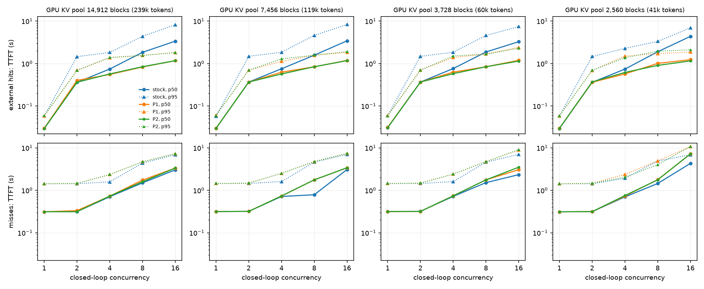

*Figure 3 — concurrency against TTFT, closed loop (s1). x: number of requests kept in the system; y: TTFT in seconds (log
scale). One column per pool size; top row external hits, bottom row misses; solid lines p50, dotted p95; stock, P1 and P2 (P1
and P2 coincide here).*

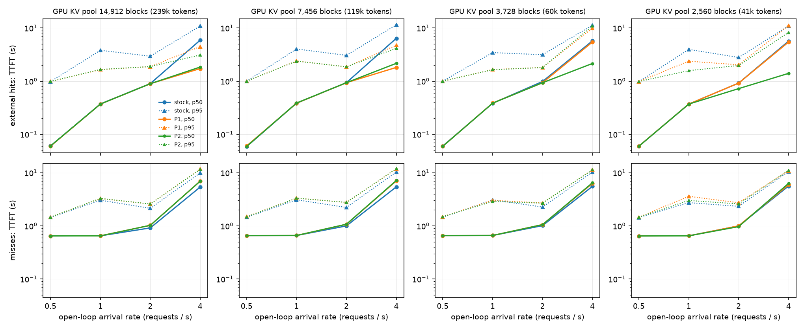

*Figure 3b — the same for the open loop (s2). x: arrival rate in requests per second; 4 requests/s is above the engine's
capacity. With the two smaller pools P1 follows stock at 4 requests/s and P2 does not.*

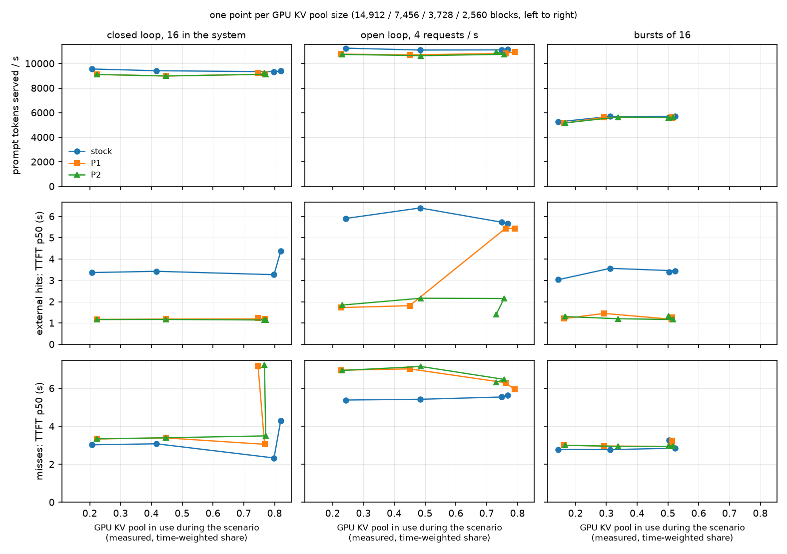

*Figure 6 — throughput and TTFT against measured GPU KV memory pressure. x: time-weighted share of the pool in use during the
scenario, one point per pool size (the largest pool is the leftmost point). Columns: the three saturated scenarios. Rows: prompt
tokens served per second, TTFT p50 of the external hits, TTFT p50 of the misses. Stock, P1 and P2.*

What the matrix shows:
- **Without any memory pressure the hits wait as long as with it, and the token mechanisms remove most of that wait.** With the
  two larger pools no admission attempt is refused in any configuration and at most 49 % of the pool is in use; a hit still gets
  its first token after 3.4 s in the closed loop with 16 requests, 5.9–6.4 s in the open loop above capacity and 3.0–3.6 s in
  bursts of 16 — as long as a miss. With P1 these are 1.2 s, 1.7–1.8 s and 1.2–1.5 s (2.5–3.5× sooner); the p95 falls from 8.2 to
  1.8 s in the closed loop. P2 equals P1 here: its bypass has nothing to act on.
- **The misses pay, and the engine loses a few per cent.** TTFT p50 of the misses +7 to +10 % in the closed loop and in bursts,
  +29 to +30 % in the open loop above capacity; completed requests per second −1 to −5 %.
- **Below saturation the tails move in both directions and the request time gets longer.** With up to 4 requests in the closed
  loop and up to 1 request/s, throughput and the mean request time stay within 3 % and the misses' median within 0.02 s; the
  hits gain already (p50 0.74 → 0.55 s with 4 in the system; p95 1.46 → 0.69 s with 2 in the system and 3.8–4.0 → 1.7–2.4 s at
  1 request/s) and the misses' p95 rises (1.58 → 2.35 s with 4 in the system). At 2 requests/s the medians move by at most
  0.11 s, the hits' p95 falls (2.95 → 1.88 s on the largest pool), the misses' p95 rises (2.15 → 2.58 s) and the mean request
  time is 4–14 % *higher* with P1 (`figs/table-fig3-fig6.md`).
- **Under memory pressure the token mechanisms alone stop working in the open loop, and the bypass restores them.** With the two
  smaller pools 75–82 % of the pool is in use in the closed loop and in the open loop above capacity, and 256 and 747 admission
  attempts are refused in the stock runs. P1 leaves
  the hits of the open loop at 4 requests/s where they were (5.7 → 5.4 s): they now stand behind a request that waits for blocks,
  which P1 does not pass (`blkfirst`). P2 serves them in 2.15 s and 1.40 s at the median (the p95 stays at 10.9 and 8.3 s
  against 11.3 and 11.0 s), with a third to a half fewer refused attempts than stock and a mean request time 4 % and 14 % below
  stock.
- **The smallest pool shows the price most clearly:** in the closed loop the misses' TTFT p50 rises from 4.30 to 7.2 s (+67 %)
  while the hits' falls from 4.37 to 1.2 s.

**Result 2 — the scheduler options vLLM already has, same workloads, pool 7,456 blocks** (`E16/cc/tables-cc-options-7456.md`).

| scenario | configuration | hits: TTFT p50 / p95 (s) | misses: TTFT p50 / p95 (s) | requests / s | request time, mean (s) |
|---|---|---|---|---|---|
| closed loop, 16 in the system | stock | 3.43 / 8.29 | 3.08 / 6.98 | 2.38 | 6.67 |
| | synchronous scheduling | 2.47 / 7.12 | 2.26 / 6.77 | 2.34 | 6.79 |
| | prefill cap 1,024 | 3.25 / 7.44 | 3.28 / 6.80 | 2.37 | 6.70 |
| | hits-first priority (client-labelled) | 3.30 / 4.81 | 3.34 / 6.95 | 2.38 | 6.68 |
| | P1 | 1.18 / 1.84 | 3.39 / 7.39 | 2.27 | 6.94 |
| open loop, 4 requests/s | stock | 6.40 / 11.47 | 5.42 / 10.31 | 2.75 | 9.20 |
| | synchronous scheduling | 6.21 / 11.54 | 5.73 / 10.80 | 2.71 | 9.51 |
| | prefill cap 1,024 | 6.12 / 11.26 | 5.42 / 9.92 | 2.76 | 9.04 |
| | hits-first priority (client-labelled) | 2.93 / 4.24 | 5.68 / 10.40 | 2.77 | 7.66 |
| | P1 | 1.81 / 4.74 | 7.03 / 11.89 | 2.66 | 8.06 |
| bursts of 16 | stock | 3.57 / 7.56 | 2.77 / 7.30 | 1.52 | 6.12 |
| | synchronous scheduling | 3.10 / 7.67 | 2.89 / 7.56 | 1.51 | 6.24 |
| | prefill cap 1,024 | 2.92 / 7.54 | 3.57 / 7.49 | 1.53 | 6.12 |
| | hits-first priority (client-labelled) | 1.84 / 3.99 | 3.48 / 7.59 | 1.51 | 6.22 |
| | P1 | 1.45 / 3.35 | 2.96 / 7.79 | 1.50 | 6.27 |

Synchronous scheduling lowers the TTFT p50 of hits and misses alike by about a quarter in the closed loop (2.47 and 2.26 s) with
2 % less throughput and changes little in the open loop and in bursts; the prefill cap changes little anywhere. **Hits-first
priority is the strong existing option wherever a queue forms:** in the open loop above capacity it halves the hits' TTFT
(2.93 s), costs the misses 5 %, loses no throughput and gives the lowest mean request time of all configurations (7.66 s against
9.20 stock, 8.06 P1); in bursts 1.84 s for hits at +26 % for the misses. It needs the client to say which requests are hits
(here the driver knows), and in the closed loop it lowers only the hits' p95 (4.8 s against 8.3 s), not the median (3.30 s):
there no request waits in the queue for its turn, it waits for token budget. P1 gives the lowest hit TTFT in all three and the highest miss TTFT
in the open loop.

**Result 3 — hit share and prompt length (s4, open loop at 2 requests/s; `E16/cc/tables-s4.md`).** With 8k prompts this rate is far
above capacity when most requests are misses; with 1k–2k prompts the engine is not saturated.

| prompts | hit share | pool 7,456: hits TTFT p50 (s), stock → P1 / P2 | misses TTFT p50 (s) | request time, mean (s) | pool 3,728: hits TTFT p50 (s), stock → P1 / P2 | misses TTFT p50 (s) | request time, mean (s) |
|---|---|---|---|---|---|---|---|
| 8k | 0 % | – | 27.2 → 27.6 / 27.6 | 36.6 → 35.7 / 35.7 | – | 26.9 → 27.7 / 27.7 | 33.7 → 33.6 / 33.6 |
| 8k | 25 % | 29.45 → 1.30 / 1.31 | 21.0 → 22.3 / 22.4 | 31.9 → 26.5 / 26.5 | 27.30 → 1.40 / 1.46 | 20.6 → 22.3 / 22.3 | 27.3 → 24.6 / 24.6 |
| 8k | 50 % | 9.66 → 1.67 / 1.81 | 11.7 → 15.1 / 14.9 | 19.7 → 15.1 / 15.0 | 9.31 → 6.48 / 2.21 | 11.4 → 12.6 / 12.8 | 15.5 → 15.0 / 11.4 |
| 8k | 75 % | 6.92 → 1.79 / 1.78 | 6.6 → 9.7 / 9.3 | 13.3 → 10.9 / 10.9 | 5.47 → 3.95 / 1.60 | 6.3 → 7.0 / 7.0 | 8.7 → 8.2 / 6.5 |
| 8k | 100 % | 0.10 → 0.09 / 0.09 | – | 0.54 → 0.48 / 0.48 | 0.10 → 0.10 / 0.10 | – | 0.55 → 0.48 / 0.48 |
| 1k–2k | 0–100 % | 0.03–0.09, unchanged | 0.31–0.35, unchanged | 0.33–1.04, unchanged | unchanged | unchanged | unchanged |

- With a mix of long hits and long misses the hits' TTFT falls from 7–29 s to 1.3–1.8 s, the misses' rises by 7 % (25 % hits),
  29 % (50 %) and 46 % (75 %), and the mean request time falls by 17–23 %. The prompt tokens served per second are unchanged up to
  50 % hits and 5 % lower at 75 % (11,463 → 10,844).
- With half the pool, P1 keeps only part of the gain (9.3 → 6.5 s at 50 % hits) and P2 the whole (2.2 s), with a mean request time
  26 % below stock and 5.5 % *more* prompt tokens served per second (9,045 → 9,543): here the bypass removes idle waiting instead
  of moving it.
- All misses, all hits, or short prompts: no difference between the configurations. The mechanisms act only where short and long
  work compete for the same engine steps.
- **The gain does not depend on the prefix length.** Over all scenarios of s1–s3, hits of 1k, 2k, 4k and 8k tokens have a TTFT
  p50 of 2.8–4.9 s in stock and 1.1–1.5 s with P1, at every pool size (`figs/table-cc-by-length.md`).

<!-- C1B -->
**Result 4 — under memory pressure, the bound of the bypass and the bypass alone (added 2026-11-11 after C2.2; node c74,
`E16/ccb/`, `tables-ccb-matrix.md`, `tables-ccb-p3728.md`, `tables-ccb-p2560.md`).** The overloaded replay showed that the 3 s
bound of P2 was chosen too short and that the bypass does most of its work without the token mechanisms (C2.2). The two smaller
pools were therefore run again on one node with four configurations: stock, P2, **P4** (P2 with a 30 s bound) and the **bypass
alone** with the 30 s bound (stock token rules). The stock and P2 runs reproduce those of Result 1 on the other nodes (open loop
at 4 requests/s, pool 3,728: hits 6.01 → 2.19 s here, 5.73 → 2.15 s there).

| scenario | quantity (stock → P2 / P4 / bypass alone, 30 s) | pool 3,728 blocks | pool 2,560 blocks |
|---|---|---|---|
| closed loop, 16 in the system | external hits: TTFT p50 (s) | 3.04 → 1.16 / 1.28 / 3.34 | 4.49 → 1.19 / 1.23 / 3.31 |
| closed loop, 16 in the system | misses: TTFT p50 (s) | 2.49 → 3.72 / 4.17 / 2.74 | 4.43 → 7.47 / 4.15 / 4.13 |
| closed loop, 16 in the system | completed requests / s | 2.33 → 2.28 / 2.25 / 2.34 | 2.31 → 2.27 / 2.27 / 2.32 |
| closed loop, 16 in the system | request time, mean (s) | 6.79 → 6.83 / 7.02 / 6.76 | 6.71 → 6.58 / 6.30 / 6.53 |
| closed loop, 16 in the system | pool in use, measured: stock / P2 / P4 / bypass alone, 30 s | 0.80 / 0.75 / 0.80 / 0.79 | 0.82 / 0.77 / 0.85 / 0.81 |
| open loop, 2 requests/s | external hits: TTFT p50 (s) | 1.03 → 1.02 / 1.01 / 1.02 | 1.02 → 1.00 / 0.92 / 0.95 |
| open loop, 2 requests/s | misses: TTFT p50 (s) | 1.07 → 1.06 / 0.97 / 0.88 | 1.08 → 1.16 / 1.14 / 0.96 |
| open loop, 2 requests/s | completed requests / s | 2.05 → 2.05 / 2.05 / 2.05 | 2.05 → 2.05 / 2.05 / 2.05 |
| open loop, 2 requests/s | request time, mean (s) | 2.76 → 2.89 / 2.80 / 2.63 | 2.48 → 2.46 / 2.44 / 2.37 |
| open loop, 2 requests/s | pool in use, measured: stock / P2 / P4 / bypass alone, 30 s | 0.37 / 0.41 / 0.40 / 0.36 | 0.46 / 0.48 / 0.47 / 0.45 |
| open loop, 4 requests/s | external hits: TTFT p50 (s) | 6.01 → 2.19 / 1.50 / 3.00 | 6.12 → 1.69 / 1.24 / 1.65 |
| open loop, 4 requests/s | misses: TTFT p50 (s) | 5.74 → 7.15 / 4.78 / 4.35 | 6.18 → 6.75 / 5.54 / 3.87 |
| open loop, 4 requests/s | completed requests / s | 2.73 → 2.66 / 2.66 / 2.72 | 2.70 → 2.65 / 2.67 / 2.70 |
| open loop, 4 requests/s | request time, mean (s) | 8.31 → 7.49 / 6.75 / 7.03 | 7.48 → 6.70 / 5.43 / 5.45 |
| open loop, 4 requests/s | pool in use, measured: stock / P2 / P4 / bypass alone, 30 s | 0.75 / 0.78 / 0.77 / 0.74 | 0.77 / 0.75 / 0.75 / 0.79 |
| bursts of 16 | external hits: TTFT p50 (s) | 3.52 → 1.32 / 1.58 / 3.21 | 3.18 → 1.43 / 1.28 / 3.53 |
| bursts of 16 | misses: TTFT p50 (s) | 2.89 → 3.02 / 3.03 / 2.88 | 3.40 → 3.07 / 3.42 / 3.39 |
| bursts of 16 | completed requests / s | 1.45 → 1.42 / 1.42 / 1.44 | 1.40 → 1.41 / 1.40 / 1.42 |
| bursts of 16 | request time, mean (s) | 6.12 → 5.58 / 5.67 / 6.05 | 5.61 → 4.84 / 4.82 / 5.32 |
| bursts of 16 | pool in use, measured: stock / P2 / P4 / bypass alone, 30 s | 0.54 / 0.49 / 0.49 / 0.55 | 0.50 / 0.50 / 0.49 / 0.49 |
| whole run | refused admission attempts: stock / P2 / P4 / bypass alone, 30 s | 256 / 180 / 6 / 47 | 755 / 354 / 0 / 0 |
| whole run | preemptions: stock / P2 / P4 / bypass alone, 30 s | 8 / 3 / 2 / 7 | 0 / 0 / 0 / 0 |

- **Open loop above capacity** (the one scenario of the matrix in which a queue builds up behind requests that do not fit):
  with the 30 s bound the hits' tail is gone (p95 11.7–11.8 s in stock, 7.0–11.0 s with P2, 2.2–3.0 s with P4), the misses
  are served *sooner* than in stock instead of later (5.74 → 4.78 s and 6.18 → 5.54 s), and the mean request time is 19 % and
  27 % below stock. Refused admission attempts: 256 and 755 in stock, 6 and 0 with P4.
- **The bypass alone gives the misses the larger share of that gain and costs no throughput:** misses 5.74 → 4.35 s and
  6.18 → 3.87 s (−24 % and −37 %), hits 6.0–6.1 → 3.0 and 1.65 s, mean request time −15 % and −27 %, completed requests per
  second 2.72 and 2.70 against 2.73 and 2.70.
- **Elsewhere the bypass alone stays close to stock** (closed loop, bursts, 2 requests/s: mean request time within 5 %,
  throughput within 1 %, medians within 0.35 s except the hits of the closed loop at the smallest pool, 4.49 → 3.31 s), and
  the token mechanisms are what make the hits fast — at the misses' expense in the closed loop: median +49 % (P2) and +67 %
  (P4) at 3,728 blocks; at 2,560 blocks +69 % with P2, and with P4 an unchanged median with a p95 of 12.7 s against 7.1 s.
<!-- /C1B -->

**Explanation.** The first two pools separate the two causes of A. No request is ever refused memory there, so the 3–6 s a hit
waits are engine steps: the running prefills take the whole 2,048-token budget of a step, the waiting queue is scanned only with
what they leave, and a hit — which needs a transfer of 0.05 s and a few hundred tokens of compute — gets in when a prefill ends
(A1.1, A4). The token reserve gives the queue 768 tokens of every step while short work is waiting, and the short steps bound how
long that work waits for the step in flight. The budget is shared, so every token given to a hit is taken from a miss in the same
step, and steps of 512 tokens spread the fixed cost of a step over fewer tokens: that is the misses' +7 to +30 % and the −1 to
−5 % of throughput. The mean request time falls where a queue exists (open loop above capacity: short requests are served
first) and rises where it does not (closed loop: it is the inverse of throughput; 2 requests/s: the misses' prefills are
stretched and nobody was waiting long). The two smaller pools add the second cause: a request that does not fit stops the scan
(A1.2), the hits behind it wait for memory they do not need, and only the bypass (P2) helps — there it also raises throughput,
because blocks and steps that stood idle behind the blocked request are used.

<!-- C2 -->
### C2. Trace replays (the brief's Experiment D; MEASURED 2026-11-10 16:09 – 2026-11-11 10:41; c28 `replay/`, 16 GB nodes `E16/X08/`, `E16/E/`, `E16/T06/`)
**Why.** The controlled workloads say what each mechanism does to requests of known type. Whether the serving system as a whole
gains depends on the mix a real trace produces — how often hits arrive behind prefills, how tight memory gets, how long outputs
are — and on what the change costs everybody else.

**How.** The replay framework of 2026-11-04 unchanged (`replay.py`: every 512-token hash block of the Mooncake trace becomes a
fixed token sequence, so requests share prefixes as in the trace; request *i* is sent at its trace time divided by the speed,
whatever happened to earlier requests; output lengths from the trace, capped at 1,024). Four primary configurations on c28, each
with a 320 GB pinned-DRAM host tier and the GPU KV pool pinned at 7,456 blocks: tool-agent and conversation trace, seconds 0–200
at 0.04× (the sustainable load of the earlier study: GPU busy 49 %) and seconds 0–100 at 0.08× (overload: GPU busy 87 %, the
backlog grows for the whole window). c28 runs one replay at a time (24 minutes under overload, 85 at the sustainable load), so
part of the matrix ran on 16 GB nodes with the same pinned pool, **each family with its own stock run on its node**: variants
of the overloaded replays on c60 and c61 (150 GB host tier: the replay stores at most 114 GB, so nothing is evicted, as on
c28), the 80 GB capacity point on c61 and c66 (C2.4), an intermediate load on c73 (C2.5). With the pool pinned these nodes
come close to c28 and to each other — the stock overloaded replay on c60 is within 1.5 % of c28's in every quantity of the
primary table, the one on c61 within 8 %; the stock runs of c61 and c66 at the sustainable load agree within 1 % — but no
table compares runs across nodes.

**Server configurations.**
- *Stock,* and the options vLLM has that do not reorder requests: synchronous scheduling, prefill cap 1,024.
- *Ordering baselines with vLLM's own priority scheduling* (`--scheduling-policy priority`; the waiting queue becomes a heap
  ordered by the request's `priority` field, then by arrival; under memory shortage the running request with the worst
  priority is preempted first — `scheduler.py:765`, `request_queue.py:131`): **oracle hits-first** (a request that was a hit in
  the stock run is sent with priority 0, the others with 1 — knowledge a client does not have); **shortest-prompt-first**
  (priority = number of prompt tokens — something any client or gateway can set; added on 2026-11-11); and, in one run, oracle
  shortest-compute-first (priority = the prompt tokens the stock run had to compute).
- *The prototype:* P1 (token mechanisms), P2 (P1 + bypass bounded at 3 s, the configuration chosen for the matrix on
  2026-11-10 22:22 from the controlled scenarios), P3 (P2 + starvation bound), and — added on 2026-11-11 when the bound turned
  out to decide the outcome under overload — P4 (P1 + bypass bounded at 30 s) and **the bypass alone** with bounds of 3 to
  100 s (stock token rules); the store fix alone; the earlier module versions as they were measured.

**Tables.** Every table compares the same requests. Classes are fixed by the stock run of the family — its *host-dominant
hits* (at least half of the prompt loaded from the host tier), its *GPU-prefix hits* and its *misses* (less than 10 %
cached) — and followed through the other runs; percentages are changes of the mean against that stock run. Two tables per
family: the eight primary quantities of the brief (`table_adm_primary.py`; *admission delay* is the time from queueing to
RUNNING; *requests / s* and *output tokens / s* are over the makespan, first send to last completion; *GPU busy* is the
share of time in engine steps that computed tokens / the NVML utilization), and tails, fairness and side effects
(`table_adm_tails.py`). Full tables per family (run level with the exact cache-hit distribution, per category, paired, by
prompt length): `tables-d-<family>.md`; waiting time by reason per run: `tables-adm-<run>.md`. All of them are regenerated by
`tables_adm_all.sh`.

#### C2.1 Tool-agent trace at the sustainable load (0.04×; c28, `replay/tool04-320-*`, MEASURED 2026-11-10 16:09 – 2026-11-11 10:18)
**How.** 1,159 requests arrive in 4,984 s. The stock server is busy 49 % of the time, has on average 1.8 requests running and
0.8 waiting, and less than a quarter of the pool free for 9 % of the time: the queue fills in bursts and drains again.

**Result — primary quantities** (`replay/tables-primary-tool04-320.md`).

| configuration | host-dominant hits (n = 148): TTFT p50 / mean (s) | GPU-prefix hits (n = 576): TTFT p50 / mean (s) | all requests: TTFT p50 / p95 / mean (s) | misses (n = 301): TTFT p50 / mean (s) | requests / s; output tokens / s | request time mean / p95 (s) | admission delay, mean (s): hits / misses | pool in use; time with < 25 % free; refused attempts | GPU busy: steps / NVML |
|---|---|---|---|---|---|---|---|---|---|
| stock | 3.34 / 8.19 | 0.27 / 2.56 | 1.56 / 21.0 / 4.93 | 5.05 / 7.89 | 0.233; 44.0 | 11.4 / 40.3 | 7.59 / 3.87 | 0.26; 0.09; 4924 | 0.49 / 0.49 |
| oracle hits-first priority | 2.61 / 4.32 (-47 %) | 0.27 / 1.60 (-37 %) | 1.48 / 16.4 / 3.94 (-20 %) | 5.05 / 8.07 (+2 %) | 0.233; 44.0 | 10.6 (-7 %) / 39.8 | 3.64 / 4.03 | 0.26; 0.10; 4604 | 0.49 / 0.49 |
| prototype v1.1 | 1.52 / 3.58 (-56 %) | 0.28 / 1.11 (-57 %) | 1.21 / 17.6 / 3.64 (-26 %) | 5.22 / 8.35 (+6 %) | 0.233; 44.0 | 10.5 (-8 %) / 40.2 | 2.91 / 4.13 | 0.26; 0.09; 4803 | 0.49 / 0.49 |
| P2 | 1.61 / 3.86 (-53 %) | 0.27 / 1.20 (-53 %) | 1.22 / 18.5 / 3.74 (-24 %) | 5.22 / 8.35 (+6 %) | 0.232; 44.0 | 10.6 (-7 %) / 39.9 | 3.17 / 4.11 | 0.26; 0.09; 4894 | 0.49 / 0.49 |
| P4 | 1.45 / 2.27 (-72 %) | 0.28 / 1.01 (-60 %) | 1.20 / 14.8 / 3.25 (-34 %) | 5.21 / 8.11 (+3 %) | 0.233; 44.0 | 10.2 (-10 %) / 40.0 | 1.58 / 3.85 | 0.26; 0.09; 765 | 0.49 / 0.49 |

**Result — tails, fairness, side effects** (`replay/tables-tails-tool04-320.md`).

| configuration | TTFT p99 / longest (s) | requests with TTFT > 30 s / > 60 s | requests faster / slower than in stock by > 10 % | prompts < 2,048 tokens (n = 112): TTFT p50 / p95 (s) | prompts ≥ 8,192 tokens (n = 306): TTFT p50 / p95 (s) | preemptions | prompt tokens computed / s | cached share: host tier / GPU prefix | GB stored |
|---|---|---|---|---|---|---|---|---|---|
| stock | 34.0 / 43.9 | 28 / 0 | – | 0.59 / 28.0 | 5.22 / 28.7 | 1 | 1117 | 0.120 / 0.311 | 187.9 |
| oracle hits-first priority | 33.5 / 43.1 | 18 / 0 | 12 % / 1 % | 0.56 / 11.2 | 5.21 / 27.0 | 2 | 1119 | 0.110 / 0.321 | 190.0 |
| prototype v1.1 | 34.3 / 40.4 | 18 / 0 | 22 % / 13 % | 0.65 / 7.6 | 4.67 / 29.5 | 3 | 1088 | 0.119 / 0.327 | 202.5 |
| P2 | 34.6 / 40.4 | 18 / 0 | 21 % / 13 % | 0.64 / 9.8 | 4.73 / 29.8 | 3 | 1088 | 0.122 / 0.324 | 202.7 |
| P4 | 32.1 / 43.1 | 14 / 0 | 24 % / 12 % | 0.65 / 7.6 | 4.67 / 27.1 | 3 | 1088 | 0.118 / 0.328 | 202.4 |

- **The prototype** (v1.1 and P2 are the same mechanisms at this load: the bypass of P2 holds a reservation for 0.6 % of the
  run): mean TTFT −24 to −26 % (4.93 → 3.64–3.74 s), median −22 %, p95 −12 to −16 %; p99 unchanged (34.0 → 34.3–34.6 s),
  longest TTFT 43.9 → 40.4 s. Host-dominant hits 8.19 → 3.58–3.86 s (−53 to −56 %), GPU-prefix hits 2.56 → 1.11–1.20 s
  (−53 to −57 %). Misses: mean TTFT +6 % (7.89 → 8.35 s), p95 +11 to +12 %, request time +0 to +1 %. Mean request time of all
  requests −7 to −8 % (11.4 → 10.5–10.6 s). 21–22 % of the requests get their first token more than 10 % sooner than in stock,
  13 % more than 10 % later.
- **With the bypass bounded at 30 s added (P4, run on 2026-11-11): mean TTFT −34 % (4.93 → 3.25 s), p95 −30 % (21.0 →
  14.8 s), mean request time −10 %**; host-dominant hits −72 % (8.19 → 2.27 s), GPU-prefix hits −60 %, misses +3 %; p99
  32.1 s against 34.0 s, 14 requests above 30 s instead of 28. Head-of-line blocking is a quarter of the hits' waiting time at
  this load (A2.1); the 3 s bypass of P2 left it in place, the 30 s bypass removes most of it.
- **Oracle hits-first priority** (stock scheduler, priorities from the stock run): mean TTFT −20 % (3.94 s), p95 −22 %
  (21.0 → 16.4 s), host-dominant hits −47 %, GPU-prefix hits −37 %, misses +2 %, mean request time −7 %; 12 % of the requests
  sooner, 1 % later.
- **Against that baseline** the token mechanisms are 4–6 points better in mean TTFT, 6–10 points worse at p95, and cost the
  misses 6 % instead of 2 %, at the same mean request time (10.5–10.6 s); P4 is 14 points better in mean TTFT and 8 at p95,
  with the misses at +3 %. The realizable ordering baseline, shortest-prompt-first, was measured at this load with the 80 GB
  tier (C2.4: −28 %).
- **Throughput and utilization do not move** in any configuration: same makespan, 0.233 requests and 44.0 output tokens per
  second, GPU busy 0.49. The prototype runs compute 2.6 % fewer prompt tokens per second because more of the prompt is served
  from a cache (0.446 against 0.431): with the store fix 202.5–202.7 GB reach the host tier instead of 187.9 GB.
- **Memory pressure is unchanged** (pool in use 0.26, 9 % of the time with less than a quarter free, 4,600–4,900 refused
  attempts); what changes is the token budget: the share of time in steps whose running requests use all of it falls from
  18.6 % to 7.0 % with the prototype and stays at 18.7 % with priority.

**Explanation.** At this load the waiting time is mostly token budget (A2.1: 56–68 %), and both remedies give the next free
budget to cheap requests — in two different ways. Priority changes who is first when the queue is scanned: a hit no longer waits
through the prefills of the misses that arrived before it (its budget wait falls from 4.3 to 1.9 s), but it still waits for the
prefill that is running when it arrives, because during that prefill the queue is not scanned at all. The token reserve makes
the running prefill leave room: the hit starts within about a second, whoever is running (median of the host-dominant hits 1.5–
1.6 s against 2.6 s with priority). The reserve takes its tokens from prefills in progress — that is the misses' +6 % — while
reordering takes nothing from a request that is already running. Neither adds capacity; with the engine half idle the delayed
work is absorbed in the gaps between bursts, which is why the mean request time falls for both.

#### C2.2 Tool-agent trace under overload (0.08×; c28 `replay/tool08-320-*`, 16 GB nodes `E16/X08/`; MEASURED 2026-11-10 17:47 – 2026-11-11 07:33)
**Why.** Overload is where the earlier study found the longest waits of host hits (19 s) and where a change that only moves
waiting time around is easiest to tell from one that removes it: the engine has no spare compute to hide a cost in.

**How.** 544 requests arrive in 1,250 s; the stock server needs 1,280 s to finish them, is busy 87 % of the time and has on
average 6.2 requests running and 5.5 waiting; less than a quarter of the pool is free for 52 % of the time. Besides the
configurations of C2 two more were added on 2026-11-11, after the first results: the bypass *alone* (stock token rules) with
bounds of 3 to 100 s, and **shortest-prompt-first** — vLLM's priority scheduling with the number of prompt tokens as priority,
which any client or front end can set without knowing anything about the cache — plain and with an aging term.

**Result 1 — c28, 320 GB host tier: primary quantities** (`replay/tables-primary-tool08-320.md`).

| configuration | host-dominant hits (n = 106): TTFT p50 / mean (s) | GPU-prefix hits (n = 207): TTFT p50 / mean (s) | all requests: TTFT p50 / p95 / mean (s) | misses (n = 167): TTFT p50 / mean (s) | requests / s; output tokens / s | request time mean / p95 (s) | admission delay, mean (s): hits / misses | pool in use; time with < 25 % free; refused attempts | GPU busy: steps / NVML |
|---|---|---|---|---|---|---|---|---|---|
| stock | 19.17 / 19.65 | 6.28 / 11.22 | 12.45 / 40.8 / 14.67 | 13.67 / 16.64 | 0.425; 87.7 | 27.6 / 70.0 | 18.95 / 12.31 | 0.61; 0.52; 6527 | 0.87 / 0.87 |
| stock; second run | 19.12 / 19.65 (-0 %) | 6.28 / 11.26 (+0 %) | 12.38 / 40.8 / 14.70 (+0 %) | 13.71 / 16.67 (+0 %) | 0.425; 87.7 | 27.7 (+0 %) / 69.9 | 18.95 / 12.33 | 0.61; 0.52; 6544 | 0.87 / 0.87 |
| synchronous scheduling | 20.69 / 20.89 (+6 %) | 6.86 / 12.11 (+8 %) | 13.70 / 41.8 / 15.64 (+7 %) | 14.90 / 17.55 (+5 %) | 0.423; 87.3 | 29.1 (+5 %) / 74.9 | 20.32 / 13.31 | 0.61; 0.53; 6831 | 0.87 / 0.86 |
| prefill cap 1024 | 24.30 / 24.90 (+27 %) | 11.12 / 13.60 (+21 %) | 17.71 / 43.9 / 18.64 (+27 %) | 20.58 / 22.14 (+33 %) | 0.416; 85.9 | 34.5 (+25 %) / 84.4 | 23.86 / 15.17 | 0.69; 0.63; 7724 | 0.90 / 0.90 |
| oracle hits-first priority | 4.59 / 5.19 (-74 %) | 1.68 / 3.09 (-72 %) | 4.65 / 37.9 / 9.83 (-33 %) | 15.62 / 19.19 (+15 %) | 0.424; 87.4 | 23.1 (-16 %) / 75.0 | 4.50 / 14.83 | 0.62; 0.54; 6754 | 0.87 / 0.87 |
| shortest-prompt-first priority | 4.50 / 5.40 (-73 %) | 2.08 / 3.39 (-70 %) | 4.07 / 25.4 / 7.45 (-49 %) | 8.96 / 15.45 (-7 %) | 0.423; 87.3 | 21.8 (-21 %) / 68.3 | 4.60 / 11.09 | 0.64; 0.56; 7265 | 0.89 / 0.89 |
| store fix alone | 18.85 / 19.14 (-3 %) | 6.25 / 11.09 (-1 %) | 12.16 / 40.9 / 14.43 (-2 %) | 13.12 / 16.42 (-1 %) | 0.428; 88.3 | 27.2 (-2 %) / 70.5 | 18.47 / 12.16 | 0.60; 0.51; 6565 | 0.87 / 0.86 |
| bypass alone; 30 s | 8.32 / 9.34 (-52 %) | 4.69 / 7.57 (-33 %) | 7.18 / 29.4 / 10.52 (-28 %) | 11.99 / 15.73 (-6 %) | 0.428; 88.3 | 23.6 (-15 %) / 68.6 | 8.72 / 11.47 | 0.61; 0.51; 1638 | 0.87 / 0.87 |
| prototype v1 | 8.69 / 12.30 (-37 %) | 4.59 / 9.48 (-16 %) | 10.47 / 58.8 / 16.90 (+15 %) | 21.80 / 27.42 (+65 %) | 0.411; 84.8 | 31.7 (+15 %) / 99.7 | 11.23 / 22.42 | 0.67; 0.60; 7159 | 0.90 / 0.90 |
| prototype v1.1 | 2.90 / 6.51 (-67 %) | 1.56 / 4.43 (-61 %) | 4.21 / 48.2 / 11.80 (-20 %) | 18.09 / 23.13 (+39 %) | 0.420; 86.7 | 26.1 (-6 %) / 83.8 | 5.58 / 18.21 | 0.64; 0.55; 7004 | 0.88 / 0.88 |
| P1 | 13.91 / 17.41 (-11 %) | 3.17 / 10.97 (-2 %) | 12.64 / 44.4 / 15.99 (+9 %) | 18.16 / 21.35 (+28 %) | 0.422; 87.1 | 30.1 (+9 %) / 81.4 | 16.60 / 16.68 | 0.64; 0.57; 7939 | 0.88 / 0.88 |
| P2 | 6.05 / 11.28 (-43 %) | 2.22 / 9.37 (-17 %) | 8.64 / 44.1 / 14.09 (-4 %) | 18.47 / 21.41 (+29 %) | 0.422; 87.2 | 28.2 (+2 %) / 78.6 | 10.46 / 16.67 | 0.64; 0.56; 7458 | 0.88 / 0.88 |
| P2; second run | 6.04 / 11.62 (-41 %) | 2.19 / 9.62 (-14 %) | 8.61 / 44.2 / 14.15 (-4 %) | 18.08 / 21.27 (+28 %) | 0.422; 87.2 | 28.2 (+2 %) / 79.1 | 10.80 / 16.56 | 0.64; 0.56; 7428 | 0.88 / 0.88 |
| P3 | 12.00 / 14.02 (-29 %) | 2.67 / 9.68 (-14 %) | 11.37 / 42.1 / 13.93 (-5 %) | 16.61 / 19.26 (+16 %) | 0.425; 87.6 | 28.0 (+1 %) / 72.7 | 13.26 / 14.64 | 0.64; 0.56; 7205 | 0.88 / 0.88 |
| oracle priority + P1 | 1.98 / 3.24 (-84 %) | 1.16 / 2.34 (-79 %) | 2.79 / 44.1 / 9.69 (-34 %) | 17.71 / 21.12 (+27 %) | 0.423; 87.3 | 23.4 (-15 %) / 79.1 | 2.54 / 16.47 | 0.62; 0.52; 7347 | 0.88 / 0.88 |

**Tails, fairness, side effects** (`replay/tables-tails-tool08-320.md`).

| configuration | TTFT p99 / longest (s) | requests with TTFT > 30 s / > 60 s | requests faster / slower than in stock by > 10 % | prompts < 2,048 tokens (n = 60): TTFT p50 / p95 (s) | prompts ≥ 8,192 tokens (n = 144): TTFT p50 / p95 (s) | preemptions | prompt tokens computed / s | cached share: host tier / GPU prefix | GB stored |
|---|---|---|---|---|---|---|---|---|---|
| stock | 47.4 / 53.2 | 74 / 0 | – | 10.92 / 40.8 | 14.91 / 43.3 | 5 | 2321 | 0.114 / 0.241 | 73.8 |
| stock; second run | 47.4 / 53.2 | 74 / 0 | 0 % / 2 % | 10.87 / 40.8 | 14.91 / 43.3 | 6 | 2321 | 0.117 / 0.239 | 73.7 |
| synchronous scheduling | 49.0 / 55.5 | 92 / 0 | 0 % / 23 % | 11.34 / 41.3 | 16.26 / 44.0 | 7 | 2311 | 0.120 / 0.235 | 71.8 |
| prefill cap 1024 | 56.9 / 63.0 | 138 / 2 | 17 % / 53 % | 14.39 / 41.1 | 23.26 / 49.5 | 74 | 2280 | 0.109 / 0.244 | 72.3 |
| oracle hits-first priority | 53.6 / 55.8 | 48 / 0 | 35 % / 21 % | 4.24 / 42.4 | 15.62 / 51.3 | 5 | 2327 | 0.095 / 0.257 | 71.9 |
| shortest-prompt-first priority | 65.1 / 248.6 | 21 / 7 | 53 % / 15 % | 1.68 / 8.8 | 11.43 / 49.1 | 5 | 2330 | 0.100 / 0.250 | 71.0 |
| store fix alone | 47.3 / 52.7 | 73 / 0 | 3 % / 2 % | 10.87 / 40.9 | 14.53 / 42.5 | 7 | 2293 | 0.126 / 0.242 | 108.9 |
| bypass alone; 30 s | 48.7 / 57.6 | 27 / 0 | 35 % / 12 % | 5.77 / 27.6 | 13.89 / 47.0 | 10 | 2293 | 0.134 / 0.234 | 108.9 |
| prototype v1 | 67.8 / 86.6 | 103 / 24 | 26 % / 57 % | 13.48 / 61.6 | 23.38 / 64.1 | 8 | 2296 | 0.105 / 0.236 | 31.3 |
| prototype v1.1 | 65.2 / 77.7 | 65 / 6 | 41 % / 35 % | 2.01 / 58.3 | 18.09 / 56.8 | 32 | 2252 | 0.116 / 0.252 | 108.7 |
| P1 | 57.9 / 62.6 | 104 / 5 | 24 % / 52 % | 3.28 / 49.8 | 19.17 / 51.5 | 9 | 2262 | 0.134 / 0.233 | 108.7 |
| P2 | 53.7 / 62.7 | 82 / 3 | 32 % / 45 % | 2.22 / 47.7 | 18.47 / 52.4 | 8 | 2263 | 0.131 / 0.237 | 108.8 |
| P2; second run | 53.7 / 62.8 | 85 / 3 | 32 % / 42 % | 2.03 / 47.6 | 18.08 / 52.8 | 7 | 2263 | 0.129 / 0.239 | 108.8 |
| P3 | 49.5 / 56.8 | 81 / 0 | 28 % / 42 % | 2.69 / 41.3 | 18.47 / 45.6 | 11 | 2274 | 0.130 / 0.238 | 108.9 |
| oracle priority + P1 | 53.4 / 63.7 | 51 / 2 | 44 % / 33 % | 1.56 / 47.4 | 17.62 / 50.9 | 4 | 2267 | 0.106 / 0.261 | 108.9 |

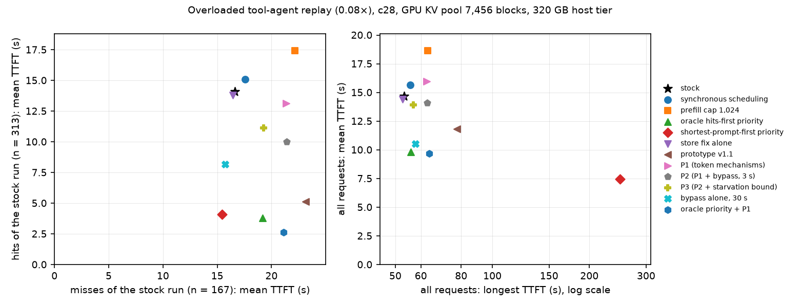

*Figure 7 — every server configuration of the overloaded replay on c28 as one point. Left: mean TTFT of the stock run's misses
(x) against mean TTFT of its hits (y); towards the lower left both classes are served sooner. Right: the longest TTFT of the run
(x, log scale) against the mean TTFT of all requests (y); towards the lower left the mean is low and nobody waits long.*

- **Repeatability.** The second stock run and the second P2 run reproduce the first within 0.5 % on the all-request means,
  within 0.1 s on p50 / p95 / p99 and within 3 % on the class means.
- **Existing options that do not reorder.** Synchronous scheduling: mean TTFT +7 %. Prefill cap 1,024: +27 %, 74 preemptions
  against 5.
- **The token mechanisms alone (P1) are worse than stock:** mean TTFT +9 %, mean request time +9 %, misses +28 %, 104 requests
  above 30 s against 74. The admission delay of the hits falls by 12 % only (18.95 → 16.60 s).
- **Token mechanisms with a 3 s bypass (P2):** the hits gain what the misses lose — host-dominant hits −43 %, misses +29 %,
  mean TTFT −4 %, mean request time +2 %, p95 44.1 s against 40.8 s, three requests above 60 s (none in stock). With the
  starvation bound (P3) the tail is back near stock and so is most of the gain (mean TTFT −5 %, misses +16 %).
- **The bypass alone with a 30 s bound: mean TTFT −28 % (14.67 → 10.52 s), mean request time −15 % (27.6 → 23.6 s), p95 −28 %
  (40.8 → 29.4 s), and no class is slower on average** — host-dominant hits −52 %, GPU-prefix hits −33 %, misses −6 %. 27
  requests above 30 s instead of 74. The price is at the far end: p99 48.7 s against 47.4 s, longest TTFT 57.6 s against
  53.2 s, p95 of the prompts of 8,192 tokens or more 47.0 s against 43.3 s (their median falls from 14.9 to 13.9 s); 10
  preemptions against 5.
- **Ordering with vLLM's own priority scheduling.** *Oracle hits-first:* mean TTFT −33 %, mean request time −16 %,
  host-dominant hits −74 %, misses +15 %, p99 53.6 s, long prompts' p95 51.3 s. *Shortest-prompt-first:* **mean TTFT −49 %
  (14.67 → 7.45 s), mean request time −21 % (27.6 → 21.8 s), p95 25.4 s — the lowest means of any configuration, with no
  class slower on average** (host-dominant hits −73 %, GPU-prefix hits −70 %, misses −7 %) and 53 % of the requests more than
  10 % sooner than in stock. The cost is concentrated in a handful of requests: seven wait more than 60 s (none in stock),
  p99 65.1 s, longest TTFT 248.6 s.
- **Oracle priority with the token mechanisms on top** gains nothing over priority alone in the mean (−34 % against −33 %):
  the median falls further (2.79 against 4.65 s) and the misses lose more (+27 % against +15 %).
- **Store fix alone** (stock scheduling): 108.9 GB reach the host tier instead of 73.8 GB, the share of prompt tokens served
  from it rises from 0.114 to 0.126, mean TTFT −2 %, no class loses. Every prototype configuration includes it.
- **No configuration changes what the engine gets done:** 2,260–2,330 prompt tokens computed and 86–88 output tokens emitted
  per second, GPU busy 0.87–0.88 (prefill cap 0.90), in every row.

**Result 2 — the bound of the bypass** (node c60, same replay, pool pinned at 7,456 blocks, 150 GB host tier — nothing is
evicted, as on c28 — and its own stock run, which reproduces c28's within 1 %; `E16/X08/tables-primary-x08-c60.md`,
`tables-tails-x08-c60.md`).

| configuration | host-dominant hits (n = 106): TTFT p50 / mean (s) | GPU-prefix hits (n = 207): TTFT p50 / mean (s) | all requests: TTFT p50 / p95 / mean (s) | misses (n = 167): TTFT p50 / mean (s) | requests / s; output tokens / s | request time mean / p95 (s) | admission delay, mean (s): hits / misses | pool in use; time with < 25 % free; refused attempts | GPU busy: steps / NVML |
|---|---|---|---|---|---|---|---|---|---|
| stock (c60) | 19.39 / 19.79 | 6.37 / 11.27 | 12.46 / 40.9 / 14.75 | 13.75 / 16.71 | 0.425; 87.6 | 27.7 / 70.4 | 19.08 / 12.36 | 0.61; 0.52; 6581 | 0.87 / 0.87 |
| shortest-prompt-first with aging; 3 ms per token | 4.34 / 5.67 (-71 %) | 1.54 / 3.02 (-73 %) | 3.53 / 31.4 / 7.37 (-50 %) | 8.88 / 15.35 (-8 %) | 0.422; 87.1 | 21.1 (-24 %) / 65.9 | 4.85 / 11.01 | 0.62; 0.53; 6911 | 0.88 / 0.88 |
| bypass alone; 3 s | 14.74 / 15.85 (-20 %) | 5.45 / 10.19 (-10 %) | 9.78 / 40.1 / 13.25 (-10 %) | 12.62 / 16.43 (-2 %) | 0.428; 88.3 | 26.0 (-6 %) / 68.5 | 15.14 / 12.16 | 0.60; 0.50; 5698 | 0.87 / 0.87 |
| bypass alone; 10 s | 10.82 / 11.44 (-42 %) | 4.18 / 8.35 (-26 %) | 7.70 / 35.9 / 11.40 (-23 %) | 12.51 / 15.85 (-5 %) | 0.429; 88.5 | 24.2 (-13 %) / 66.7 | 10.74 / 11.57 | 0.60; 0.51; 3416 | 0.87 / 0.87 |
| bypass alone; 30 s | 8.16 / 9.41 (-52 %) | 4.72 / 7.63 (-32 %) | 7.22 / 30.1 / 10.60 (-28 %) | 12.38 / 15.91 (-5 %) | 0.428; 88.3 | 23.7 (-15 %) / 69.0 | 8.79 / 11.64 | 0.61; 0.52; 1700 | 0.87 / 0.87 |
| bypass alone; 100 s | 6.77 / 7.34 (-63 %) | 3.83 / 5.49 (-51 %) | 5.70 / 32.3 / 9.02 (-39 %) | 12.51 / 15.97 (-4 %) | 0.428; 88.2 | 22.1 (-20 %) / 67.1 | 6.71 / 11.69 | 0.61; 0.52; 549 | 0.87 / 0.87 |
| bypass alone; 30 s; no block reservation | 7.50 / 9.00 (-55 %) | 3.19 / 6.60 (-41 %) | 6.03 / 31.8 / 9.85 (-33 %) | 12.02 / 15.68 (-6 %) | 0.429; 88.4 | 22.8 (-18 %) / 68.0 | 8.37 / 11.34 | 0.61; 0.51; 1927 | 0.87 / 0.87 |
| P2 (token rules + bypass; 3 s) | 7.31 / 12.78 (-35 %) | 1.91 / 9.47 (-16 %) | 8.54 / 44.8 / 14.44 (-2 %) | 17.36 / 21.43 (+28 %) | 0.422; 87.1 | 28.5 (+3 %) / 79.2 | 11.92 / 16.72 | 0.64; 0.55; 7422 | 0.88 / 0.88 |
| token rules + bypass; 10 s | 4.01 / 11.01 (-44 %) | 1.63 / 8.77 (-22 %) | 6.19 / 43.9 / 13.63 (-8 %) | 17.15 / 21.36 (+28 %) | 0.422; 87.1 | 27.7 (-0 %) / 80.7 | 10.23 / 16.64 | 0.63; 0.55; 6990 | 0.88 / 0.88 |
| P4 (token rules + bypass; 30 s) | 2.30 / 6.51 (-67 %) | 1.36 / 5.38 (-52 %) | 3.79 / 39.9 / 10.55 (-28 %) | 15.73 / 19.37 (+16 %) | 0.423; 87.3 | 24.8 (-10 %) / 76.0 | 5.78 / 14.71 | 0.64; 0.56; 2856 | 0.88 / 0.88 |
| P4; second run | 2.27 / 6.35 (-68 %) | 1.41 / 5.35 (-53 %) | 3.70 / 40.0 / 10.53 (-29 %) | 15.72 / 19.42 (+16 %) | 0.423; 87.3 | 24.8 (-10 %) / 76.2 | 5.61 / 14.75 | 0.64; 0.56; 2846 | 0.88 / 0.88 |
| token rules + bypass; 100 s | 2.12 / 3.73 (-81 %) | 1.34 / 2.83 (-75 %) | 2.91 / 30.6 / 8.07 (-45 %) | 13.85 / 18.21 (+9 %) | 0.424; 87.5 | 22.1 (-20 %) / 71.9 | 3.00 / 13.61 | 0.63; 0.54; 444 | 0.88 / 0.88 |

| configuration | TTFT p99 / longest (s) | requests with TTFT > 30 s / > 60 s | requests faster / slower than in stock by > 10 % | prompts < 2,048 tokens (n = 60): TTFT p50 / p95 (s) | prompts ≥ 8,192 tokens (n = 144): TTFT p50 / p95 (s) | preemptions | prompt tokens computed / s | cached share: host tier / GPU prefix | GB stored |
|---|---|---|---|---|---|---|---|---|---|
| stock (c60) | 47.6 / 53.3 | 75 / 0 | – | 10.96 / 40.8 | 14.94 / 43.4 | 5 | 2320 | 0.116 / 0.239 | 73.6 |
| shortest-prompt-first with aging; 3 ms per token | 58.6 / 95.9 | 30 / 4 | 52 % / 15 % | 1.57 / 8.1 | 11.39 / 58.3 | 7 | 2323 | 0.102 / 0.248 | 72.4 |
| bypass alone; 3 s | 48.9 / 56.2 | 59 / 0 | 19 % / 12 % | 7.04 / 35.9 | 14.73 / 44.2 | 6 | 2294 | 0.126 / 0.241 | 109.0 |
| bypass alone; 10 s | 45.0 / 53.6 | 38 / 0 | 30 % / 10 % | 4.70 / 37.6 | 14.93 / 43.3 | 5 | 2297 | 0.119 / 0.249 | 109.0 |
| bypass alone; 30 s | 48.7 / 57.8 | 29 / 0 | 35 % / 13 % | 4.39 / 27.8 | 13.99 / 47.2 | 9 | 2292 | 0.137 / 0.231 | 108.9 |
| bypass alone; 100 s | 56.5 / 75.2 | 28 / 3 | 42 % / 12 % | 3.00 / 17.6 | 13.62 / 49.9 | 5 | 2291 | 0.136 / 0.232 | 108.9 |
| bypass alone; 30 s; no block reservation | 50.3 / 58.2 | 33 / 0 | 37 % / 13 % | 3.00 / 21.7 | 14.30 / 46.6 | 12 | 2296 | 0.116 / 0.252 | 108.7 |
| P2 (token rules + bypass; 3 s) | 54.3 / 63.1 | 88 / 3 | 31 % / 43 % | 1.58 / 49.8 | 18.22 / 52.9 | 6 | 2262 | 0.141 / 0.226 | 108.9 |
| token rules + bypass; 10 s | 53.3 / 64.1 | 84 / 3 | 35 % / 40 % | 1.51 / 50.3 | 18.24 / 52.9 | 10 | 2262 | 0.128 / 0.240 | 108.8 |
| P4 (token rules + bypass; 30 s) | 56.6 / 60.9 | 44 / 2 | 44 % / 31 % | 1.16 / 46.6 | 16.88 / 52.2 | 10 | 2266 | 0.128 / 0.240 | 108.6 |
| P4; second run | 56.7 / 61.0 | 44 / 2 | 43 % / 31 % | 1.17 / 46.7 | 16.96 / 52.0 | 10 | 2267 | 0.127 / 0.241 | 108.6 |
| token rules + bypass; 100 s | 55.4 / 109.5 | 31 / 4 | 53 % / 26 % | 1.40 / 13.0 | 15.00 / 54.6 | 8 | 2272 | 0.107 / 0.261 | 108.8 |

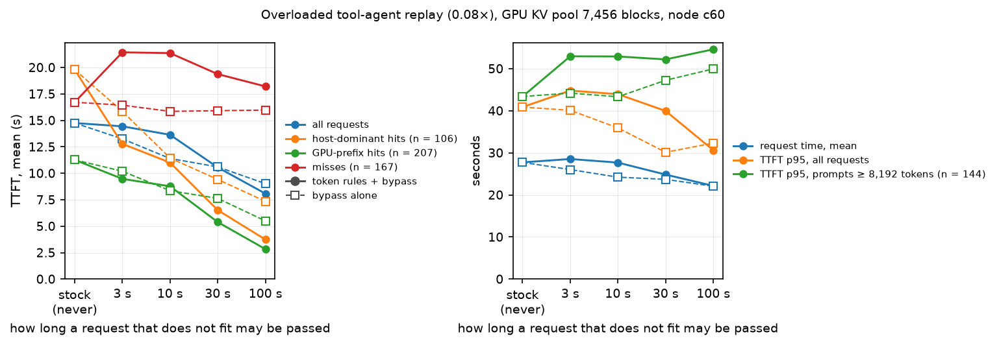

*Figure 8 — the bound of the bypass on the overloaded replay (node c60). x: how long a request that does not fit may be passed
by requests that fit (stock: never). Left: mean TTFT of all requests and of the stock run's classes. Right: mean request time,
TTFT p95 of all requests, TTFT p95 of the prompts of 8,192 tokens or more. Solid: token mechanisms plus bypass; dashed, hollow
markers: the bypass alone.*

- **With the token mechanisms, the mean falls with the bound and the tail grows.** Mean TTFT −2 % (3 s), −8 % (10 s), −28 %
  (30 s; a second run −29 %), −45 % (100 s — longer than any TTFT of the stock run, so effectively no bound); mean request
  time +3 %, 0 %, −10 %, −20 %; misses +28 %, +28 %, +16 %, +9 %. Longest TTFT 53.3 s in stock, then 63.1, 64.1, 60.9 and
  109.5 s; requests above 60 s: none, then 3, 3, 2, 4. Refused admission attempts: 6,581 in stock, 7,422, 6,990, 2,856, 444.
- **The bypass alone at 30 s reaches the same mean as with the token mechanisms (−28 %) without their cost:** mean request
  time −15 % against −10 %, misses −5 % against +16 %, p95 30.1 s against 39.9 s, no request above 60 s against two, 1,700 refused
  attempts. This is the c28 result of Result 1 measured again on another node (10.60 s against 10.52 s).
- **The bypass alone over the same bounds:** mean TTFT −10 % (3 s), −23 % (10 s), −28 % (30 s), −39 % (100 s); mean request
  time −6 %, −13 %, −15 %, −20 %; and the misses are 2–5 % *faster* at every bound, where they are 9–28 % slower with the
  token mechanisms. Up to 10 s nothing measurable is paid: longest TTFT 53.6 s against 53.3 s, p99 45.0 s against 47.6 s, the
  p95 of the largest prompts unchanged (43.3 s against 43.4 s). At 30 s the largest prompts' p95 is 47.2 s and the longest
  TTFT 57.8 s; at 100 s 49.9 s and 75.2 s, with three requests above 60 s.
- **Without the block reservation for passed hits** (bypass alone, 30 s, `hitres` off): mean TTFT −33 % instead of −28 %,
  mean request time −18 % instead of −15 %, host-dominant hits −55 % instead of −52 %; p95 31.8 s against 30.1 s, p99 50.3 s
  against 48.7 s, 12 preemptions against 9. In the replay the reservation — active 16 % of the time, 81 blocks on average —
  costs more than it protects.

**Result 3 — other variants one flag apart, and the ordering baselines** (node c61, same set-up, its own stock run;
`E16/X08/tables-primary-x08-c61.md`, `tables-tails-x08-c61.md`).

| configuration | host-dominant hits (n = 101): TTFT p50 / mean (s) | GPU-prefix hits (n = 212): TTFT p50 / mean (s) | all requests: TTFT p50 / p95 / mean (s) | misses (n = 167): TTFT p50 / mean (s) | requests / s; output tokens / s | request time mean / p95 (s) | admission delay, mean (s): hits / misses | pool in use; time with < 25 % free; refused attempts | GPU busy: steps / NVML |
|---|---|---|---|---|---|---|---|---|---|
| stock (c61) | 18.72 / 19.46 | 6.20 / 10.72 | 11.50 / 40.6 / 14.15 | 12.79 / 16.13 | 0.426; 87.8 | 26.8 / 68.5 | 18.74 / 11.83 | 0.60; 0.50; 6341 | 0.87 / 0.87 |
| shortest-prompt-first priority | 4.33 / 5.23 (-73 %) | 1.96 / 3.27 (-69 %) | 3.65 / 23.3 / 7.15 (-49 %) | 8.64 / 14.81 (-8 %) | 0.424; 87.4 | 21.5 (-20 %) / 64.3 | 4.38 / 10.50 | 0.64; 0.53; 7556 | 0.89 / 0.89 |
| oracle shortest-compute-first priority | 4.05 / 5.00 (-74 %) | 1.46 / 2.56 (-76 %) | 3.43 / 23.9 / 6.83 (-52 %) | 9.36 / 14.69 (-9 %) | 0.424; 87.6 | 20.5 (-24 %) / 63.7 | 4.17 / 10.38 | 0.62; 0.52; 6829 | 0.88 / 0.87 |
| shortest-prompt-first with aging; 1 ms per token | 11.16 / 10.64 (-45 %) | 3.22 / 6.61 (-38 %) | 6.58 / 28.2 / 9.85 (-30 %) | 11.52 / 14.67 (-9 %) | 0.425; 87.7 | 23.0 (-14 %) / 64.7 | 9.81 / 10.38 | 0.61; 0.51; 6267 | 0.87 / 0.87 |
| bypass alone; 3 s | 11.70 / 14.71 (-24 %) | 5.25 / 9.49 (-11 %) | 8.00 / 39.5 / 12.42 (-12 %) | 12.36 / 15.89 (-1 %) | 0.429; 88.5 | 25.1 (-6 %) / 67.6 | 14.01 / 11.67 | 0.60; 0.49; 5271 | 0.86 / 0.86 |
| v1.2 (P1 without blkfirst) | 5.11 / 9.15 (-53 %) | 1.99 / 6.08 (-43 %) | 6.18 / 43.9 / 11.97 (-15 %) | 16.52 / 20.81 (+29 %) | 0.423; 87.4 | 25.6 (-4 %) / 77.8 | 8.33 / 16.13 | 0.63; 0.54; 7162 | 0.88 / 0.88 |
| P1 + starvation bound 20 s | 14.57 / 16.16 (-17 %) | 3.43 / 9.89 (-8 %) | 11.05 / 41.0 / 14.09 (-0 %) | 15.71 / 18.55 (+15 %) | 0.425; 87.7 | 28.0 (+4 %) / 72.4 | 15.37 / 14.01 | 0.63; 0.56; 7537 | 0.88 / 0.88 |
| P2 + synchronous scheduling | 8.50 / 13.68 (-30 %) | 2.67 / 9.83 (-8 %) | 9.52 / 51.1 / 15.72 (+11 %) | 19.35 / 23.88 (+48 %) | 0.418; 86.3 | 30.7 (+15 %) / 87.3 | 12.93 / 19.22 | 0.65; 0.58; 7701 | 0.88 / 0.87 |

| configuration | TTFT p99 / longest (s) | requests with TTFT > 30 s / > 60 s | requests faster / slower than in stock by > 10 % | prompts < 2,048 tokens (n = 60): TTFT p50 / p95 (s) | prompts ≥ 8,192 tokens (n = 144): TTFT p50 / p95 (s) | preemptions | prompt tokens computed / s | cached share: host tier / GPU prefix | GB stored |
|---|---|---|---|---|---|---|---|---|---|
| stock (c61) | 45.6 / 51.9 | 70 / 0 | – | 10.84 / 40.4 | 14.23 / 42.6 | 5 | 2326 | 0.111 / 0.244 | 75.1 |
| shortest-prompt-first priority | 65.0 / 259.3 | 19 / 6 | 54 % / 16 % | 1.56 / 14.4 | 10.66 / 40.0 | 6 | 2340 | 0.109 / 0.239 | 71.4 |
| oracle shortest-compute-first priority | 64.5 / 228.4 | 18 / 6 | 53 % / 12 % | 1.98 / 7.7 | 11.63 / 40.0 | 2 | 2337 | 0.099 / 0.251 | 71.0 |
| shortest-prompt-first with aging; 1 ms per token | 48.6 / 52.1 | 22 / 0 | 40 % / 12 % | 2.58 / 17.5 | 14.05 / 44.8 | 3 | 2339 | 0.095 / 0.256 | 73.0 |
| bypass alone; 3 s | 46.4 / 55.8 | 53 / 0 | 19 % / 10 % | 6.28 / 34.6 | 14.79 / 43.9 | 4 | 2299 | 0.133 / 0.235 | 109.0 |
| v1.2 (P1 without blkfirst) | 57.3 / 65.7 | 58 / 4 | 36 % / 40 % | 1.72 / 51.0 | 16.79 / 53.0 | 6 | 2268 | 0.138 / 0.230 | 108.9 |
| P1 + starvation bound 20 s | 50.5 / 55.4 | 82 / 0 | 22 % / 42 % | 3.15 / 39.0 | 17.33 / 44.3 | 6 | 2277 | 0.133 / 0.235 | 109.0 |
| P2 + synchronous scheduling | 66.0 / 76.8 | 90 / 6 | 26 % / 51 % | 1.23 / 59.4 | 20.18 / 57.5 | 14 | 2241 | 0.123 / 0.244 | 108.9 |

- **Shortest-prompt-first:** mean TTFT −49 % (14.15 → 7.15 s), mean request time −20 %, p95 23.3 s against 40.6 s;
  host-dominant hits −73 %, GPU-prefix hits −69 %, misses −8 %; 54 % of the requests more than 10 % sooner than in stock, 16 %
  later; even the prompts of 8,192 tokens or more gain at the median (14.2 → 10.7 s) and hold their p95 (42.6 → 40.0 s). The
  cost is concentrated: p99 65.0 s against 45.6 s, and the six requests above 60 s are the six largest prompts of the window
  (32k tokens), which wait 65 to 259 s where they waited 14 to 52 s. The queue is short (2.3 requests waiting on average
  against 5.3) because the head nearly always fits. Stock store path: 71.4 GB stored.
- **Shortest-prompt-first with aging** (priority = send time in ms + *a* × prompt tokens: a request can be overtaken only
  by shorter ones sent within *a* ms per token of difference after it; still computed by the client). With *a* = 1 ms per
  token — about 30 s for the largest prompts — **mean TTFT −30 % (9.85 s), mean request time −14 %, p95 28.2 s against
  40.6 s, misses −9 %, and the longest TTFT is that of stock (52.1 s against 51.9 s)**; no request above 60 s; 40 % of the
  requests more than 10 % sooner, 12 % later. With *a* = 3 ms per token (node c60, the table of Result 2): mean TTFT −50 %,
  mean request time −24 %, longest TTFT 95.9 s, four requests above 60 s. The aging term does for the priority order what
  the bound does for the bypass, and at an equal worst case the two give the same mean: −30 % and 52 s here, −28 % and 58 s
  for the bypass alone at 30 s.
- **Bypass alone, 3 s:** mean TTFT −12 %, mean request time −6 %, misses −1 %, 53 requests above 30 s instead of 70; nothing
  is worse than stock except the longest TTFT (55.8 s against 51.9 s).
- **v1.2** (P1 without `blkfirst`, i.e. with the unbounded passing that the early versions did by accident): −15 % in the
  mean, misses +29 %, four requests above 60 s. The accident was a bypass; it was removed for its lack of a bound and came
  back as a flag with one.
- **P1 with the starvation bound:** the bound neutralizes the damage of the token mechanisms (mean TTFT −0 % instead of +9 %
  on c28) and that is all it does: mean request time +4 %, misses +15 %.
- **P2 with synchronous scheduling,** which gave the fastest hits in the controlled scenario (B2), is the worst prototype
  configuration under overload: mean TTFT +11 %, mean request time +15 %, misses +48 %, longest TTFT 76.8 s.
- **Oracle shortest-compute-first** (priority = the prompt tokens the stock run had to compute; the cache-aware counterpart
  of shortest-prompt-first): mean TTFT −52 % (6.83 s), mean request time −24 %, misses −9 %, longest TTFT 228 s. Knowing
  exactly what is cached improves the ordering by 3 points of mean TTFT and 4 of mean request time over the prompt length,
  and the same six requests starve.

**Explanation.** Under overload a request waits in two queues, one after the other, and stock serves both first-come-first-
served. The first is the token budget (54 % of the hits' waiting time in stock); the second is the block gate, where a request
that does not fit stops the scan for everybody behind it (32 %). The token mechanisms reorder the first queue only: the hits
get through it and then stand in the second (with P1 head-of-line blocking is 68 % of a wait that is as long as before), while
the reserve has slowed the prefills down — hence P1 is worse than stock. The bypass reorders the second queue, and what it lets
pass are the requests that fit: those that need few new blocks, which are the short prompts and the requests whose prefix is
still in the GPU pool (a request served from the host tier needs the blocks of its whole sequence, like a miss of its
length, and passes when that much is free). It is a smallest-first rule with a time limit, and the mean falls as it does under any such rule: more with a
longer limit, and at the expense of the largest requests' tail. Shortest-prompt-first is the same idea stated openly and
without a limit: the shortest request is always at the head, so the head nearly always fits, and the largest prompts wait
until nothing shorter is left; an aging term in the priority gives it a limit as well. No configuration computes more tokens per second than stock; every gain in this section is a
gain of order. What separates the bypass alone from the other reorderings is whom it takes from: with stock token rules
nothing is taken from a prefill in progress, and a miss that fits passes like a hit, so the class of the misses does not lose
— the requests that pay are the few that are passed, the largest ones, and the bound limits what they pay. The queue is shorter
for it (waiting requests, time-weighted mean: 5.5 → 3.8); the makespan is the store fix's (1,271 s against 1,280 s), not
shorter.

#### C2.3 Conversation trace (overload: c28 `replay/conv08-320-*` and node c60 `E16/X08/x08c-conv-*`; sustainable load: c28 `replay/conv04-320-*`; MEASURED 2026-11-10 18:10 – 2026-11-11 08:53)
**Why.** A second trace with a different shape: longer prompts and far less reuse. In the overloaded window 13 % of the
requests are hits (11 host-dominant, 28 GPU-prefix of 291; 186 misses) against 58 % in the tool-agent trace; 7.5 % of the prompt
tokens come from a cache. If the mechanisms only help where most requests are cheap, this trace shows it.

**Result 1 — overload (0.08×, 291 requests, GPU busy 88 %).** c28, 320 GB host tier (`replay/tables-primary-conv08-320.md`):

| configuration | host-dominant hits (n = 11): TTFT p50 / mean (s) | GPU-prefix hits (n = 28): TTFT p50 / mean (s) | all requests: TTFT p50 / p95 / mean (s) | misses (n = 186): TTFT p50 / mean (s) | requests / s; output tokens / s | request time mean / p95 (s) | admission delay, mean (s): hits / misses | pool in use; time with < 25 % free; refused attempts | GPU busy: steps / NVML |
|---|---|---|---|---|---|---|---|---|---|
| stock | 25.23 / 19.34 | 12.88 / 15.33 | 14.43 / 41.8 / 16.89 | 15.33 / 18.10 | 0.225; 83.6 | 39.9 / 83.4 | 18.77 / 13.75 | 0.61; 0.51; 6363 | 0.88 / 0.88 |
| P2 | 4.78 / 9.80 (-49 %) | 1.42 / 7.63 (-50 %) | 13.34 / 51.8 / 17.90 (+6 %) | 16.20 / 20.76 (+15 %) | 0.225; 83.5 | 42.4 (+6 %) / 91.3 | 8.83 / 16.24 | 0.63; 0.55; 6922 | 0.88 / 0.88 |

Node c60, 150 GB host tier, its own stock run (within 0.5 % of c28's) (`E16/X08/tables-primary-x08c-conv.md`, `tables-tails-x08c-conv.md`):

| configuration | host-dominant hits (n = 11): TTFT p50 / mean (s) | GPU-prefix hits (n = 28): TTFT p50 / mean (s) | all requests: TTFT p50 / p95 / mean (s) | misses (n = 186): TTFT p50 / mean (s) | requests / s; output tokens / s | request time mean / p95 (s) | admission delay, mean (s): hits / misses | pool in use; time with < 25 % free; refused attempts | GPU busy: steps / NVML |
|---|---|---|---|---|---|---|---|---|---|
| stock (c60) | 25.45 / 19.47 | 12.90 / 15.40 | 14.46 / 41.9 / 16.96 | 15.35 / 18.18 | 0.225; 83.6 | 40.0 / 83.5 | 18.78 / 13.83 | 0.61; 0.51; 6376 | 0.88 / 0.87 |
| shortest-prompt-first priority | 5.49 / 5.38 (-72 %) | 2.22 / 3.62 (-77 %) | 5.82 / 34.9 / 11.60 (-32 %) | 9.30 / 16.00 (-12 %) | 0.222; 82.4 | 36.8 (-8 %) / 79.9 | 4.26 / 11.65 | 0.62; 0.52; 7032 | 0.89 / 0.88 |
| bypass alone; 30 s | 9.46 / 11.53 (-41 %) | 5.88 / 6.47 (-58 %) | 10.20 / 42.9 / 13.26 (-22 %) | 12.67 / 16.64 (-8 %) | 0.227; 84.3 | 36.4 (-9 %) / 79.6 | 10.93 / 12.33 | 0.61; 0.51; 1581 | 0.87 / 0.87 |
| P2 | 4.86 / 8.67 (-55 %) | 1.47 / 8.34 (-46 %) | 13.42 / 52.0 / 17.98 (+6 %) | 16.31 / 20.83 (+15 %) | 0.225; 83.5 | 42.4 (+6 %) / 91.6 | 7.72 / 16.30 | 0.63; 0.55; 6882 | 0.88 / 0.88 |
| P4 | 2.91 / 4.83 (-75 %) | 1.31 / 5.22 (-66 %) | 10.82 / 52.0 / 15.83 (-7 %) | 14.32 / 19.49 (+7 %) | 0.225; 83.5 | 40.7 (+2 %) / 91.2 | 3.93 / 14.97 | 0.63; 0.55; 3507 | 0.88 / 0.88 |

| configuration | TTFT p99 / longest (s) | requests with TTFT > 30 s / > 60 s | requests faster / slower than in stock by > 10 % | prompts < 2,048 tokens (n = 62): TTFT p50 / p95 (s) | prompts ≥ 8,192 tokens (n = 153): TTFT p50 / p95 (s) | preemptions | prompt tokens computed / s | cached share: host tier / GPU prefix | GB stored |
|---|---|---|---|---|---|---|---|---|---|
| stock (c60) | 52.3 / 54.5 | 59 / 0 | – | 11.70 / 40.5 | 15.76 / 44.2 | 5 | 2392 | 0.031 / 0.044 | 76.6 |
| shortest-prompt-first priority | 146.7 / 314.8 | 21 / 7 | 48 % / 14 % | 1.98 / 8.9 | 10.77 / 56.9 | 5 | 2365 | 0.028 / 0.044 | 73.2 |
| bypass alone; 30 s | 55.8 / 60.8 | 34 / 1 | 29 % / 10 % | 3.25 / 18.7 | 13.79 / 49.4 | 6 | 2368 | 0.048 / 0.044 | 114.1 |
| P2 | 62.5 / 67.2 | 69 / 7 | 13 % / 44 % | 1.76 / 52.6 | 16.33 / 52.6 | 8 | 2345 | 0.048 / 0.044 | 114.2 |
| P4 | 63.3 / 64.8 | 49 / 5 | 26 % / 38 % | 1.50 / 52.5 | 15.35 / 53.5 | 11 | 2344 | 0.048 / 0.044 | 114.1 |

- **Token mechanisms with the 3 s bypass (P2), on both nodes:** the 39 hits are served 46–55 % sooner on average, everything
  else later: mean TTFT +6 %, p95 +24 %, mean request time +6 %, misses +15 %, seven requests above 60 s (none in stock).
- **With the 30 s bound (P4):** mean TTFT −7 %, mean request time +2 %, misses +7 %; the tail stays where P2 put it (p95
  52.0 s, five requests above 60 s).
- **The bypass alone, 30 s:** mean TTFT −22 % (16.96 → 13.26 s), mean request time −9 %, and no class slower on average
  (host-dominant hits −41 %, GPU-prefix hits −58 %, misses −8 %); 34 requests above 30 s instead of 59; p95 42.9 s against
  41.9 s, longest TTFT 60.8 s against 54.5 s.
- **Shortest-prompt-first:** mean TTFT −32 % (11.60 s), mean request time −8 %, misses −12 %, p95 34.9 s — and a p99 of
  147 s with a longest TTFT of 315 s (seven requests above 60 s).

**Result 2 — sustainable load (0.04×, 599 requests, GPU busy 49 %; c28, 320 GB host tier)** (`replay/tables-primary-conv04-320.md`,
`tables-tails-conv04-320.md`). The stock run has the same anatomy as the tool-agent trace at this load: 57–63 % of the waiting
time of every class is token budget, 14–28 % head-of-line blocking, the pool is 26 % in use on average and 20.5 % of the run is
spent in steps with the budget exhausted (`replay/tables-adm-conv04-320-base.md`).

| configuration | host-dominant hits (n = 65): TTFT p50 / mean (s) | GPU-prefix hits (n = 54): TTFT p50 / mean (s) | all requests: TTFT p50 / p95 / mean (s) | misses (n = 339): TTFT p50 / mean (s) | requests / s; output tokens / s | request time mean / p95 (s) | admission delay, mean (s): hits / misses | pool in use; time with < 25 % free; refused attempts | GPU busy: steps / NVML |
|---|---|---|---|---|---|---|---|---|---|
| stock | 0.79 / 5.45 | 0.16 / 4.75 | 3.46 / 27.0 / 6.32 | 5.15 / 7.52 | 0.120; 42.2 | 18.6 / 45.1 | 4.82 / 3.53 | 0.26; 0.10; 4966 | 0.49 / 0.49 |
| shortest-prompt-first priority | 0.81 / 5.03 (-8 %) | 0.16 / 1.84 (-61 %) | 3.09 / 17.4 / 5.34 (-15 %) | 4.84 / 7.01 (-7 %) | 0.120; 42.2 | 18.4 (-1 %) / 45.7 | 4.23 / 3.02 | 0.27; 0.10; 4400 | 0.50 / 0.50 |
| P4 | 0.71 / 1.90 (-65 %) | 0.17 / 0.81 (-83 %) | 2.44 / 16.8 / 5.00 (-21 %) | 4.96 / 7.37 (-2 %) | 0.120; 42.2 | 17.9 (-4 %) / 44.3 | 1.15 / 3.25 | 0.26; 0.10; 747 | 0.49 / 0.49 |

| configuration | TTFT p99 / longest (s) | requests with TTFT > 30 s / > 60 s | requests faster / slower than in stock by > 10 % | prompts < 2,048 tokens (n = 121): TTFT p50 / p95 (s) | prompts ≥ 8,192 tokens (n = 321): TTFT p50 / p95 (s) | preemptions | prompt tokens computed / s | cached share: host tier / GPU prefix | GB stored |
|---|---|---|---|---|---|---|---|---|---|
| stock | 34.2 / 40.6 | 15 / 0 | – | 0.23 / 27.6 | 5.36 / 27.2 | 2 | 1155 | 0.120 / 0.044 | 198.4 |
| shortest-prompt-first priority | 36.3 / 45.0 | 12 / 0 | 12 % / 4 % | 0.23 / 8.4 | 5.42 / 24.8 | 3 | 1162 | 0.115 / 0.044 | 199.2 |
| P4 | 36.9 / 44.1 | 12 / 0 | 16 % / 9 % | 0.24 / 4.3 | 4.95 / 23.7 | 4 | 1131 | 0.137 / 0.044 | 212.2 |

- **P4 (token mechanisms with the 30 s bypass):** mean TTFT −21 % (6.32 → 5.00 s), median −30 % (3.46 → 2.44 s), p95 −38 %
  (27.0 → 16.8 s), mean request time −4 %; host-dominant hits −65 % (5.45 → 1.90 s), GPU-prefix hits −83 %, misses −2 %; p99
  36.9 s against 34.2 s, longest TTFT 44.1 s against 40.6 s; 16 % of the requests more than 10 % sooner than in stock, 9 %
  later.
- **Shortest-prompt-first:** mean TTFT −15 % (5.34 s), median −11 %, p95 −36 %, mean request time −1 %; host-dominant hits
  −8 %, GPU-prefix hits −61 %, misses −7 %; p99 36.3 s, longest TTFT 45.0 s.
- At this load the prototype is ahead of the ordering baseline on the conversation trace as well (−21 % against −15 % in
  mean TTFT, as −33 % against −28 % on the tool-agent trace, C2.4): a host-dominant hit here is a long prompt (9.9k tokens
  at the median, against 0.9k for the GPU-prefix hits), which shortest-prompt-first does not move forward, and the token
  reserve serves it during the prefill it arrived behind.

**Explanation.** Under overload, with few cheap requests, the token mechanisms have little to give and the same price to
charge: every hit served during a prefill delays a miss, and here there are five misses for every hit. At the sustainable load
that debt is absorbed between bursts, as on the tool-agent trace, and the misses do not pay (−2 %). The two mechanisms that do not single out hits —
the bypass at the block gate and ordering by length — work on this trace as on the other, because what they exploit is the
spread of request sizes, not the cache: under overload the bypass alone is the only prototype configuration that improves both means of the
conversation trace, and shortest-prompt-first again has the lowest mean and the longest tail.

#### C2.4 Capacity sensitivity: the sustainable load with an 80 GB host tier (nodes c61 and c66, `E16/E/e-tool04-80-p7456-*`, `e66-tool04-80-p7456-*`; MEASURED 2026-11-10 19:45 – 2026-11-11 10:41)
**Why.** The brief asks for one configuration with a smaller host tier, to see whether the importance of the problem and the
effect of the remedies depend on host capacity. The 16 GB nodes cannot hold 320 GB, so this is also where the configurations
that were added on 2026-11-11 were measured at the sustainable load.

**How.** The tool-agent replay of C2.1 (seconds 0–200 at 0.04×, 1,159 requests) with the pool pinned at 7,456 blocks and an
80 GB host tier, which fills at 68.7 GB and evicts (14,500–17,500 chunks per run). Two nodes of the same type, each with its own
stock run; the two stock runs agree within 1 % in every quantity, and the one on c61 reproduces c28's own 80 GB replay of
2026-11-05 (C3, Result 1).

Node c61 (`E16/E/tables-primary-e-tool04-80-p7456.md`, `tables-tails-e-tool04-80-p7456.md`):

| configuration | host-dominant hits (n = 112): TTFT p50 / mean (s) | GPU-prefix hits (n = 577): TTFT p50 / mean (s) | all requests: TTFT p50 / p95 / mean (s) | misses (n = 339): TTFT p50 / mean (s) | requests / s; output tokens / s | request time mean / p95 (s) | admission delay, mean (s): hits / misses | pool in use; time with < 25 % free; refused attempts | GPU busy: steps / NVML |
|---|---|---|---|---|---|---|---|---|---|
| stock (c61) | 6.60 / 10.50 | 0.32 / 2.89 | 2.03 / 22.5 / 5.41 | 5.49 / 8.12 | 0.233; 44.0 | 12.2 / 41.1 | 9.94 / 4.06 | 0.27; 0.10; 5047 | 0.50 / 0.50 |
| oracle hits-first priority | 2.94 / 4.89 (-53 %) | 0.32 / 1.88 (-35 %) | 1.91 / 16.8 / 4.37 (-19 %) | 5.49 / 8.25 (+2 %) | 0.233; 44.0 | 11.4 (-7 %) / 40.6 | 4.22 / 4.19 | 0.27; 0.10; 4454 | 0.50 / 0.50 |
| shortest-prompt-first priority | 3.18 / 5.38 (-49 %) | 0.32 / 1.84 (-36 %) | 1.89 / 13.8 / 3.91 (-28 %) | 5.21 / 7.49 (-8 %) | 0.233; 44.0 | 11.3 (-7 %) / 40.7 | 4.69 / 3.40 | 0.27; 0.10; 4204 | 0.50 / 0.50 |
| shortest-prompt-first + P1 | 1.64 / 2.19 (-79 %) | 0.35 / 0.99 (-66 %) | 1.37 / 12.0 / 3.21 (-41 %) | 5.13 / 7.78 (-4 %) | 0.233; 44.0 | 11.0 (-10 %) / 41.1 | 1.51 / 3.51 | 0.27; 0.10; 4285 | 0.51 / 0.51 |
| P1 | 1.62 / 4.25 (-60 %) | 0.35 / 1.33 (-54 %) | 1.40 / 20.6 / 4.19 (-23 %) | 5.72 / 8.78 (+8 %) | 0.233; 44.0 | 11.5 (-6 %) / 41.6 | 3.55 / 4.47 | 0.27; 0.10; 4813 | 0.51 / 0.50 |
| P4 | 1.61 / 2.45 (-77 %) | 0.34 / 1.18 (-59 %) | 1.40 / 15.3 / 3.65 (-33 %) | 5.70 / 8.45 (+4 %) | 0.233; 44.0 | 11.1 (-9 %) / 41.2 | 1.73 / 4.17 | 0.27; 0.10; 1050 | 0.50 / 0.50 |

| configuration | TTFT p99 / longest (s) | requests with TTFT > 30 s / > 60 s | requests faster / slower than in stock by > 10 % | prompts < 2,048 tokens (n = 112): TTFT p50 / p95 (s) | prompts ≥ 8,192 tokens (n = 306): TTFT p50 / p95 (s) | preemptions | prompt tokens computed / s | cached share: host tier / GPU prefix | GB stored |
|---|---|---|---|---|---|---|---|---|---|
| stock (c61) | 34.7 / 52.0 | 26 / 0 | – | 0.90 / 27.7 | 6.06 / 28.3 | 1 | 1214 | 0.071 / 0.311 | 204.3 |
| oracle hits-first priority | 33.7 / 48.5 | 18 / 0 | 12 % / 1 % | 0.90 / 20.1 | 6.05 / 27.8 | 2 | 1214 | 0.063 / 0.319 | 205.5 |
| shortest-prompt-first priority | 31.2 / 48.2 | 13 / 0 | 17 % / 3 % | 0.89 / 9.3 | 6.03 / 27.9 | 3 | 1218 | 0.061 / 0.319 | 206.0 |
| shortest-prompt-first + P1 | 32.0 / 51.2 | 12 / 0 | 29 % / 12 % | 0.92 / 4.5 | 5.60 / 28.1 | 4 | 1212 | 0.055 / 0.328 | 225.5 |
| P1 | 35.2 / 51.7 | 22 / 0 | 21 % / 15 % | 1.00 / 9.8 | 5.74 / 29.9 | 3 | 1212 | 0.060 / 0.323 | 225.5 |
| P4 | 32.0 / 51.8 | 14 / 0 | 24 % / 14 % | 0.92 / 8.9 | 5.73 / 28.6 | 4 | 1209 | 0.056 / 0.329 | 224.9 |

Node c66 (`E16/E/tables-primary-e66-tool04-80-p7456.md`, `tables-tails-e66-tool04-80-p7456.md`):

| configuration | host-dominant hits (n = 111): TTFT p50 / mean (s) | GPU-prefix hits (n = 578): TTFT p50 / mean (s) | all requests: TTFT p50 / p95 / mean (s) | misses (n = 339): TTFT p50 / mean (s) | requests / s; output tokens / s | request time mean / p95 (s) | admission delay, mean (s): hits / misses | pool in use; time with < 25 % free; refused attempts | GPU busy: steps / NVML |
|---|---|---|---|---|---|---|---|---|---|
| stock (c66) | 6.57 / 10.51 | 0.32 / 2.86 | 2.01 / 22.3 / 5.37 | 5.45 / 8.06 | 0.233; 44.0 | 12.1 / 40.9 | 9.96 / 4.02 | 0.26; 0.10; 5029 | 0.50 / 0.50 |
| shortest-prompt-first priority | 3.11 / 5.37 (-49 %) | 0.32 / 1.82 (-36 %) | 1.85 / 13.5 / 3.88 (-28 %) | 5.17 / 7.44 (-8 %) | 0.233; 44.0 | 11.3 (-7 %) / 40.5 | 4.66 / 3.38 | 0.27; 0.10; 4203 | 0.50 / 0.50 |
| shortest-prompt-first + P1 | 1.68 / 2.12 (-80 %) | 0.34 / 0.98 (-66 %) | 1.38 / 11.8 / 3.19 (-41 %) | 5.11 / 7.75 (-4 %) | 0.233; 44.0 | 10.9 (-10 %) / 41.0 | 1.41 / 3.49 | 0.27; 0.10; 4284 | 0.51 / 0.51 |
| bypass alone; 30 s | 3.26 / 6.54 (-38 %) | 0.32 / 2.46 (-14 %) | 1.99 / 16.3 / 4.53 (-16 %) | 5.29 / 7.73 (-4 %) | 0.233; 44.0 | 11.5 (-5 %) / 40.4 | 5.84 / 3.74 | 0.26; 0.10; 311 | 0.50 / 0.50 |

| configuration | TTFT p99 / longest (s) | requests with TTFT > 30 s / > 60 s | requests faster / slower than in stock by > 10 % | prompts < 2,048 tokens (n = 112): TTFT p50 / p95 (s) | prompts ≥ 8,192 tokens (n = 306): TTFT p50 / p95 (s) | preemptions | prompt tokens computed / s | cached share: host tier / GPU prefix | GB stored |
|---|---|---|---|---|---|---|---|---|---|
| stock (c66) | 34.5 / 51.7 | 26 / 0 | – | 0.88 / 27.5 | 6.01 / 28.2 | 1 | 1214 | 0.071 / 0.311 | 204.3 |
| shortest-prompt-first priority | 31.0 / 48.0 | 13 / 0 | 17 % / 4 % | 0.87 / 9.2 | 5.97 / 27.8 | 3 | 1218 | 0.060 / 0.320 | 206.2 |
| shortest-prompt-first + P1 | 31.8 / 51.2 | 12 / 0 | 28 % / 12 % | 0.89 / 4.5 | 5.56 / 27.8 | 4 | 1212 | 0.054 / 0.329 | 225.5 |
| bypass alone; 30 s | 31.1 / 49.1 | 12 / 0 | 7 % / 2 % | 0.83 / 12.9 | 5.77 / 27.0 | 3 | 1210 | 0.066 / 0.318 | 225.1 |

- **The stock server has the same anatomy with less host memory, and fewer hits.** Mean TTFT 5.41 s against 4.93 s with
  320 GB (C2.1), median 2.03 s against 1.56 s; 112 host-dominant hits against 148, 339 misses against 301; the host-dominant
  hits wait 9.9 s for admission against 7.6 s.
- **Token mechanisms (P1, c61):** mean TTFT −23 % (5.41 → 4.19 s), host-dominant hits −60 %, misses +8 %, mean request time
  −6 % — the result of C2.1 (−24 to −26 %, −53 to −56 %, +6 %, −7 to −8 %) within a few points.
- **Bypass alone, 30 s (c66):** mean TTFT −16 % (5.37 → 4.53 s), p95 −27 %, p99 −10 %, mean request time −5 %, and no class
  slower on average (host-dominant hits −38 %, GPU-prefix hits −14 %, misses −4 %). Memory is short for a tenth of this run
  only; the bypass is worth a sixth of the mean TTFT all the same.
- **Both (P4, c61): mean TTFT −33 % (5.41 → 3.65 s), median −31 %, p95 −32 %, p99 −8 %, mean request time −9 %**;
  host-dominant hits −77 % (10.50 → 2.45 s), misses +4 %. The best prototype configuration at this load, and better than
  either mechanism alone.
- **Shortest-prompt-first (c66):** mean TTFT −28 % (5.37 → 3.88 s), p95 −40 %, p99 −10 %, mean request time −7 %, misses
  8 % *faster*; 17 % of the requests more than 10 % sooner than in stock, 4 % later; longest TTFT 48 s against 52 s.
  The same configuration on c61 gives the same result (−28 %, p95 −39 %, misses −8 %), so P4 and shortest-prompt-first can
  be compared on one node: 3.65 s against 3.91 s in mean TTFT, 15.3 s against 13.8 s at p95, misses +4 % against −8 %.
- **Oracle hits-first (c61):** mean TTFT −19 %, p95 −25 %, misses +2 %, mean request time −7 %.
- **Shortest-prompt-first with the token mechanisms on top (c66): mean TTFT −41 % (5.37 → 3.19 s), median −31 %, p95 −47 %
  (22.3 → 11.8 s), mean request time −10 %**; host-dominant hits −80 % (10.51 → 2.12 s), GPU-prefix hits −66 %, and the
  misses still 4 % faster than in stock; p99 31.8 s against 34.5 s, longest TTFT 51.2 s against 51.7 s. The best configuration
  measured at this load; a second measurement on c61 gives the same (−41 %, p95 −47 %, host-dominant hits −79 %, misses −4 %).
- **Reading.** At the sustainable load the full prototype (P4) and shortest-prompt-first are of the same order: P4 has the
  lower mean and median (−33 % and −31 % against −28 % and −8 %), shortest-prompt-first the lower p95, and it is the only
  single mechanism with which the misses gain. They are not alternatives: ordering decides who is first when the queue is
  scanned, and only the token reserve lets a cached request start while a prefill is running. Put together they reach −41 %,
  13 points more than the ordering alone, for 4 of the 8 points the misses had gained. No configuration changes the p99 by
  more than 10 %, the longest wait, or the throughput.

#### C2.5 An intermediate load (tool-agent trace, seconds 0–150 at 0.06×; node c73, 80 GB host tier, `E16/T06/`; MEASURED 2026-11-11 03:00 – 07:29)
**Why.** The two loads of the brief are far apart (GPU busy 49 % and 87 %), and the token mechanisms change sign between
them. One load in between shows where.

**How.** 853 requests in 2,500 s on a node of the same kind as the others (RTX 4060 Ti 16 GB, pool pinned at 7,456 blocks; this
node has 125 GiB of RAM, hence the 80 GB tier, which evicts in every run of the family alike). The stock server is busy 71 % of
the time; mean TTFT 9.93 s, p95 37.7 s, two requests above 60 s.

| configuration | host-dominant hits (n = 121): TTFT p50 / mean (s) | GPU-prefix hits (n = 374): TTFT p50 / mean (s) | all requests: TTFT p50 / p95 / mean (s) | misses (n = 262): TTFT p50 / mean (s) | requests / s; output tokens / s | request time mean / p95 (s) | admission delay, mean (s): hits / misses | pool in use; time with < 25 % free; refused attempts | GPU busy: steps / NVML |
|---|---|---|---|---|---|---|---|---|---|
| stock (c73) | 13.42 / 17.46 | 2.12 / 6.15 | 5.32 / 37.7 / 9.93 | 8.55 / 12.30 | 0.332; 64.7 | 19.3 / 57.9 | 16.79 / 7.95 | 0.40; 0.22; 5846 | 0.71 / 0.71 |
| oracle hits-first priority | 3.67 / 5.45 (-69 %) | 1.67 / 2.97 (-52 %) | 3.42 / 28.3 / 6.80 (-32 %) | 8.57 / 12.58 (+2 %) | 0.332; 64.8 | 16.5 (-15 %) / 53.4 | 4.67 / 8.22 | 0.41; 0.22; 5410 | 0.71 / 0.71 |
| shortest-prompt-first priority | 4.39 / 5.79 (-67 %) | 1.52 / 2.77 (-55 %) | 3.07 / 16.2 / 5.64 (-43 %) | 7.25 / 10.45 (-15 %) | 0.332; 64.8 | 15.8 (-18 %) / 46.1 | 4.99 / 6.12 | 0.41; 0.23; 5642 | 0.71 / 0.72 |
| bypass alone; 30 s | 9.60 / 9.01 (-48 %) | 2.11 / 4.57 (-26 %) | 4.83 / 22.5 / 7.45 (-25 %) | 8.55 / 11.59 (-6 %) | 0.332; 64.7 | 17.3 (-10 %) / 52.2 | 8.11 / 7.26 | 0.41; 0.23; 1224 | 0.71 / 0.72 |
| P2 | 2.22 / 8.72 (-50 %) | 1.12 / 3.13 (-49 %) | 1.99 / 33.5 / 7.67 (-23 %) | 9.54 / 13.67 (+11 %) | 0.331; 64.6 | 18.0 (-7 %) / 59.2 | 7.78 / 9.03 | 0.42; 0.22; 5824 | 0.72 / 0.73 |
| P4 | 2.20 / 5.59 (-68 %) | 1.15 / 2.79 (-55 %) | 1.90 / 30.5 / 6.74 (-32 %) | 9.47 / 13.28 (+8 %) | 0.331; 64.5 | 17.1 (-11 %) / 54.5 | 4.66 / 8.63 | 0.41; 0.22; 2158 | 0.72 / 0.72 |

| configuration | TTFT p99 / longest (s) | requests with TTFT > 30 s / > 60 s | requests faster / slower than in stock by > 10 % | prompts < 2,048 tokens (n = 86): TTFT p50 / p95 (s) | prompts ≥ 8,192 tokens (n = 236): TTFT p50 / p95 (s) | preemptions | prompt tokens computed / s | cached share: host tier / GPU prefix | GB stored |
|---|---|---|---|---|---|---|---|---|---|
| stock (c73) | 52.5 / 61.2 | 78 / 2 | – | 3.28 / 39.8 | 8.57 / 41.6 | 3 | 1837 | 0.096 / 0.264 | 148.3 |
| oracle hits-first priority | 46.0 / 65.7 | 40 / 1 | 20 % / 4 % | 2.24 / 14.5 | 8.39 / 39.7 | 3 | 1835 | 0.094 / 0.267 | 147.3 |
| shortest-prompt-first priority | 39.1 / 151.0 | 17 / 2 | 30 % / 7 % | 1.65 / 9.9 | 7.42 / 35.1 | 4 | 1828 | 0.096 / 0.268 | 148.9 |
| bypass alone; 30 s | 43.8 / 64.3 | 21 / 1 | 16 % / 7 % | 3.29 / 15.2 | 8.58 / 39.9 | 7 | 1851 | 0.083 / 0.273 | 177.6 |
| P2 | 54.5 / 62.7 | 61 / 3 | 30 % / 25 % | 1.22 / 23.7 | 9.48 / 45.4 | 7 | 1846 | 0.065 / 0.290 | 177.7 |
| P4 | 47.1 / 64.5 | 44 / 5 | 33 % / 25 % | 1.19 / 11.9 | 9.39 / 43.1 | 9 | 1844 | 0.057 / 0.298 | 177.3 |

- **Token mechanisms with the 3 s bypass (P2):** still a gain at this load — mean TTFT −23 %, mean request time −7 % — with
  the misses 11 % slower and one request more above 60 s (3 against 2).
- **Bypass alone, 30 s:** mean TTFT −25 % (9.93 → 7.45 s), mean request time −10 %, p95 −40 % (37.7 → 22.5 s), p99 −17 %, no
  class slower on average (host-dominant hits −48 %, GPU-prefix hits −26 %, misses −6 %); longest TTFT 64.3 s against
  61.2 s. Refused admission attempts 1,224 against 5,846.
- **Both (P4):** mean TTFT −32 %, mean request time −11 %, p95 −19 %, p99 −10 %; host-dominant hits −68 %, misses +8 %; five
  requests above 60 s (2).
- **Oracle hits-first:** mean TTFT −32 %, mean request time −15 %, p95 −25 %, misses +2 %.
- **Shortest-prompt-first:** mean TTFT −43 % (5.64 s), mean request time −18 %, p95 −57 % (16.2 s), p99 −26 %, misses 15 %
  faster; two requests above 60 s as in stock, the longer of them at 151 s against 61 s.

Between the two loads of the brief the picture is that of the sustainable load with larger numbers: the token mechanisms help
(the queue still drains: the token budget is exhausted 32 % of the time, against 19 % and 42 % at the other two loads), the
bypass alone gives as much without a loser, the two together equal the oracle hits-first priority in the mean, and
shortest-prompt-first is ahead of all of them on every mean and percentile and behind on the single longest wait.

#### C2.6 What the replays establish (the key question of the brief)
*"Can we reduce external-hit admission delays while maintaining or improving overall serving performance?"* The matrix below
puts every configuration that was run at more than one load side by side. Each column is one replay family with its own stock
run on its node; each cell gives the change of the mean TTFT of all requests / of the mean request time / of the mean TTFT of
the stock run's misses, and the longest TTFT of the run in seconds (`replay/tables-cross-load.md`, `table_adm_cross.py`).

| configuration | sustainable, 320 GB (c28) | sustainable, 80 GB (c61) | sustainable, 80 GB (c66) | intermediate, 80 GB (c73) | overload, 320 GB (c28) | overload, 150 GB (c60) | overload, 150 GB (c61) | overload, large pool (c66) |
|---|---|---|---|---|---|---|---|---|
| stock: mean TTFT / mean request time / misses' mean TTFT / longest TTFT (s) | 4.93 / 11.4 / 7.89 / 44 | 5.41 / 12.2 / 8.12 / 52 | 5.37 / 12.1 / 8.06 / 52 | 9.93 / 19.3 / 12.30 / 61 | 14.67 / 27.6 / 16.64 / 53 | 14.75 / 27.7 / 16.71 / 53 | 14.15 / 26.8 / 16.13 / 52 | 12.72 / 32.4 / 14.53 / 46 |
| oracle hits-first priority | -20 % / -7 % / +2 % / 43 | -19 % / -7 % / +2 % / 49 | – | -32 % / -15 % / +2 % / 66 | -33 % / -16 % / +15 % / 56 | – | – | – |
| shortest-prompt-first priority | – | -28 % / -7 % / -8 % / 48 | -28 % / -7 % / -8 % / 48 | -43 % / -18 % / -15 % / 151 | -49 % / -21 % / -7 % / 249 | – | -49 % / -20 % / -8 % / 259 | -31 % / -10 % / -9 % / 62 |
| oracle shortest-compute-first priority | – | – | – | – | – | – | -52 % / -24 % / -9 % / 228 | – |
| shortest-prompt-first with aging (1 ms per token on c61; 3 ms on c60) | – | – | – | – | – | -50 % / -24 % / -8 % / 96 | -30 % / -14 % / -9 % / 52 | – |
| shortest-prompt-first + token mechanisms (P1) | – | -41 % / -10 % / -4 % / 51 | -41 % / -10 % / -4 % / 51 | – | – | – | – | – |
| token mechanisms (P1; with the 3 s bypass, P2, on c28 at the sustainable load and on c73) | -24 % / -7 % / +6 % / 40 | -23 % / -6 % / +8 % / 52 | – | -23 % / -7 % / +11 % / 63 | +9 % / +9 % / +28 % / 63 | – | – | +29 % / +22 % / +50 % / 68 |
| token mechanisms + bypass, 3 s (P2) | – | – | – | – | -4 % / +2 % / +29 % / 63 | -2 % / +3 % / +28 % / 63 | – | – |
| bypass alone, 3 s | – | – | – | – | – | -10 % / -6 % / -2 % / 56 | -12 % / -6 % / -1 % / 56 | – |
| bypass alone, 10 s | – | – | – | – | – | -23 % / -13 % / -5 % / 54 | – | – |
| bypass alone, 30 s | – | – | -16 % / -5 % / -4 % / 49 | -25 % / -10 % / -6 % / 64 | -28 % / -15 % / -6 % / 58 | -28 % / -15 % / -5 % / 58 | – | – |
| bypass alone, 100 s | – | – | – | – | – | -39 % / -20 % / -4 % / 75 | – | – |
| token mechanisms + bypass, 30 s (P4) | -34 % / -10 % / +3 % / 43 | -33 % / -9 % / +4 % / 52 | – | -32 % / -11 % / +8 % / 65 | – | -28 % / -10 % / +16 % / 61 | – | – |
| token mechanisms + bypass, 100 s | – | – | – | – | – | -45 % / -20 % / +9 % / 109 | – | – |

The conversation trace (`replay/tables-cross-load-conv.md`):

| configuration | conversation, sustainable, 320 GB (c28) | conversation, overload, 320 GB (c28) | conversation, overload, 150 GB (c60) |
|---|---|---|---|
| stock: mean TTFT / mean request time / misses' mean TTFT / longest TTFT (s) | 6.32 / 18.6 / 7.52 / 41 | 16.89 / 39.9 / 18.10 / 54 | 16.96 / 40.0 / 18.18 / 54 |
| shortest-prompt-first priority | -15 % / -1 % / -7 % / 45 | – | -32 % / -8 % / -12 % / 315 |
| bypass alone, 30 s | – | – | -22 % / -9 % / -8 % / 61 |
| token mechanisms + bypass, 3 s (P2) | – | +6 % / +6 % / +15 % / 67 | +6 % / +6 % / +15 % / 67 |
| token mechanisms + bypass, 30 s (P4) | -21 % / -4 % / -2 % / 44 | – | -7 % / +2 % / +7 % / 65 |

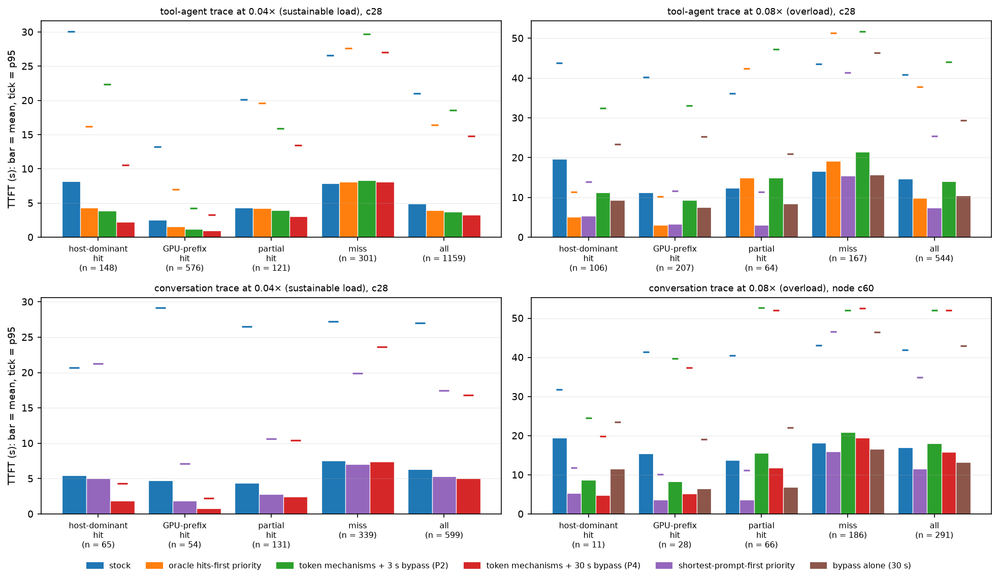

*Figure 5 — TTFT of hits against misses in the four primary replays. One group of bars per request class of the stock run (the
same requests in every configuration; n below the group); bar = mean TTFT, tick = p95. Colours are configurations and mean the
same in every panel. The conversation trace under overload is the family measured on node c60 (150 GB host tier); the other three panels are c28 (320 GB).*

1. **The delay of cached requests can be reduced at every load, by a different mechanism at each.** The token mechanisms where
   the queue drains (−23 to −26 % in mean TTFT at the sustainable load, −23 % at the intermediate one, +9 % under overload);
   the bypass where a queue stands behind requests that do not fit (−16 %, −25 %, −28 %).
2. **"Maintaining or improving overall performance" holds for the bypass alone at every load** — the mean request time falls by
   5 %, 10 % and 15 %, the misses are 4–6 % faster, the longest wait grows by at most 5 s on the tool-agent trace (6 s on the
   conversation trace) — **and for the two mechanisms together (P4) up to the intermediate load** (−33 to −34 % and −32 %
   in mean TTFT, −9 to −10 % and −11 % in mean request time, misses +3 to +4 % and +8 %). Under overload P4 gains nothing over the bypass alone
   and charges the misses 16 %. The token mechanisms without the bypass must not be used under overload at all.
3. **The comparison with a strong baseline.** Shortest-prompt-first, an option of the stock scheduler, reaches −28 %, −43 %
   and −49 % in mean TTFT at the three loads and −31 % on the large pool, with the misses *faster* every time. P4 is ahead of
   it at the sustainable load in the mean and the median (−33 % and −31 % against −28 % and −8 %; on the conversation trace
   −21 % against −15 % in the mean) and behind at p95 on the tool-agent trace (−32 % against −40 %); from the intermediate load on, shortest-prompt-first has the lower means and the lower p95 (16.2 s against
   30.5 s; 25.4 s against 39.9 s). In its plain form it has no bound: its longest TTFT is 48 s at the sustainable load (stock
   52 s), 151 s at the intermediate one (61 s), 249–259 s under overload (53 s), 315 s on the conversation trace under
   overload (54 s), where the bypass alone with a 30 s bound stays within about 6 s of stock in every run. With an aging term
   in the priority (1 ms per prompt token, measured under overload) it is bounded too: −30 % in mean TTFT with the longest
   wait of stock — the bypass's result, from the stock scheduler.
4. **Knowledge of the cache is not what the ordering needs.** With oracle knowledge of which requests are hits, priority
   reaches −19 to −20 %, −32 % and −33 %: less than ordering by prompt length at every load. With oracle knowledge of the
   tokens each request needs computed, −52 % under overload against −49 % for the prompt length.
5. **The token reserve adds to the ordering where the queue drains, and only there.** At the sustainable load
   shortest-prompt-first with the token mechanisms on top reaches −41 % in mean TTFT (−28 % without them) and −47 % at p95,
   with the misses still 4 % faster than in stock (C2.4). Under overload the token mechanisms add nothing to a priority order
   (oracle hits-first: −34 % with them, −33 % without; misses +27 % against +15 %; C2.2).
6. **Nothing changes the throughput** (D6).
<!-- /C2 -->

### C3. Beyond the 8 GB GPU (the brief's Experiment E; MEASURED 2026-11-10 18:21 – 2026-11-11 07:16, 16 GB nodes c60, c61, c66, `E16/E/`)
**Why.** c28's GPU holds 119k tokens of KV for the 3B model. If the delays of A came from that small pool, a larger GPU would
remove them and the study would be about one configuration. The question has two parts: does the *memory* part of the problem
(the full-sequence gate, head-of-line blocking, preemptions) survive a larger pool, and does the *token-budget* part?

**What was available.** c33 (A100 80 GB) and c29 (H100 94 GB) are allocated to another user's jobs until 2026-11-13; the
partition of RTX 4060 Ti 16 GB nodes was free. These nodes have the same GPU model as c28 with twice the memory: the same compute
speed, a GPU KV pool of 19,916 blocks for the 3B model (318,656 tokens, 2.67× c28's) or room for a 7B model with slightly more
than c28's token capacity (Qwen2.5-7B-Instruct-AWQ: 8,753 blocks, 140,048 tokens). **Limitation:** no GPU with more compute was
available; a faster GPU shortens every prefill step and with it the absolute waits, which these runs cannot show.

**How.** Three server sizes on one node type, the same trace window as on c28 (tool-agent, seconds 0–200 at 0.04×; 1,159
requests), 80 GB host tier (the nodes have 188 GiB of RAM):
1. *small pool, small model*: pool pinned at c28's 7,456 blocks (`e-tool04-80-p7456-*`, node c61);
2. *larger pool, same model*: 19,916 blocks (`e-tool04-80-big-*`, c61), also under overload (seconds 0–100 at 0.08×, 120 GB host
   tier, `e-tool08-120-big-*`, c66);
3. *larger model, similar token capacity*: 7B-AWQ, seconds 0–100 at 0.02× — half the arrival rate for a model that computes
   about half as fast, so that the engine is as busy as with the 3B model at 0.04× (`e7-tool02-80-*`, c60; GPU busy 47 % against
   49–50 %).
Each family has its own stock run on its node. Pressure is compared through measured quantities — blocks in the pool, refused
attempts, the time-weighted share of the pool in use, the share of time with a saturated token budget — not through concurrency.

**Result 1 — the node is a valid stand-in for c28.** With the pool pinned, the stock replay on c61 reproduces c28's replay of
2026-11-05 with the same host tier (`dl-tool-dram80`, pool 7,612 blocks): cached share 0.382 against 0.383 (host tier 0.071
against 0.072), TTFT p50 / p95 / p99 2.03 / 22.5 / 34.5 s against 2.04 / 22.5 / 35.2 s (interpolated percentiles of the
`*-replay.json` summaries), 1,214 against 1,212 prompt tokens computed per second, 68.7 GB of host tier in use in both.

**Result 2 — a 2.67× larger pool removes the memory gate and leaves the token budget where it was (stock, same node).**

| quantity | pool 7,456 blocks | pool 19,916 blocks |
|---|---|---|
| refused admission attempts (full-sequence gate / reservation) | 5,041 / 6 | 0 / 0 |
| preemptions | 1 | 0 |
| pool in use, time-weighted mean; time with less than 25 % free | 0.265; 9.6 % | 0.108; 0 % |
| time in steps whose running requests use the whole token budget | 20.3 % | 20.5 % |
| requests served mostly from the host tier / with any load from it | 112 / 127 | 30 / 42 |
| share of prompt tokens from a cache: host tier / GPU prefix | 0.071 / 0.311 | 0.036 / 0.348 |
| TTFT p50 / p95 / p99, all requests (s) | 2.03 / 22.5 / 34.7 | 2.03 / 18.1 / 25.7 |
| TTFT p50 / p95 of the host-dominant hits of the small-pool run (same 112 requests) (s) | 6.60 / 31.3 | 5.59 / 25.0 |

The tail shortens (p95 −20 %, p99 −26 %) and the median does not move. On the large pool a host-dominant hit that arrives while
no prefill is in flight answers in 0.29 s (median, 17 requests); one that arrives during a prefill answers in 15.8 s (13
requests) — with 80 % of the pool free.

**Result 3 — the token mechanisms give the same gain on all three server sizes at the sustainable load** (P1; paired by the
stock run's classes; `E16/E/tables-primary-*.md`, full tables `E16/E/tables-d-*.md`).

| quantity | pool 7,456, 3B (c61) | pool 19,916, 3B (c61) | pool 8,753, 7B (c60) |
|---|---|---|---|
| all requests: TTFT mean (s), stock → P1 | 5.41 → 4.19 (−23 %) | 4.80 → 3.81 (−21 %) | 8.44 → 6.97 (−17 %) |
| all requests: TTFT p50 (s) | 2.03 → 1.40 (−31 %) | 2.03 → 1.38 (−32 %) | 3.69 → 2.64 (−28 %) |
| all requests: TTFT p95 (s) | 22.5 → 20.6 (−8 %) | 18.1 → 17.6 (−3 %) | 32.6 → 29.8 (−9 %) |
| host-dominant hits (n): TTFT mean (s) | (112) 10.50 → 4.25 (−60 %) | (30) 7.39 → 1.38 (−81 %) | (25) 16.49 → 5.76 (−65 %) |
| GPU-prefix hits (n): TTFT mean (s) | (577) 2.89 → 1.33 (−54 %) | (661) 3.48 → 1.68 (−52 %) | (278) 4.74 → 2.34 (−51 %) |
| misses (n): TTFT mean (s) | (339) 8.12 → 8.78 (+8 %) | (340) 7.27 → 8.04 (+11 %) | (175) 14.00 → 14.80 (+6 %) |
| misses: request time mean (s) | 23.85 → 24.53 (+3 %) | 24.82 → 25.50 (+3 %) | 44.80 → 45.41 (+1 %) |
| all requests: request time mean (s) | 12.22 → 11.49 (−6 %) | 12.48 → 11.88 (−5 %) | 22.70 → 21.82 (−4 %) |
| requests with TTFT lower / higher by more than 10 % | 21 % / 15 % | 19 % / 16 % | 17 % / 11 % |
| time in budget-saturated steps | 20.3 % → 7.2 % | 20.5 % → 6.9 % | 19.6 % → 8.2 % |
| requests with TTFT above 30 s | 26 → 22 | 4 → 6 | 31 → 27 |
| completed requests / s; GPU busy | 0.233 → 0.233; 0.50 → 0.51 | 0.233 → 0.233; 0.50 → 0.50 | 0.108 → 0.108; 0.47 → 0.47 |

With synchronous scheduling added on the large pool (`e-tool04-80-big-p1-sync`) the median TTFT falls further (1.09 s, −46 %
against stock) and the mean request time is back at the stock value (12.5 s): mean TTFT −20 %, misses +13 %.

**Result 4 — under overload on the large pool the token mechanisms make everything worse, and ordering still helps** (seconds
0–100 at 0.08×, 544 requests; `e-tool08-120-big-*`, node c66; one request of the P1 run was lost to the client-side connection
reset described in G; the shortest-prompt-first run of C2 was added on 2026-11-11).

| quantity | stock | P1 | shortest-prompt-first priority |
|---|---|---|---|
| all requests: TTFT p50 / p95 / p99 / mean (s) | 10.42 / 36.4 / 43.0 / 12.72 | 12.43 / 47.0 / 61.2 / 16.44 (+29 %) | 6.25 / 26.3 / 39.3 / 8.77 (−31 %) |
| request time, mean (s) | 32.4 | 39.4 (+22 %) | 29.1 (−10 %) |
| host-dominant hits (17): TTFT mean (s); request time mean (s) | 16.11; 41.6 | 9.84 (−39 %); 42.9 (+3 %) | 11.78 (−27 %); 38.8 (−7 %) |
| GPU-prefix hits (299): TTFT mean (s) | 11.84 | 13.81 (+17 %) | 6.85 (−42 %) |
| misses (163): TTFT mean (s); request time mean (s) | 14.48; 56.5 | 21.74 (+50 %); 70.3 (+24 %) | 13.25 (−9 %); 56.2 (−1 %) |
| requests with TTFT lower / higher by more than 10 % | – | 20 % / 54 % | 37 % / 11 % |
| requests with TTFT above 30 s / above 60 s | 57 / 0 | 127 / 8 | 20 / 1 |
| longest TTFT (s) | 46.1 | 68.5 | 61.8 |
| refused admission attempts; preemptions | 0; 0 | 0; 0 | 0; 0 |
| waiting time of a request by reason (share, range over the classes) | token budget 57–65 %, running slots 23–33 % | running slots 53–89 %, token rule of the prototype 0–40 % | token budget 49–57 %, running slots 30–40 % |
| time in budget-saturated steps | 43.5 % | 4.2 % | 43.6 % |
| running / waiting requests, time-weighted mean | 9.1 / 4.6 | 10.4 / 6.0 | 9.4 / 2.9 |
| time per output token after the first, p50 (ms) | 74 | 123 | 90 |
| prompt tokens computed / s; GPU busy | 2,287; 0.87 | 2,235; 0.90 | 2,287; 0.87 |

**Explanation.** The two halves of the problem separate cleanly. The memory half (refusals at the full-sequence gate,
head-of-line blocking, preemptions) is a property of the ratio of pool to workload: with 2.67× the pool it is gone at the
sustainable load, and with it a fifth of the tail. The token half does not depend on memory at all: on the large pool the same
fifth of the run has its token budget exhausted, a hit that arrives during a prefill waits 15.8 s with four fifths of the pool
free, and the token reserve recovers the same 17–23 % of mean TTFT on the small pool, the large pool and the larger model, at
the same price (misses +6 to +11 % TTFT, +1 to +3 % request time). Result 4 shows what the saturated token budget is worth
under overload: it is an unintended admission control. With the reserve, requests no longer wait for budget; they are admitted
until the 16 running slots are the limit, more of them decode at once and each more slowly (the same prefill work now runs
beside them instead of before them), every request holds its slot longer, and with no additional compute (the GPU was 87 % busy
before) the mean TTFT and the mean request time rise by 29 % and 22 %. On c28's pool the memory gate plays the role of the
slot limit and the damage is smaller (C2.2). Reordering the queue instead of opening it works here as it does on the small
pool: with shortest-prompt-first the budget is as saturated as in stock (43.6 % of the time), the same work is done per
second, and the mean TTFT is 31 % lower because the requests that wait are the long ones — one of them for 62 s.

### C4. Real CXL validation: blocked, documented, nothing changed (checked 2026-11-10 15:55 and 2026-11-11 00:43)
**Why.** The project's host tier is meant to be CXL memory; the brief asks to repeat representative runs on a CXL-backed LMCache if the
devices are accessible, and otherwise to document the blocker and label the results.

**What was checked.** `/dev/dax0.0`, `/dev/dax1.0` and `/dev/dax2.0` are `crw------- root root` (modification time 2026-10-20
15:32). Opening `dax0.0` and `dax1.0` read-only as `ghu4` fails with `EACCES`, at the start of the study and again at its end.
`/dev/dax2.0` is in addition mounted as a root-owned famfs (FUSE) at `/mnt/famfs/dax2.0` and is reserved for another project by the
user's rule of 2026-09-17; it was not opened. No permission, mount or system setting was changed.

**Consequence.** Every host-tier result in this report is measured with pinned DRAM: these are **host-memory admission results**,
not CXL measurements, and no number here is a CXL speedup. What transfers to a CXL tier and what does not, from what was measured:
- The mechanisms of A and B act in the engine's scheduler, before a load is issued and after it has arrived. They do not touch
  the medium the KV is read from.
- The transfer itself is a small part of the delay it sits in: 0.05 s for a 16k prefix against waits of seconds (A2.1). The
  2026-11-04 study measured the host → GPU transfer at the PCIe link's rate (11.3–12.0 GB/s) with DRAM as the source; whether a
  CXL source keeps that rate under this load is not measured here.
- Lookup and retrieval CPU cost on CXL, the effect of concurrent stores on loads (the duplex question, out of scope by the
  brief), and any change of admission behaviour with a slower tier are **not measured**.

<!-- D -->
## D. Cross-experiment analysis

**D1. Does reducing the admission wait always reduce TTFT?** No. Admission is the middle of three stages — the scan reaches the
request, the request gets its blocks, an engine step computes its tokens — and the stage after it obeys the same token budget
as the stage before it.
- *Where it does:* at the sustainable load the hits' admission delay falls by 4.4–4.7 s with the prototype (7.59 → 2.91–3.17 s)
  and their TTFT by 4.3–4.6 s (8.19 → 3.58–3.86 s): what is saved in front of the gate arrives at the first token (C2.1).
- *Admitted later, answered sooner:* in the bounded-reservation scenario the hit is admitted at 2.97 s instead of 2.57 s and
  its first token comes after 3.33 s instead of 4.50 s, because the misses that stock admits together with it have already been
  served (B3.1).
- *Admitted sooner, nothing gained:* with the reservation of loads removed the hit is admitted 2.4 s sooner, a running
  request is preempted for it, and the next hit is later (B4). With the token mechanisms alone under overload the hits leave the
  token queue and wait at the block gate instead: admission delay −12 %, mean TTFT of all requests +9 % (C2.2).
- *The first token is not the last:* behind 8k and 16k prefills a hit's first token comes 2–4× sooner and its last token at
  the same time (B2); on the large pool under overload the hits' TTFT falls by 39 % and their request time rises by 3 % (C3).

**D2. When does a reservation help?** Three reservations appear in this study, and they behave differently.
- *The stock reservation for prefills in flight* (blocks the running prefills will still need) is what keeps admissions from
  causing preemptions. Removing it for loads (`alpha=0`, B4) admits the hit 2.4 s sooner and costs a preemption in every
  trial; the first prototype versions admitted short requests during a prefill without honouring it and had 32 preemptions
  against 5 in the overloaded replay, 9 once they did (`resvall`, B0).
- *A reservation for a waiting external hit* (the brief's B2) is meaningful only together with the bypass. In stock nothing
  passes a request that does not fit, so every block that is freed waits for it: head-of-line blocking is a reservation of the
  whole pool for the request at the head. With the bypass and no reservation the passed hit is admitted 1.4 s later than in
  stock; with 300–600 blocks kept free 0.3–0.4 s later while smaller requests still pass; with its full need nothing passes
  and the result is stock again (B3.1). In the replays the reservation exists only while a hit is being passed — 0.6 % of the
  time at the sustainable load, 16–17 % under overload, on average 3 and 75–87 blocks of 7,456 — so it does not hold memory
  back when no hit needs it. In the overloaded replay it is nevertheless a net cost: the bypass without it reaches −33 % in
  mean TTFT against −28 % with it, for a p95 and p99 1.6 s higher and 12 preemptions against 9 (C2.2). The scenario it was
  built for — one large hit, a stream of small misses — is the case in which it pays; a trace has few such moments.
- *It does not help where memory is not the constraint.* On the 19,916-block pool no admission attempt is refused, the
  reservation is never formed, and the hits wait all the same (C3).

**D3. Does chunked loading enable earlier execution?** No, for three independent reasons (B6). (1) The gate that refuses loads
is the full-sequence gate, which asks for the blocks of the whole sequence before anything is admitted; a hit and a miss of the
same length are refused and admitted at the same free-block counts (A3), so a hit that brings its prefix in pieces would be
admitted no earlier — and with the gate switched off hits are still refused at the same counts (A3.1). (2) A partially loaded
prefix cannot be used: the tail's computation attends to every prefix position. (3) The connector protocol has no notion of a
partial load (one number: tokens to load, all or nothing). Besides, the transfer is not what the hit waits for: 0.05 s for a
16k-token prefix against waits of seconds in front of the scan (A2.1).

**D4. Do the results generalize across prefix lengths?** Yes, in each layer of evidence. At the block gate, hits and misses of
1k to 8k behave identically, with the threshold at the request's own need (A3, Figure 2). In the mixed workloads the token
mechanisms bring hits of 1k, 2k, 4k and 8k from 2.8–4.9 s to 1.1–1.5 s alike (C1). What does depend on length is the *other*
request: a hit sent 0.5 s after an 8k, 16k or 28k prefill has started gets its first token after 2.0, 4.1 and 7.8 s in stock
and after 0.9–1.6 s with the token mechanisms (B2) — the wait is set by the work in front of the hit, not by the hit's own
prefix. In the replays the requests with the largest prompts (8,192 tokens or more; mostly misses) are the ones that pay:
unchanged at the sustainable load, later at the tail under overload with every mechanism that reorders (C2.2).

**D5. Are the benefits different under bursts and under sustained overload?** Yes, and differently for each mechanism — this is
the main thing the replays add to the controlled scenarios (C2.6).
- *The token mechanisms* help where the queue drains between bursts and hurt where it does not. Sustainable load (GPU busy
  49 %): mean TTFT −23 to −26 % on four server configurations, misses +6 to +11 %. Intermediate load (GPU busy 71 %): −23 %
  with the 3 s bypass. Sustained overload (GPU busy 87 %): +9 % alone, −4 % with the 3 s bypass, +29 % on the large pool. A hit
  served during a prefill delays that prefill by the hit's short work; in a burst that debt is repaid when the queue empties,
  under sustained overload it is passed on to every request behind.
- *The bypass* does nothing where memory is not short and the most where the queue is longest: stock-like in the closed loop,
  in bursts and below capacity (C1); in the replays −16 % mean TTFT at the sustainable load, −25 % at the intermediate one and
  −28 % under overload (mean request time −5 %, −10 %, −15 %), each time with no class slower on average (C2.2, C2.4, C2.5).
- *Ordering the queue by prompt length* helps at every load that was measured, and more the longer the queue: −28 % mean TTFT
  at the sustainable load, −43 % at the intermediate one, −49 % under overload — where, without an aging term, it also starves
  the largest prompts, which it does not at the sustainable load (longest TTFT 48 s against 52 s in stock; 151 s against 61 s
  at the intermediate load; 249–259 s against 52–53 s under overload).

**D6. Does the prototype improve total system performance?** In latency, at the load each mechanism is made for; in capacity,
never; and beyond what the best existing option does only at the sustainable load.
- No configuration of this study — stock options, prototype, priorities — changes the work the engine gets through: in every
  open-loop replay the makespan is within 2 % of stock, the GPU-busy share within 0.03, and the prototype's token mechanisms
  cost 2–3 % of the prompt tokens computed per second. The closed-loop and saturated open-loop workloads show the same (−1 to
  −5 % completed requests per second with the token mechanisms, ±1 % with the bypass alone). The one measured gain in work
  done is the store fix: 35 GB more KV in the host tier under overload, 1–1.5 points more of the prompt served from a cache.
- What improves is the order of service, and with it the mean TTFT (−23 to −34 % at the sustainable load, −28 % under
  overload, for the mechanism that fits the load), the mean request time (−6 to −8 % and −15 %) and the p95 (−8 to −16 % and
  −28 %). The p99 improves in one prototype configuration (P4 at the intermediate load, −10 %) and is unchanged or worse in
  the others.
- Against the strong baseline (C2.6): at the sustainable load the token mechanisms reach −23 to −26 % in mean TTFT and, with
  the 30 s bypass added, −33 to −34 %, where shortest-prompt-first reaches −28 % with a p95 40 % below stock (P4: 32 %) and the
  misses 8 % *faster* (P4: 4 % slower) — the prototype is level with the baseline there. From the intermediate load on it is
  behind on the means: −32 % against −43 % at 0.06×, −28 % against −49 % under overload. What it has that the baseline
  lacks: the lowest median for cached requests at the sustainable load (host-dominant hits 1.6 s against 3.1 s with the 80 GB
  tier). The bounded longest wait of the bypass under overload (58 s against 249–259 s for plain shortest-prompt-first) is
  matched once the priority has an aging term: −30 % in mean TTFT at a longest wait of 52 s (C2.2). And at the sustainable
  load the two are complementary: shortest-prompt-first with the token mechanisms on top reaches −41 %,
  13 points more than the ordering alone, with the misses still faster than in stock (C2.4); under overload the token
  mechanisms add nothing to a priority order (C2.2).

**D7. Does it trade latency between request classes?** The token mechanisms always do; the bypass alone and the store fix do
not on average; ordering by length does only under overload, and then by size, not by class.
- *Token mechanisms, sustainable load:* 148 host-dominant hits gain 4.3 s each and 575 GPU-prefix hits 1.4 s (1,430 s in
  total), 301 misses lose 0.45 s each (135 s): about ten seconds gained per second lost, and the misses' request time is
  unchanged (+0 to +1 %).
- *Token mechanisms with the 3 s bypass, overload:* 106 host-dominant hits gain 8.4 s and 207 GPU-prefix hits 1.9 s (1,270 s),
  167 misses lose 4.8 s (800 s): a ratio of 1.6, and the mean request time is 2 % higher. Without the bypass the sum is
  negative.
- *Bypass alone, overload:* every class gains on average (−52 %, −33 %, −6 %); the loss is inside the classes, at the top of
  the size distribution: p95 of the prompts of 8,192 tokens or more +9 %, longest TTFT +4 s.
- *Shortest-prompt-first, overload:* every class gains on average (−73 %, −70 %, −7 %) and seven requests — prompts of about
  32k tokens, the largest of the window — wait 64 to 249 s. At the sustainable load nobody pays measurably: 17 % of the
  requests are more than 10 % sooner than in stock, 4 % later, and the longest TTFT is shorter.
<!-- /D -->

<!-- E -->
## E. Negative results
Every item was measured (or, for item 4, established from the source); the runs are kept, paths in brackets.

1. **The hypothesis the study started from.** "Whole-prefix GPU KV reservation makes external hits wait while misses enter with a
   chunk" does not describe vLLM 0.31 with its defaults. The reservation gate refused 17 of 4,924 attempts at the sustainable load,
   9 of 6,527 under overload and none in the conversation replay (A2, A4); at the block gate a hit and a miss of the same length are
   refused and admitted together (A3). The asymmetry exists only with `--no-scheduler-reserve-full-isl` (A3.1).
2. **Relaxing the reservation of loads** (`alpha=0`, the literal form of B2). It admits the hit 2.4 s sooner in the scenario built
   for it and costs one preemption and two failed chunk allocations in every trial; the next hit is later (B4; `E16/c2b`).
3. **Compute fallback** (B5). Never applicable: where a load is refused, computing is refused by the same full-sequence gate (0
   fallback decisions; `E16/c2b/c2b-tokfast-fb`).
4. **Chunked external loading** (B3). Not expressible in the connector protocol, and a partial load would not be admitted earlier
   and cannot run (B6).
5. **Existing scheduler options that do not reorder requests.** Synchronous scheduling alone: no effect behind a prefill (B1),
   7 % higher mean TTFT in the overloaded replay. Prefill cap 1,024: helps the first hit in the controlled scenario, worse on
   every metric in the overloaded replay (mean TTFT +27 %, 74 preemptions against 5). A 512-token step: worse everywhere.
   Full-sequence gate off: hits are refused at the same free-block counts as before, 23 preemptions against 2 (A3.1).
6. **Prototype v1** (`replay/tool08-320-tokfast`). Its store-counter fix covered only loads while its own `minchunk` rule made the
   scheduler poll GPU-prefix hits again: the host tier received 31.3 GB instead of 73.8 GB. It also kept the engine in short steps
   for 24 % of the run for requests that were waiting for memory, not tokens. TTFT p95 58.8 s against 40.8 s.
7. **Prototype v1.1 under overload** (`replay/tool08-320-tokfast11`). Hits 4–7× sooner at the median, at the price of misses +32 %
   (p50) and +39 % (mean), p95 +18 %, p99 +38 %, a longest wait of 77.7 s against 53.2 s and 32 preemptions against 5. Its token
   rule let short work pass memory-blocked requests without any bound (B0).
8. **The token mechanisms under overload.** Alone (P1, `replay/tool08-320-p1`) they make the mean TTFT and the mean request
   time 9 % *worse* than stock: the hits leave the token queue and wait at the block gate (head-of-line blocking 68 % of their
   waiting time against 32 % in stock), and the reserve has slowed the prefills (C2.2). On the large pool, where no admission
   attempt is refused, they are worse still: mean TTFT +29 %, mean request time +22 %, 127 requests above 30 s against 57 (C3).
   With synchronous scheduling added — the fastest configuration in the controlled scenario — +11 % and +15 % (`E16/X08/x08b-p2-sync`).
9. **The bound of the bypass chosen from the controlled scenario was too short.** P2's 3 s came from a scenario with one
   blocked request (B3.1) and was used for the whole matrix of 2026-11-10. In the overloaded replay it gives −2 to −4 % in mean
   TTFT where 30 s gives −28 %; the configuration that had been declared the prototype moved waiting time from misses to hits
   and little else (C2.2).
10. **The prototype against the ordering baselines.** An option vLLM already has does as well or better on the system-level
   means: shortest-prompt-first lowers the mean TTFT by 28 % at the sustainable load (token mechanisms 23–26 %, with the 30 s
   bypass 33 %; misses slower instead of faster), by 43 % at the intermediate load (prototype 32 %) and by 49 % under overload
   (bypass alone 28 %). With exact knowledge of the hits, priority reaches −20 %, −32 % and −33 %. The prototype keeps two
   one thing the baseline does not have — the lowest median for cached requests at the sustainable load, where it adds to the
   ordering (−41 % together, C2.4). The bounded longest wait of the bypass under overload is matched by an aging term in the
   priority (−30 % at the longest wait of stock, C2.2).
11. **The conversation trace.** Where 13 % of the requests are hits, the token mechanisms have little to give: under overload P2 makes
   the 39 hits 46–55 % faster and everything else slower (mean TTFT +6 %, p95 +24 %, mean request time +6 %, on two nodes);
   with the 30 s bound (P4) the mean TTFT is 7 % below stock and the mean request time 2 % above. At the sustainable load the same trace gains 21 % with P4 and the misses do not pay (C2.3).
12. **The first token is not the last.** Behind 8k and 16k prefills the request time of a hit is unchanged by the prototype although
   its first token comes 2–4× sooner (B2); in the saturated mixed workloads the hits' TTFT p50 falls 2.5–3.5× while the mean
   request time moves between −26 % and +14 % and the completed requests per second between −5 % and +5.5 % (C1); on the large
   pool under overload the hits' TTFT falls by 39 % and their request time rises by 3 % (C3).
13. **No capacity gain anywhere.** Makespan, tokens computed per second and GPU-busy share of every replay are within 2–3 % of
   stock in every configuration, prototype or baseline; every latency gain in this report is a gain of order (D6).
14. **Starvation under plain shortest-prompt-first** (a negative result of the strongest baseline, `replay/tool08-320-priolen`,
   `E16/X08/x08b-priolen`): under overload seven of 544 requests — the 32k-token prompts — wait 64 to 249 s (stock: at most
   53 s); the p99 is 65 s against 47 s. An aging term of 1 ms per prompt token removes it and keeps −30 % of the −49 %.
15. **A pool of 2,048 blocks** (= `max_model_len`) cannot be tested: vLLM does not start (`E16/cc/failed-pool2048`).
<!-- /E -->

<!-- F -->
## F. Research implications
The seven questions of the brief, answered from the measurements above, and the six success criteria. Host-tier capacity in
every run is pinned DRAM: these are host-memory results, and nothing here is a measured CXL speedup (C4).

**1. Is GPU KV admission a genuine serving bottleneck?** The delay is genuine and repeatable; the name fits only its smaller
part. A request whose KV is cached needs 0.05 s of transfer and a few hundred tokens of compute and answers in 0.2–0.3 s on an
idle engine. Under load it waits as long as an uncached request: 3.3 s at the median for host-dominant hits at a sustainable
load (8.2 s on average), 19 s under overload. This is reproducible on three node types (six nodes), on two traces, with
the pool at 0.34× to 2.67× of c28's and with a second model. What the request waits for is first the engine step (the queue
is served from the token budget that running requests leave: 54–68 % of the waiting time) and second, only when the pool is
nearly full, the request in front of it at the block gate (10–35 %). GPU-prefix hits and short misses wait in the same two
places: the delay is not specific to KV that comes from the host tier.

**2. Is whole-prefix reservation the primary cause?** No. In vLLM 0.31 with its defaults the whole-prefix requirement applies
to hits and misses alike (the full-sequence gate), the in-flight reservation refused 17 of 4,924 admission attempts at the
sustainable load and 9 of 6,527 under overload, and a hit and a miss of the same length are refused and admitted at the same
free-block counts (A3). The hypothesis the study started from is refuted (E, item 1).

**3. Can a practical mechanism address it?** Yes — three were measured, and the simplest one is already in the engine.
- *A token reserve with short steps* (about 200 lines in a policy module, no engine patch): a hit behind a 28k-token prefill
  gets its first token after 0.9–1.1 s instead of 4–8 s (B2).
- *A bounded head-of-line bypass at the block gate,* with a bounded block reservation for hits that are passed: requests that
  fit are served in 0.3–0.8 s instead of 8 s behind a request that does not (B3); the bound decides how much is gained and
  who pays (C2.2).
- *vLLM's priority scheduling with a priority that puts cheap requests first.* Shortest-prompt-first needs one field in the
  request and no knowledge of the cache.
- Also practical and independent of the rest: the one-line store fix (A5, B7).
- Not practical: relaxing the reservation of loads (a preemption per trial), compute fallback (never applicable), chunked
  loading (not expressible, and no earlier admission) (B4–B6).

**4. Does the mechanism improve end-to-end performance?** It depends on the load, and on what it is compared with.
- *Sustainable load* (tool-agent trace, GPU busy 49 %). The token mechanisms lower the mean TTFT by 17–26 % on four server
  configurations (two host-tier sizes, two pool sizes, two models), the median by 22–32 %, the mean request time by 4–8 %;
  cached requests answer in less than half the time (host-dominant hits −53 to −81 %); the misses' TTFT is 6–11 % higher and
  their request time 0–3 %; p99 and throughput do not move. With the bypass bounded at 30 s added (P4, both host-tier sizes)
  the mean TTFT is 33–34 % and the p95 30–32 % below stock, with the misses 3–4 % slower. That is an end-to-end gain
  against stock, and of the same order as the best ordering baseline: shortest-prompt-first with the stock scheduler lowers
  the mean TTFT by 28 %, the p95 by 40 % and makes the misses 8 % *faster*; the oracle hits-first priority reaches −19 to
  −20 % with the misses at +2 %. The two combine: shortest-prompt-first with the token mechanisms on top reaches −41 % in mean TTFT and −47 % at p95
  with the misses still 4 % faster than in stock — the best configuration measured at this load.
- *Intermediate load* (GPU busy 71 %). Token mechanisms with the 3 s bypass −23 %, bypass alone −25 % with no class slower,
  both (P4) −32 %; shortest-prompt-first −43 % with the misses 15 % faster and one request waiting 151 s (stock: 61 s).
- *Sustained overload with a full pool* (GPU busy 87 %). The token mechanisms alone make things worse (+9 %); with a 3 s bypass
  they only move time from misses to hits. The bypass alone with a 30 s bound lowers the mean TTFT by 28 %, the mean request
  time by 15 % and the p95 by 28 % with no class slower on average and the longest wait 4 s longer. Shortest-prompt-first
  lowers the means further (−49 %, −21 %) and lets seven of 544 requests wait one to four minutes; with an aging term of 1 ms
  per prompt token it gives −30 % and −14 % with the longest wait of stock — what the bypass gives, without a prototype.
- *Throughput* is unchanged by every configuration except through the store fix (D6).
- *In one sentence:* the delay is a consequence of serving the queue first-come-first-served at the token budget and at the
  block gate; reordering it recovers a quarter of the mean TTFT at a sustainable load and a quarter to a half under overload;
  the prototype is one way to reorder and an existing option is another — level with the prototype at a sustainable load,
  ahead of it on the means from the intermediate load on, and, given an aging term, with the same bound on the longest wait.

**5. Does it generalize beyond the 8 GB GPU?** In two halves. *The token-budget half does:* on a pool 2.67× as large the same
fifth of the run has its budget exhausted (20.5 % against 20.3 %), a hit that arrives during a prefill answers in 15.8 s
against 0.29 s otherwise, and the token mechanisms recover 21 % of mean TTFT there, 23 % on the small pool of the same node
and 17 % with the 7B model, at the same price for the misses (C3). *The memory half is a property of pool against workload:*
with the larger pool no admission attempt is refused at the sustainable load and none under overload either; there the bypass
has nothing to act on and the token mechanisms are harmful (+29 % mean TTFT) because the saturated token budget was the only
admission control left. Ordering does carry over: shortest-prompt-first lowers the mean TTFT of the overloaded replay on the large pool by 31 % and the mean request time by 10 %, with the longest wait at 62 s against 46 s (C3). All of this is on one GPU compute class; a faster GPU was not available (H).

**6. How does larger host cache capacity affect the importance of admission?** Capacity and scheduling are separate levers, and in these measurements they multiply. With the stock scheduler,
320 GB instead of 80 GB of host tier (c28 against c61, which reproduces c28's own 80 GB run, C3) turns 38 misses into hits (host-dominant hits 112 → 148 of 1,159; share of prompt tokens
served from the host tier 0.071 → 0.120) and lowers the mean TTFT by 9 % (5.41 → 4.93 s) and the median by 23 % (2.03 →
1.56 s). The token mechanisms take 23 % off at 80 GB and 24–26 % at 320 GB (with the 30 s bypass 33 % and 34 %): the same
relative gain at both capacities, 31–33 % for both steps together (5.41 → 3.64–3.74 s; 40 % with P4, 5.41 → 3.25 s). A larger tier therefore raises the *number* of requests whose TTFT is almost
entirely waiting — a host-dominant hit that finds the engine free answers in 0.3 s, the class median is 3.3–6.6 s — and does
not change how long each of them waits; nor is the wait specific to that class (the GPU-prefix hits, four to five times as
many, wait in the same queue). Two findings bear on capacity directly. Under overload the stock store path loses 31–33 % of the KV it has
computed (A5): a larger tier is not filled faster than the store path writes, and the prototype runs, which carry the fix,
serve 1.3 points more of the prompt from a cache. And none of this depends on the medium: the mechanisms act before a load
is issued and after it has arrived (C4).

**7. Is this problem substantial enough to support a new serving-system research direction?** What the measurements support, and what they do not:
- *Supported:* the stock runtime serves cached requests inefficiently, the cause is understood down to the scheduler loop, and
  the size is not small — a quarter of the mean TTFT at a sustainable load, a quarter to a half under overload, is lost to the
  order of service. A store-path defect silently discards a third of the KV under overload.
- *Not supported:* that this is a problem of GPU KV *admission of external hits*. The whole-prefix reservation does not block
  them (question 2); GPU-prefix hits and short misses wait in the same two queues; and the largest part of the loss is
  recovered by an ordering option the engine already has, which knows nothing about KV. The mechanisms built here for KV
  admission recover the same order of magnitude at the load each fits, not more.
- *Not measured:* anything that depends on the host tier being CXL memory (C4), a faster GPU, another engine.

What the data leaves open — stated as measured gaps, not as a plan:
1. *Mean against worst case under overload.* Both reorderings have a dial for it and neither escapes it. The bypass bound:
   −10 % to −39 % in mean TTFT for 3 to 100 s, the longest wait going from 54 to 75 s (Figure 8). The aging term of the
   priority: −30 % and −50 % for 1 and 3 ms per token, the longest wait 52 and 96 s; without aging −49 % and four to five
   minutes. At an equal worst case the two are within a few points of each other, and the second needs no change to the
   engine.
2. *Whether knowing the cache improves the order.* Prompt length is a proxy for work; with a cache, the work is the uncached
   part. Measured with oracle knowledge under overload: ordering by the uncached tokens
   instead of the prompt length moves the mean TTFT from −49 % to −52 % and the mean request time from −20 % to −24 %
   (C2.2). In this trace the cache adds little to the order.
3. *Starting a cheap request during a prefill.* Only the token reserve does this; ordering cannot, because the queue is not
   scanned while a prefill uses the budget. Measured at the sustainable load: on top of shortest-prompt-first the token mechanisms take the mean TTFT from −28 % to
   −41 % and the median wait of the host-dominant hits from 3.1 to 1.7 s. Under overload they add nothing (C2.2).
4. *Overload without memory pressure* (large pool): the prototype has no mechanism that helps there (C3). Ordering helps there (−31 % mean TTFT with shortest-prompt-first); the token mechanisms hurt (+29 %).
5. *The store path:* host capacity matters only for KV that is written; under overload a third is not (A5).

On this evidence the admission mechanisms by themselves are a thin basis for a larger system: the bottleneck is real but not
specific to KV admission; its biggest part, a bounded worst case included, is recovered by the engine's own priority
scheduling with a priority a gateway can compute; and what the mechanisms add to that is measured at 13 points of mean TTFT
at a sustainable load (the token reserve). The points above are what the measurements leave open.

**The six success criteria of the brief.**

| criterion | finding |
|---|---|
| 1. A repeatable, measurable admission bottleneck | **Met, with a different name.** Cached requests wait seconds for a few hundred tokens of work, reproducibly: three node types, two traces, three loads, pools of 0.34× to 2.67×, two models; controlled scenarios stable to 0.05 s. The wait is a scheduling delay (token budget, then head-of-line blocking), not a reservation that blocks admission. |
| 2. A clear causal explanation | **Met.** Source, per-step attribution of every waiting interval, controlled trials with pressure set and measured; the explanation predicted what the larger pool would and would not remove (C3) and why the first prototype configurations failed under overload (C2.2). |
| 3. A practical mechanism that substantially reduces unnecessary waiting | **Met.** Token reserve and short steps: cached requests 53–81 % sooner at the sustainable load. Bounded bypass: host-dominant hits 52 % sooner under overload with no class slower. Both are flags in a policy module without an engine patch. An existing option (priority by prompt length, with an aging term under overload) reduces the waiting as much or more. |
| 4. Improvement in overall TTFT, tail latency, or throughput | **Partly.** Mean TTFT −17 to −26 % (sustainable load, token mechanisms) and −28 % (overload, bypass alone); p95 −8 to −28 %; mean request time −4 to −15 %. No gain at p99, none in throughput. Against shortest-prompt-first the prototype is level at the sustainable load (P4 −33 % against −28 %) and behind on the means from the intermediate load on (−32 % against −43 %; −28 % against −49 %); added to it, the token mechanisms give −41 % at the sustainable load. |
| 5. No unacceptable degradation for cache misses | **Depends on the mechanism.** Bypass alone: misses 5–8 % *faster* under overload. Token mechanisms: misses' TTFT +6 to +11 % and request time +0 to +3 % at the sustainable load; +28 to +50 % under overload, which is not acceptable — they must be off there. |
| 6. Benefits beyond one pathological workload or one small GPU configuration | **Partly.** The token-budget effect and its remedy hold on a 2.67× pool and with a 7B model; the memory effect and the bypass are tied to a pool that is small for the workload; on the conversation trace only the bypass and ordering help. One GPU compute class, one engine version. |
<!-- /F -->

## G. Correctness and experimental validity (the brief's section 9)

**What is held constant in every comparison.** Within a table, all configurations ran the same request sequence — the same trace
window, speed, request order, token content and output lengths for the replays (the client derives every prompt from the trace's
hash blocks with a fixed generator), the same seeded prompts, types and arrival instants for the controlled workloads — on the same
node, with the same model, host-tier size, GPU KV pool (pinned with `--num-gpu-blocks-override` wherever a prototype is compared;
the one unpinned run, `tool04-320-base`, came up at the same 7,456 blocks) and the same instrumentation. Only the flags named in
the column differ. No table puts an overloaded baseline next to a lightly loaded prototype: load is offered open-loop from the
trace at the same instants in both.

**Completion.** The configuration matrix (`experiment-matrix.md`) has 181 rows: 172 runs that completed and 9 starts
that did not (below). In the completed runs every measured request finished with HTTP 200 except three, all lost on the client
side within a millisecond of being sent, before they reached the server (no server-side record): request 113 of `tool04-320-p2`
and request 449 of `e-tool08-120-big-p1` (`ServerDisconnectedError` after 0.4 and 0.8 ms) and one 8k miss of scenario s2-r1 in
`cc-p7456-sync` (`ClientOSError 104`, connection reset, after 0.9 ms; that scenario is not used in a table of this report). The
cause is a race on kept-alive connections: the server closes an idle connection at the moment the client reuses it. The same
reset hit *filler* requests — the 16k-token prompts that flush the GPU prefix cache between scenarios of the mixed workloads:
1–5 of the 176 fillers of a run, in stock and prototype runs alike (column `filler_errors`, 23 runs). Since 2026-11-11
02:30 the client retries a request once when the server disconnects before any status line (commit fb95dcb): in the eight
mixed-workload runs made after that (`E16/ccb/`) 20 requests were retried — 19 fillers and one measured request, which then
completed normally — and two fillers failed on the retry as well; no replay made after the fix needed a retry. No request
failed on the server, timed out or was cancelled by it. Starts that did not become runs are kept and named: a pool of 2,048
blocks (`E16/cc/failed-pool2048`), one start before the previous server had released the GPU (`E16/cc/failed-gpu-busy`; the
launcher now waits), jobs on a node without the environment (`E16/*/failed-c0`), smoke runs, and two jobs that were cancelled
in their first minute to reorder a queue (`E16/X08/aborted-x08c`, `E16/E/aborted-e66-skip`). One job (334506) was killed by
the batch system in the second it started and wrote nothing.

**Output correctness, path by path (`run_correct.py`, `E16/correct/`, node c66, 2026-11-11 00:02–00:31).** 48 prompts of 1k–8k
tokens (+100 fresh tokens) are answered five ways on one server and the generated text (32 tokens, temperature 0) is compared
with the first way: computed alone; loaded from LMCache alone; served from the GPU prefix cache alone; loaded from LMCache 0.3 s
after a 28k-token prefill has started (the situation in which the prototype acts); computed in that same situation with a cache
salt, so that neither cache is used.

| configuration | host load, alone | GPU prefix, alone | host load next to a prefill | computed next to a prefill | TTFT p50 of the host loads next to a prefill (s) |
|---|---|---|---|---|---|
| stock | 47 / 48 | 45 / 48 | 45 / 48 | 47 / 48 | 6.79 |
| stock, second run | 47 / 48 | 45 / 48 | 46 / 48 | 47 / 48 | 6.79 |
| P1 | 47 / 48 | 45 / 48 | 47 / 48 | 45 / 48 | 1.13 |
| P1, synchronous scheduling | 47 / 48 | 45 / 48 | 47 / 48 | 45 / 48 | 0.59 |
| P2 | 47 / 48 | 45 / 48 | 47 / 48 | 45 / 48 | 1.13 |

- **The three paths that run alone give the same text in every configuration, request by request** (48 / 48 identical between
  stock and each prototype run, for the computed, the host-loaded and the GPU-prefix answers): the prototype changes nothing in
  what a path produces.
- **Reusing KV instead of computing changes the text of 1 prompt in 48 (host load) and 3 in 48 (GPU prefix) on the stock server
  already.** The cached prefix is bit-identical to what was computed; the uncached tail is then computed in a different chunk
  than in the reference run, and on these random-token prompts a near-tie in the logits flips. A wrong or incomplete prefix would
  change nearly every answer, not one.
- **Next to a prefill the text depends on which requests share an engine step** (stock against its own second run: 47 / 48
  identical; stock against the prototypes: 46 / 48), for loaded and for computed answers alike.

**Output hashes in the replays (`check_runs.py`).** Two stock runs of the overloaded replay produce the same text for 543 of 544
requests. Any change of scheduling changes 1–4 % of the texts, the stock options as much as the prototype: synchronous scheduling
97.2 % identical to stock, prefill cap 97.6 %, shortest-prompt-first 96.9 %, store fix alone 98.9 %, P1 97.1 %, P2 97.2 %,
P3 96.7 %, bypass alone (30 s) 98.5 %; at the sustainable load
(c61, pinned pool) P1 97.8 %. Requests that were loaded from LMCache in one run and computed in the other agree as often as the
rest (96–98 % in the prototype runs).

**Blocks, leaks, preemptions, repeated loads** (the same script; the overloaded tool-agent replay, `replay/tables-correctness-tool08.md`).

| check | stock | stock, second run | store fix | P1 | P2 | P2, second run | P3 | bypass alone, 30 s | shortest-prompt-first |
|---|---|---|---|---|---|---|---|---|---|
| requests completed | 544 | 544 | 544 | 544 | 544 | 544 | 544 | 544 | 544 |
| output tokens generated | 112,233 | 112,233 | 112,233 | 112,233 | 112,233 | 112,233 | 112,233 | 112,233 | 112,233 |
| requests with more than one LMCache load | 0 | 0 | 0 | 0 | 0 | 0 | 0 | 0 | 0 |
| preemptions / running requests refused their next chunk | 5 / 10 | 6 / 12 | 7 / 14 | 9 / 18 | 8 / 16 | 7 / 16 | 11 / 22 | 10 / 20 | 5 / 66 |
| engine steps with no request holding blocks at which the whole pool is free | 61 / 61 | 61 / 61 | 65 / 65 | 58 / 58 | 60 / 60 | 62 / 62 | 57 / 57 | 61 / 61 | 56 / 56 |
| requests that store KV / GB stored | 396 / 73.8 | 393 / 73.7 | 477 / 108.9 | 477 / 108.7 | 477 / 108.8 | 477 / 108.8 | 477 / 108.9 | 477 / 108.9 | 394 / 71.0 |

No run leaks blocks: whenever nothing is running, loading or holding KV in the queue (and the last holder ended at least 50 ms
earlier, the time vLLM keeps a finished request's blocks until its store is confirmed), the free count equals the pool minus the
null block. No request is loaded twice. The prototype does not allocate, free or map blocks itself — it changes the connector's
answer, the reservation number and the per-step caps — so block validity rests on the stock allocator in every configuration.
Preempted requests recompute their prompt (stock rule); the prototype configurations have 7–12 preemptions against 5–6 (the
bypass alone with the 30 s bound: 10; without the block reservation: 12; shortest-prompt-first: 5), the
first version had 32 (B0).

**Repeats and variability.** *Replays:* a second run of the stock overloaded replay differs from the first by 0.07 s in TTFT
p50 (12.45 / 12.38), 0.05 s in p95, 0.03 s in the mean; every class mean within 0.4 %. A second run of P2: p50 8.64 / 8.61,
mean 14.09 / 14.15, class means within 1–8 %. The replay is open-loop with fixed prompts and arrival times, so it is close to
deterministic; differences of a few percent between configurations are differences of the configurations. *Controlled scenarios:*
three repetitions each; the three values of a cell differ by at most 0.02 s in scenarios c1 and c3 (0.13 s with synchronous
scheduling) and by at most 0.4 s in c5. *Across machines:* the pinned-pool stock replay on a 16 GB node reproduces c28's replay of
2026-11-05 (C3, Result 1), and the gain of the prototype at the sustainable load was measured on both (C2, C3). Sample sizes are
given with every table (n per class).

**Instrumentation overhead (`adm_overhead.py`).** The step stream of the 2026-11-04 hooks records the duration of the scheduler's
`schedule()` in both studies; the admission wrappers of this study run inside that interval.

| run | admission stream | steps | `schedule()` mean / p50 / p99 (µs) | total over the run (s) | share of the wall time |
|---|---|---|---|---|---|
| `dl-tool-dram320` (2026-11-05) | no | 87,171 | 129 / 86 / 660 | 11.3 | 0.23 % |
| `tool04-320-base` | yes | 87,151 | 135 / 88 / 699 | 11.8 | 0.24 % |
| `tool08-320-base` | yes | 21,789 | 224 / 144 / 987 | 4.9 | 0.38 % |
| `tool08-320-tokfast11` (policy v1.1) | yes | 21,149 | 322 / 170 / 2,085 | 6.8 | 0.53 % |

The wrappers add 6 µs to a 129 µs call (+5 %), 0.5 s over a replay of 4,982 s; the prototype's decisions add about 100 µs per
step. The instrumented stock replay reproduces the un-instrumented one of 2026-11-05 in every aggregate (A2.1, Result 1), and the
stock store loss of A5 is identical in both (48 requests, 187.9 of 200.5 GB).

**Raw logs.** Every run keeps its client records, per-request timelines, admission stream (every poll, admission attempt,
preemption and one line per engine step), LMCache event mirror, sampler output and server logs; nothing was edited after a run.
Small files are in the results directory of the repo, the streams on c28 (`README.md` there). The prototype's rules are covered by
mock tests (`kvadm/test_policy.py`, 9 cases).

<!-- H -->
## H. Limitations
1. **One engine, one cache, one version.** vLLM 0.31.0 with LMCache 0.5.5 in multi-process mode. The scheduler behaviour
   described in A is that of this version with its defaults (2,048-token step budget, full-sequence gate on, 16 running slots,
   asynchronous scheduling); the stock options that were varied are named where they appear. Other engines were not measured.
2. **One GPU compute class.** Every run used an RTX 4060 Ti (8 GB on c28, 16 GB on the other nodes). The larger GPUs of the
   cluster were allocated to other work for the whole study. A faster GPU shortens every step and with it every absolute wait;
   whether the relative effects hold there is not measured. The 16 GB nodes have less host memory than c28 (125–188 GiB), so
   the 320 GB host tier exists on c28 only.
3. **Two models,** Qwen2.5-3B-Instruct-AWQ and Qwen2.5-7B-Instruct-AWQ (the latter in one pair of runs).
4. **Host tier = pinned DRAM.** No run used CXL memory (C4). Lookup and retrieval cost on a CXL tier and the effect of
   concurrent stores on loads are outside this study.
5. **Workloads.** The Mooncake tool-agent and conversation traces, their first 100–200 trace seconds, at two speeds (plus
   one intermediate speed for the tool-agent trace); prompts are synthetic token sequences that reproduce the trace's prefix
   sharing, so the generated text has no meaning and only its identity between runs is checked; output lengths follow the
   trace, capped at 1,024 tokens. Controlled workloads use 1k–8k prompts and 16–32 output tokens.
6. **The priority baselines.** The oracle priorities (hits-first, shortest-compute-first) come from a previous run of the same
   replay; a server that classifies requests at arrival was not built. Shortest-prompt-first and its aging variant are
   computed by the client from the prompt length and the send time; the aging variant was run under overload only, with two
   values of its one parameter, and priority scheduling was not combined with the bypass.
7. **The prototype is a policy module, not an implementation.** It acts through three existing interfaces of the scheduler
   (the connector's answer, the reservation argument, two configuration values) and costs 0.3 ms per engine step in Python.
   What cannot be expressed there — a partial load, releasing part of a reservation — was analysed from the source, not built.
8. **Parameters.** Token reserve 768, short step 512, block reservation 600, bypass bounds of 3, 10, 30 and 100 s: chosen
   from the controlled scenarios and varied on one replay. They are tied to this model and GPU (a full step of 2,048 tokens
   takes about 0.45 s here) and were not tuned further.
9. **Repetitions.** The overloaded tool-agent replay was run twice for the stock server and for two prototype
   configurations and agrees within 1 % on the all-request means (G). The main results of 2026-11-11 were each measured on
   two nodes with the same relative changes (bypass alone at 30 s: c28 and c60; shortest-prompt-first: c28 and c61 under
   overload, c61 and c66 at the sustainable load; shortest-prompt-first with the token mechanisms: c61 and c66; P4 at the
   sustainable load: c28 and c61). Most other configurations were run once. Classes with few requests (host-dominant hits on the large pool: 17–30;
   in the conversation trace: 11) give noisy class means.
10. **Lost requests.** Three measured requests (one each in three runs) never reached the server because of a client-side
   connection reset; the client was made to retry afterwards (G).
<!-- /H -->

## Change history
- 2026-11-10 — study started. A1 source inspection, A2 instrumentation and instrumented baselines, A3 controlled reproduction
  (with and without the full-sequence gate), A5 store loss; prototype module v1 → v1.4 and the controlled scenarios of B; C1
  mixed workloads at four pool sizes; first replays (stock options, P1–P3, oracle hits-first priority, store fix); C3 on the
  16 GB nodes; correctness checks (G); C4 (CXL blocked).
- 2026-11-11 — the bound of the bypass varied with and without the token mechanisms (P4, bypass alone, no reservation);
  shortest-prompt-first (plain, with aging, on top of P1) and oracle shortest-compute-first as ordering baselines; the
  conversation trace at both loads; the 80 GB capacity point on two nodes; an intermediate load; the mixed workloads under
  memory pressure with the 30 s bound; sections C1 (Result 4), C2, D, E, F, H and the summary written; figures 5, 7, 8 added.
  Last run finished at 10:41; study closed.
